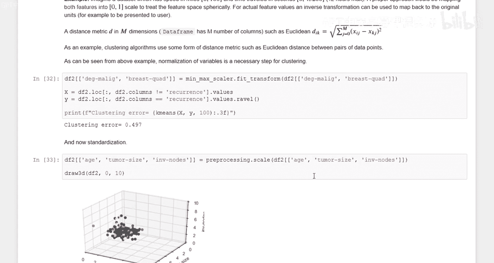

# 约翰霍普金斯大学《应用机器学习｜Applied Machine Learning》中英字幕 p16 15_数据转换技术.zh_en -BV13xuqzYErx_p16-

🎼。

Now that we looked at the data formats， thetization and coding。

 and then using a classifier and looking at the performance。Now let's look at data transformation。

Depending on the machine learning pipeline we are using or machine learning algorithm we decide to use。

 we may need to transform the features into other things。For example。

 imagine a case where the ground truth is not available， so a supervised learning is not possible。

And then we want to do some clustering to see some patterns just to see if there's a direct relation between certain features such as menopause and the recurrence of the cancer。

Here were using matpl lips，3D plot to see information about。Age， tu size。

 inverted node and recurrence。 recurrence is the color。

This is our data as we read realized I copied the F data frame into D F2， because as you know。

 all the variables on this notebook is shared as global variables。 D F。

 if I break the F here in the cell， if I go back， it will be a broken D F until I reloaded。

 So here I just copied it。 and this is a shallow copy depending on the situation you may need a deep copy。

 still， I am converting every feature feature to number。 like I said before。

 certain algorithms require numerical features。Certain algorithms require nominal features。

For a clustering algorithm， we generally require numerical features because the clustering is done based on a distance measure in general。

We can also use some similarity measures like set similarity， for example， or in some cases。

 we can also use frequency distribution or probabilistic distributions for similarities。

 Those approaches are rare。 As we will see in the following modules， most cluster algorithms。

 the most popular or most mostly use class algorithms。 They use numerical features。 Now。

 let's see what the cell is doing。 We are converting every feature to number。

 If you remember some of the categories were objects， we are converting them to numerical。

 If it's fl or integer， we are leaving them as they are。 In general。

 if you convert everything to float， that's even better as opposed to keeping some variables as integer。

 In this case， the plot 3D and。😊，Okay， well， it's a blob， right。

 Everything is clumpped in 0 to hundred，0 to00，0 to0， and。It's not a very good dynamic range。

 It's all over。Now。If you use K meanss and recall the have the ground truth， actually。

 the recurrence。So training is everything but the occurrence。

Testing or ground truth is the recurrence。And then we will measure the clustering error。

 Well clustering is 0。49。 It's not a very good value since we only have two classes。

 and the random choice would be one over2。Now， we can normalize and standardize the features。

So that we can spherly map the data points to these ranges， diminishing certain features effects。

 increasing or making the features at the same level。

Normalization is scaling or mapping the values of a particular feature to the01 range。

And it is defined by this maximum x minimum x divide by that so that everything will be between 0 and 1 and then shifting by the minimum。

 if you apply this function to every feature value。

Will end up with a scale with a normalized feature。Standardization is also another approach。

It maps everything to a 0 mean  one standard deviation distribution。 Sometimes this is good。

 especially if you use a probabilistic approach like naive base， for example。

 standardizing every feature for naive base is a good approach normalization makes the optimization surface and what is that optimization service surface。

 Well， whatever algorithm we apply， supervised unsupervised clustering。

 S VM or any other generally an optimization is involved。 Well， if that surface ispher。

 our optr will work better。 Now。😊，They are scaling。Using minmac scaling fit transform。

These three features H， tu size im， as you see。Now we have a more spread out。

 equally distributed range of values。Each feature， power。Is equal after the normalization。

A distance matrix in M dimensions is given as this。

 A distance metric is required for a clustering to work。 We take a single data point。

With M features and other data point， with M features。

 and looking at the Euclidean distance between them。

 that's the distance between those two data points。By minimizing the distances of data points。

 we group them into clusters。Let's。Normalize， standardize and look at the cluster area again。Well。

 still， it's high。Still the error is I， almost like random errors， but it doesn't matter。

 It doesn't mean that we are clustering bad。It's just， we cannot cluster。 That's all。

 The ground truth recurrence 01 does not map to the clusters。

 so we cannot just easily detect the cancer。 That's a tough problem。

 and recurrence or not recurrence information is actually coming from other sources。

 The patient dies。 Unfortunately， the cancer doesn't go away， you can measure the cancer。 Thus。

 the data point has recurrent。 However， when the cluster， it doesn't show that easily。

 thus we need a supervised learning。Well， after the standardization， as you see。

 this looks much better， recall the original information was like this。As you realize。

 we are not injecting or cutting out any information from the features。

But these skills are more meaningful。 Now， we put the 0。B zeros。In the middle of this cluster。

 Similarlyly for each one of them。We didn't have that in the previous dataset set， our。

Transformation in this manner， actually helps the clustering。As we will see in the following modules。

 And by the way， this example only shows the three features， age， tu size and inverted notes。

 General， we have to scale。Either normalize or standardize。Every feature on equal level。

 So our clustering will work better。 This particular example doesn't show the clustering nicely。

 But remember， this was originally a supervised learning approach。

 And now we just took a different perspective。Look at the features。 it was all over in this 3D plot。

But after normal normalization as standardization。Who made it more clusterlike。So it's。

Spread on different features are now on an equal scale， and that scale is 0，1，0，2，1。

