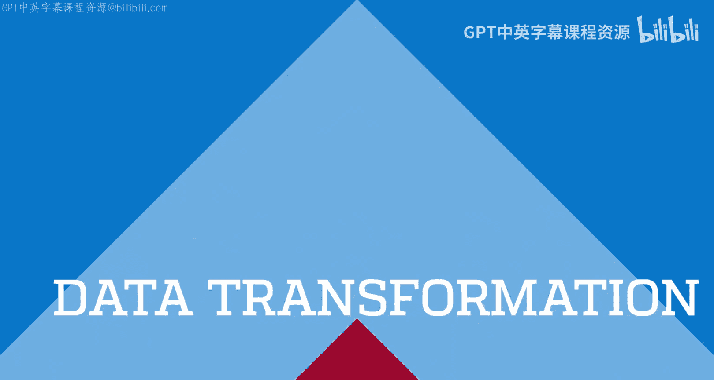
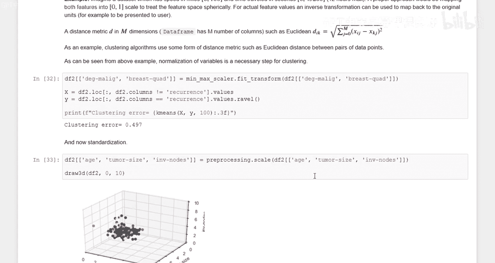

# 应用机器学习：15：数据转换技术




在本节课中，我们将学习数据转换技术。数据转换是机器学习流程中的重要步骤，它通过调整数据的尺度或分布，使算法能够更有效地工作。我们将探讨两种主要的数据转换方法：归一化和标准化，并了解它们如何影响聚类算法的性能。

## 数据转换的必要性

上一节我们介绍了数据格式、标记化和编码，以及使用分类器评估性能。本节中，我们来看看数据转换。

根据我们使用的机器学习流程或算法，我们可能需要将特征转换为其他形式。例如，假设一个场景中无法获得真实标签，因此无法进行监督学习。此时，我们希望进行一些聚类分析，以观察某些特征（如更年期与癌症复发）之间是否存在直接关系。

以下是使用 `matplotlib` 进行3D绘图，以可视化年龄、肿瘤大小、淋巴结状态和复发（用颜色表示）信息的代码示例。

```python
# 假设 df 是原始数据框，我们创建一个副本以避免修改原始数据
df2 = df.copy()
# 将所有特征转换为数值类型
for col in df2.columns:
    df2[col] = pd.to_numeric(df2[col], errors='coerce')
```

某些算法需要数值特征，而某些需要名义特征。对于聚类算法，我们通常需要数值特征，因为聚类通常基于距离度量进行。我们也可以使用一些相似性度量，如集合相似性，或者在少数情况下使用频率分布或概率分布作为相似性度量，但这些方法较为少见。在后续模块中我们将看到，最流行或最常用的聚类算法大多使用数值特征。

## 原始数据的可视化与问题

现在，让我们看看代码在做什么。我们将每个特征转换为数字。如果你记得，有些类别是对象类型，我们将它们转换为数值。如果是浮点数或整数，则保持不变。通常，将所有变量转换为浮点数比保留某些变量为整数更好。

在这种情况下，3D绘图显示数据点聚集在0到100、0到200、0到20的范围内，动态范围不佳，数据点分布杂乱。如果我们使用K均值聚类（并假设我们知道真实标签“复发”），将除“复发”外的所有特征用于训练，用“复发”作为测试或真实标签来衡量聚类误差，得到的误差约为0.49。由于我们只有两个类别，随机选择的误差会是0.5，因此这个结果并不理想。

## 数据转换方法：归一化与标准化

我们可以对特征进行归一化和标准化，从而将数据点映射到特定范围，削弱某些特征的影响，使所有特征处于同一水平。

归一化是将特定特征的值缩放或映射到[0, 1]范围的过程。其定义公式为：

**X_normalized = (X - X_min) / (X_max - X_min)**

将此函数应用于每个特征值后，我们将得到一个归一化的特征尺度。

标准化是另一种方法。它将数据映射为均值为0、标准差为1的分布。有时这很有用，特别是如果你使用像朴素贝叶斯这样的概率方法，为标准化的每个特征应用朴素贝叶斯是一个好方法。归一化能使优化曲面（即我们应用任何算法，无论是监督、无监督、聚类、SVM或其他算法时通常涉及的优化问题的曲面）更平滑，从而使优化器工作得更好。

以下是使用 `scikit-learn` 的 `MinMaxScaler` 进行归一化的代码示例。

```python
from sklearn.preprocessing import MinMaxScaler
scaler = MinMaxScaler()
# 假设我们选择三个特征进行缩放
features_to_scale = ['age', 'tumor_size', 'inv_nodes']
df2[features_to_scale] = scaler.fit_transform(df2[features_to_scale])
```

现在，经过归一化后，这三个特征的值范围更加分散和平等。每个特征的“权重”在归一化后变得相等。

## 转换后的数据与聚类效果

M维空间中的距离矩阵由以下公式给出。聚类算法工作需要距离度量。我们取一个具有M个特征的数据点和另一个具有M个特征的数据点，计算它们之间的欧几里得距离，这就是这两个数据点之间的距离。通过最小化数据点之间的距离，我们将它们分组到簇中。

让我们对数据进行归一化、标准化，并再次查看聚类误差。误差仍然很高，几乎像随机误差，但这没关系。这并不意味着我们聚类做得不好，只是意味着我们无法根据这些特征进行有效聚类。真实标签“复发”（0/1）无法映射到聚类结果，因此我们无法轻易检测癌症复发。这是一个难题，复发与否的信息实际上来自其他来源（如患者死亡）。然而，在进行聚类时，这种关系并不容易显现，因此我们需要监督学习。

经过标准化后，数据看起来好多了。回想原始信息是杂乱无章的。我们意识到，我们并没有从特征中注入或剔除任何信息，但这些缩放使数据更有意义。现在，我们将零点置于簇的中心附近，每个特征都是如此。在之前的数据集中我们没有做到这一点。以这种方式进行转换实际上有助于聚类。

在后续模块中我们将看到这一点。顺便说一下，这个例子只展示了三个特征：年龄、肿瘤大小和淋巴结状态。通常，我们必须对所有特征进行缩放（归一化或标准化），使它们处于同等水平，这样我们的聚类效果才会更好。这个特定的例子没有很好地展示聚类效果，但请记住，这原本是一个监督学习方法，现在我们只是换了一个视角来看待特征。在3D图中，原始数据点分布杂乱，但经过归一化或标准化后，数据变得更像簇状。不同特征上的分布现在处于一个相等的尺度上，这个尺度是[0,1]或均值为0、标准差为1。

## 总结



本节课中，我们一起学习了数据转换技术。我们了解了为什么需要对数据进行转换，特别是当特征尺度差异很大时。我们详细探讨了两种核心方法：**归一化**（将数据缩放到[0,1]范围）和**标准化**（将数据转换为均值为0、标准差为1的分布）。通过代码示例，我们看到了转换前后数据分布的变化，并理解了这些转换如何通过使优化曲面更平滑、让所有特征处于可比尺度，来帮助提升聚类等机器学习算法的性能。尽管在本例中聚类未能有效区分癌症复发，但转换过程为算法提供了更合适的数据基础。