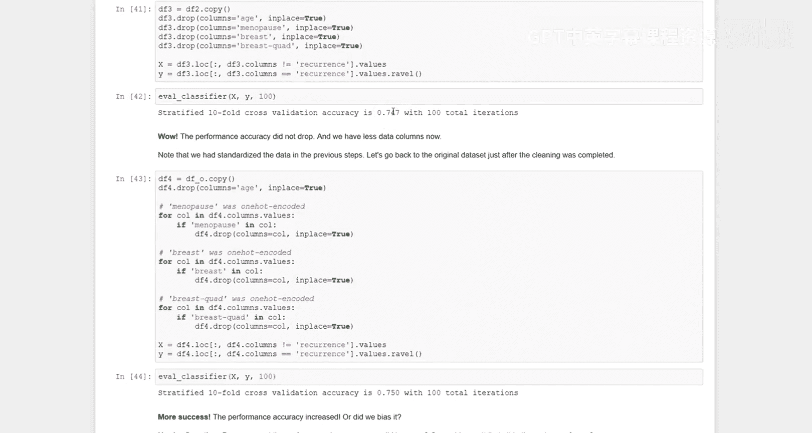

# 约翰霍普金斯大学《应用机器学习｜Applied Machine Learning》中英字幕 p17 16_数据降维方法.zh_en -BV13xuqzYErx_p17-

🎼。

Data reduction does not mean getting rid of data points。Instead。

 it means getting rid of some data features or in a more practical approach， ranking the features。

Which feature， which independent variable， which measurement explains the knowledge that I'm trying to reach。

That knowledge is captured in my model。And which variable explains most of that knowledge。

For example。In our previous videos， we looked at breast cancer data and did some supervised learning。

Our performance was around 75 to 77% accuracy。 it's a tough problem。Now。

 which feature out of those 9 features。Explains most of the recurrence or nonrecurrence of the cancer。

We can use。Feature selection， select Perile。To find out the particular feature orientta。

This cell fits the data using X and y， recall X and y is our full dataset set X has all the nine variables。

 and y has the target variable， which is the cancer record or not。

 we are using NP P log minus selector probability values and then divide them by maximum so this gives us log proties of those scores。

 and then we map them on the scale。See that degree malignant， node caps。

 inverted node gives the most of the information about the model。

If we remove age menopause breast breast qua， probably out of these five variables removing these four。

 they would have similar scores。Well， one of the reasons why we want to reduce data is also improving the model。

 getting rid of some unnecessary features， we may actually hinder the model。 Well， of course。

 maybe they are helping， we don't know that。 However。

 if we can come up with only a handful of variables。

 we can show those variables to the subject matter experts， and then ask their opinion。

 I'm not an expert in breast cancer prediction， of course， or evaluation。 but I'm guessing。

 among all these the doctor might be first looking at whatever that not caps in word node or degree malignant are。

 and you can easily argue， degree malignant。Looks like。A derived variable。

 Probably it gives most of the information。 The subject matter expert looks at the cancer patient's data and then says。

This data point， this patient has a high degree of malignancy。 Well， to me。

 knowing nothing about cancer that gives some natural information。

 And I would say H wouldn't matter because we can see cancer all over and this particular dataset set also shows that by the way。

 we are not assessing anything about cancer。 It is just this data set is this way。

Now let's get you of those four and then evaluate our classifier again。Well。

 it did not drop that much，75% recall this was at most 78 or so。 Now。

 we continued getting rid of the。Mnopause， breast qua。And as still。

 we're not losing that much information。 And depending on from round to run。

We may see a small improvement， actually。The question is asking。

 even though these values don't show them directly in a particular version of the notebook。

This final run was a bit higher than the previous one。 This one was perhaps 7，45， and this one was 7。

50。Thus。Performance accuracy increased if we buy。Do we accept the performance increase is a valid increase。

What should be the guidelines that a particular classification performance is higher than the performance in another experiment？

These are two different experiments。So are we going to assess them as equal scores。

 Is the second one better， as can be seen in this cells， I rerun the whole notebook once more。

And this particular cell gives me 7，47。 This particular cell gives me 7，50。

 If you recall from the previous discussion that we had in this notebook。

 randomness causes the performance evaluation jump around， even though we expect。A neater。

 A better result。When we use less information。Especially these very low helping features。

We might expect a performance increase， but maybe that increase can be considered as a variation of the errors。

 maybe these are equal。There are some statistical studies where the significance is assessed。

 We can look at the confidence value for each of this statistic by running so many times as a guideline。

 when we see a small increase like this， I making an educated guess， if it's less than 5%3，4%。

 I would not personally call it as an improvement。 if the data set is huge。

 And if I employ a good way of collecting the statistics。 Then I can assign confidence values。

 confidence ranges in my statistics。 and I can say it is 7，50 with an 99% confidence。

 there are statistical methods which can result the evaluation like that。

 Now we completed the module， the notebook。You can continue with the discussion our first discussion question is researching and giving one example where data reduction actually does nothing。

 maybe it also hinders and then the second discussion question is。

When do we consider a performance evaluation increase such as in accuracycur as an increase as an actual improvement。

 I gave you one example， confidence values using statistics。

 but then what else That's the discussion question。

