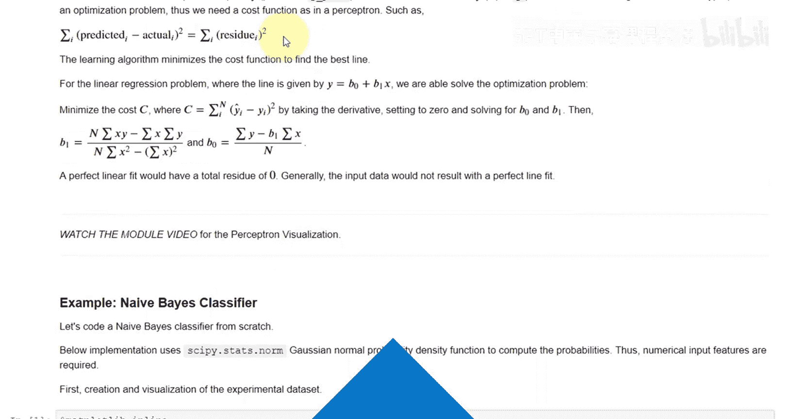

# 约翰霍普金斯大学《应用机器学习｜Applied Machine Learning》中英字幕 p19 18_监督学习.zh_en -BV13xuqzYErx_p19-

🎼。

Dear students。In this module， we will look at supervised learning。

If you have worked in machine learning before， you will immediately know that supervised learning is one of the most important concept applications in machine learning。

Supervised learning requires the ground truth to be known beforehand。The algorithm。

The approach works using the feedback from the ground truth that we have。

 we can assign if a particular hypothesis is true or false using the ground root and then we can collect the amount of the error using all the hypotheses we have。

For example， in the past module， I mentioned the simplest classifier could be the algorithm that assigns everything to0。

Thats the hypothesis well it is also falsifiable I can test if that conforms to a particular data point or not。

 meaning if it's true for that data point， yes or no。

 if I have the ground truth I can find out any condition you can come up with can be a hypothesisesis the set of all the conditions are hypothees which create and build up the actual model in a way we are trying to find all the hypotheses that are falsifiable。

 which results in the minimum matter or maximum reward criteria which we will see。

In supervised learning there are two categories， classification and regression classification is the prediction of the categories Will it be warm today Yes no。

 the categories are yes and no， will patient die from the cancers in the following two years yes or no。

 or we can say our categories set is lowest low medium high highest then there are five categories Sometimes a machine learning algorithm can be binary by design naturally in that case we will set and choose two classifiers if there are five categories I build five choose two number of classes。

 which is five times4 divided by two number of classifiers to come up with the actual model the error for a particular data point would be the result of all those five chooseose two classifiers we can do a majority voting we can accumulate the error and assign a particular label for a。

inOf course， the details are all in the algorithms we will see in the following sections and modules how we build 5 choose2 classifiers For our purposes。

 most of these things are in the libraries。 For example， if I use an SVM classifier。

 which is naturally a binary classifier based on perceptrons。

 the library builds 5 chooseose2 sVM classifiers and then automatically does a majority voting and then results are the actual predicted label for a particular data point。

Now， let's look at perceptron。 Perceptron was imed many decades ago。

 Perceptron is the building block of neural networks。

 and also it was an inspiration for the support vector machines。

 Perceptron simply attempts to find a hyperplan， which divides the data points into two categories。

 Natural， it's a binary classifier。 The way we train the perceptron is based on the error。

 The accumulation of the error for each predicted data points。

 Thus the error or cost function is the summation of all the actual class levelss，01。

 and the predicted class levels again 01。 The cap historically is the notation for the estimated variable。

 And also I had n data points。 This is our syntax or is our standard in our data set matrix。

 we have n data points， which is the number of rows， and we have。M features or dimensions。

 which are the number of attributes or the number of columns in that matrix。

 The hyperplane naturally is of M dimensions In the textbook。 It is shown how to train a perceptron。

Now before looking at the perceptron implementation in our widget。

 let's shortly quickly mention the na base and linear regression。

Nive base is a probabilistic approach based on the baesing rule。 in this module。

 we have an example implementation of naive base， and linear regression is the counterpart of the supervised learning。

 where a prediction of a continuous or real valued variable is achieved。 So in a way。

 classification and regression are counterparts classification where classifying into categories。

 regression we are trying to find an actual value， Not that there is no probability associated in regression。

 It is in its simplistic terms， a curfe。 We will see linear regression and other regressions。

 for example， Lo regression classifier based on regression in the following modules in this module。

 we will concentrate on supervised learning and categorical classification for the sake of completeness。

 the linear regression formula is like this。 we minimize。This particular error。

 not that the difference between this cost function and the costs function of a perceptron is in the details here。

 the values are 0，1，0 or1， right， It's a binary classifier。

 but here the numbers are actual numerical values。 So this predicted has a huge range。

 minus infinite to plus infinitefin。 It can be anything。 and the actual is again like that。

If if I set up the problem using a line fit， then it has a direct solution using the linear regression optimization and solving for the parameters B0 and B1 B0 as the offset B1 as the slope we can find out by minimizing this error。

 the actual B0 and B1 to come up with that line， the details will be in the following modules Now let's look at the perceptron visualization using our widget。

