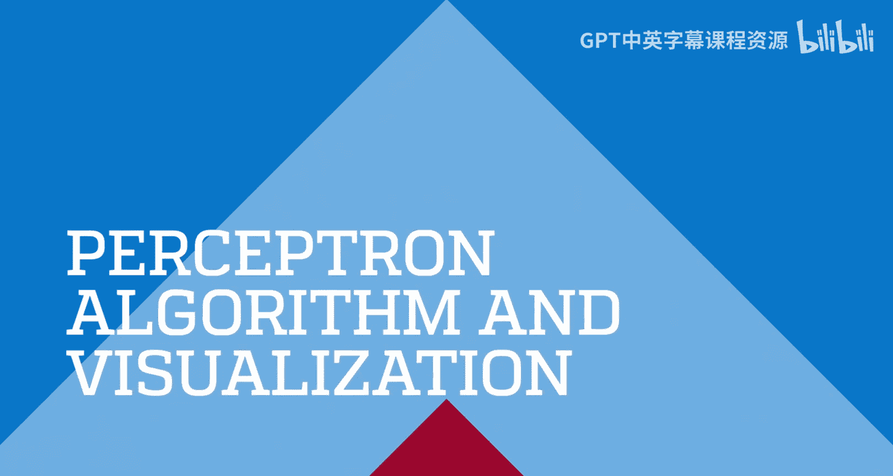
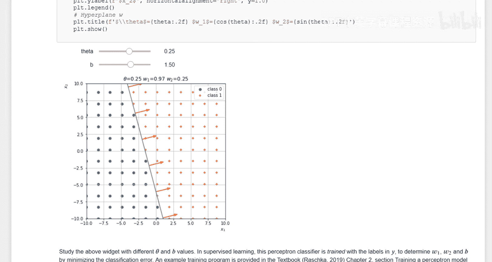

# 约翰霍普金斯大学《应用机器学习｜Applied Machine Learning》中英字幕 p20 19_感知器算法及可视化实现.zh_en -BV13xuqzYErx_p20-

🎼。

When it comes to machine learning algorithm， studying the math。

 its code application and the visualization of it is so much helpful。

 so here's the general perceptual machine visualization to tease out its parameters and its classification performance in a 2D space。

I downloaded the Perceptron visualization widget to my Ananaconta environment。

 and then in its starting state， we cannot run the widget。

 the notebook cannot run the widget because the state is not found。Well。

 I have just to rerun the cells。Now， I know that perceptron is in hyperplane in M dimensions。

 In this fiidget， we are visualizing it in two dimensions。 Now。

 we will come to the details of the implementation later， but first， let's understand how it works。

Okay now I run the widget and look at here， we have two features x1 and x2 in our x matrix。

 there are two columns okay now the hyperplane is controlled by B and w0 and w1 exactly like in this equation in here w is the normal to that hyperplane here the red arrow arrows show the normals。

 but of course the actual normal is you know in the middle of this hyperplane looking orthogonal from that hyperplane outwards。

So W is the normal， and B is the offset。 My hyperplane is defined by。By this， W X plus b equals 0。

 All the x points are the hyperplane are on the hyperplane。 Well。

 you see the x here for the data points for classification。And the X here are from the same space。

 It's the two dimensional feature space。And these x's define this hyperplane。And those x's。Are only。

Points in this space。 and naturally， in this equation， Wx plus b equals 0 is the hyperplane。

 But here， W X plus B。Greater than 0 or less than 0 are the data points around it。So for the moment。

 just forget about how we find W and B， but let's see how the hyperplane divides the space into2 marking all the ones on the left or less than 0 S class 0 and all the ones on the right or greater than 0 as class 1 for the ease of visualization I set theta based on ws I automatically compute it so that we can have a single variable to control theta is the angle Now as I move it。

The hyperplane。Positions itself， exactly， for example， minus-1。55 is pi over 2，90 degrees。

So it's looking downwards。0ero。Is the starting point0 raddiance。And an。Pi over 2 radance。

 it rotated 90 degrees or pi over 2。 Theta is here is in radiance。 And B is the offset。

 You see how it behaves。 And by the way， for each of the value that I play in the widget。

 the classification is automatically done。 All the points， greater than 0 or less than 0 are marked。

With the correct classifications， this visualization。Does everything eclifier does。

Let's look at the implementation details， this is the hyperplane。

 given the data point and given the W the normal and the offset。

 it is returning the other feature that is on the hyperplane this is used to find out given x1 find x2。

 the reason is all visualization， it is of course intentionally written that way so that we can visualize how the hyperplane divides the space into 2 and can be used as a classifier。

Perceptron is the actual classifier， and it's the same， same thing。Given X W B。

 it basically computes this Fx。 That's my classifier。 If the dot product of X W。

 like in the equation， plus B is greater than 0， return 1。Exactly like this。Or return 0。

 So a perceptron implements F x。 And， you know， this is the beauty of nuumpy。

 This dot is from nuumpy X W R arrays。 This would work for any dimension。 In this case。

 it's two dimensional feature space。 If I had M dimensions。I wouldn't change the perceptron。

 like MALB， it automatically computes by solving by computing the correct arrays here。

Now the rest is the widget and visualization， we have a figure， we have an array of w based on theta。

 theta is controlled here， so basically the W is a normal。Of length 1。

 it's based on cosine and sine theta。 itss length is one， and。

It is in the middle turning as I control theta。 I'm using W as my normal。

 which represents the hyperplane plus B， of course。 Now， x1 is all the data points。In this area。

 basically linear space 2 times sine theta 1 x1 minimum， similarly sine x1 maximum。

 and I have 11 number of segments and here x1 minimum x1 maximum for both features are provided minus 10 to 10。

 it is also reflected here， basically using all the data points in my feature space。

 I'm classifying all of them， there are two，4，6，8，1011 data points in this mesh because you know I set it to 11 here and I'm basically I'm populating all of them using these linear space I'm finding the hyperplane using that hyper。

It is solving。 This is solving。Clearly， this equation， right， given x1。

 I'm finding out x2 by solving this equation。 This would work for two dimensions easily if you want to build this in three dimensions。

 you have to provide x1 and x2 to find x3 plot them and then now classify them again。

 x1 x2 mesh grid is this whole thing。 Find out the actual classification。 My perceptron is here。

 P1 P2s are these list comprehensions。Ziping， flattening and unziping for X， Y。

Finding out the perceptrum for all those， all the negative ones。Are drawn in P1。

 All the positive ones are drawn in P2 and then P1 and P2 are marked by the small lowercase O and plus sign。

 All these are visualization。 we are classifying all this space， all these points。

 So a perceptron behaves in this manner。 And is the building block of neural networks。

Deep learners and everything else。 This is， of course， a lineage1， the hyperplane。

The combination of all these， as we will see in a neural network。

 is used to implement chairs or wgly space。 The counterpart in the support vector machine is the kernel。

To create the wiggly space， we will also see that in our current module。

