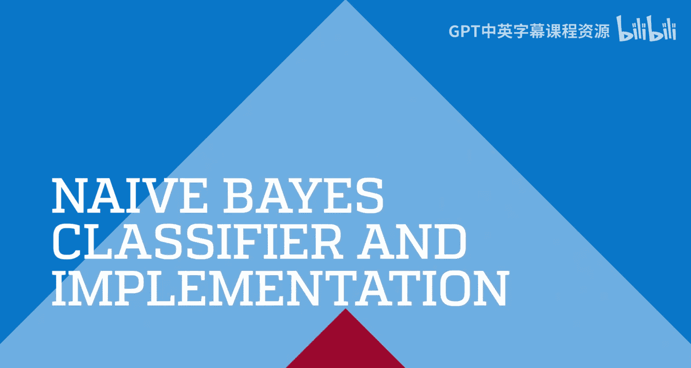

# 约翰霍普金斯大学《应用机器学习｜Applied Machine Learning》中英字幕 p21 20_朴素贝叶斯分类器及实现.zh_en -BV13xuqzYErx_p21-

🎼。

Now let's look at an implementation of nau basease classF。It's one of the simplest classifiers。

 It's not the weakest。 Nau based classifier is based on sound principles， and a few decades ago。

 it was one of the basic classifiers。 It uses the base rule where computing the posterior probability by likelihood。

 class prior probability and predicted probability。Now， here's an implementation。 First。

 let's create the data set in these cells。 we' are making use of the make blobs。

5 classes with two features。 and you see it's not that bad it's not an easy problem， there are 1，2，3。

4，5 categories， and many of them are overlapping。 their centroids are different， For example。

 the centroid of this light green is here， the centroid of these are， you know， in other places。

 if the centroids were too close， those two classes would be mixed up easily， as you can imagine。

 For example， if you cluster these， you can cluster by looking at the density。These5。

 this is a different density。 these as tighter density， but if two of them overlap each other。

 then we cannot differentiate between those two clusters， Similarlyly。

 naive ways is relatively a simple class， not would not be able to differentiate between those two。

 Our centroids are given as-3 minus-3 in this fashion。

 they are not overlapping they are nicely apart。 the number of data points are 0，5001000。

 and the cluster standard deviation is like here。 So this is the first one。 standard deviation2。

 These are tighter。 These are easier to classify， of course。And the big one is 5。

 It spread out a lot。 Well， how much classification accuracy would you expect。

 The random performance would be 20 per cent， right， So probably if I achieve 1995 per cent accuracy。

 cross validation accuracy。 I would be happy， right？

 Let's see the performance of naive base in this dataset set。 First。

 let's look at the implementation of the naive base。 And， of course， Sit learnn has a naive base。

 which is S K learnn naive base Gaussian naive base， there are many variations of it。😊。

There is also a multinoial version of it， which is multiclass naive basease。

 Gaussian naive base is not multinominal。 Let's see how we implement the custom naive base。

 The variables we need are these three likelihood class prior probability and predictor probability。

 If we assume numerical input， we can use the statusts function。

 non Pdf to come up with those probaities。 If the input data is categorical。

 we learned to one hat encode them in module tree， and we can also build a custom naive base totally nominal without one at encodecoding。

 but building a multidimensional array and storing each of the categorical input variable。

Interestingly， some classifiers are good with numerical， some classifiers are good with nominal。

 For example， support vector machine， neural networks， regression are all numerical or classing。

 Most of the clustering。arere all numerical， however， naive base can work with numerical。

 it can use those numerical values to build the PDF。

 but inherently actually it's a nominal classifier because it computes the probabilities of the numbers if I have categorical or nominal variables than it's easier to build those probabilities。

 for example， random forest uses nominal variables because it computes the entropy which is based on the probability of each of the value of the variable。

 but it doesn't matter all of these can be converted to each other。

 we can convert numerical to nominal by binning， we can convert nominal to numerical by one hot encodecoding and all of these are than automatically in psyit learn libraries。

 of course， or Waca machine learning libraries。Now， custom na is a class， it uses a norm function。

 PDF in order to compute the PDF and this interface， this API is same with the psyic learnn library。

 We have a fit， we have a predicts when we create the custom na it initializes certain things it uses capital N and C number of data points。

 number of features， number of classes， number of categories and prior predictor and likelihood variables。

 all of these are set to none。 If you make a mistake and it remains as none in the program。

 you will see an error right away。 the variables， likelihood。

 prior predictors we have prior predictor likelihood some of these are easy to compute some of these are a little bit more complicated looking and there is some error check in the fit function all of these are populated。

 we always have the self variable for a Python class。

The X train and Y train is's the same API pull the shape compute bymp unique。

 The y train ideally class numbers should start from0 doesn't have to。

 I'm just computing the number of classes， number of categories here If the minimum Y train is not0 and the maximum is not cn -1 it gives an error When you program something like this。

 it's always good to place constraints here I'm constraining the class numbers starting from0 to cn minus-1。

 This is typical in most of the cases， even though it would work with different CN Since I'm using the C in CN as an index。

Actually， I prefer to start from 0。 It's an implementation detail。 If this is not the case。

 then you can map your classes to 0 and rest。 And， of course， it's an integer。

 If I have five classes， it would go from 0 to 4，0，1，2，3，4。

 The prior is the bin count of the Y train divide by self n。

 it's basically a probability mass function。 Remember， prior is the class prior probabilities。

 How many data points belong， or I expect in my training data set to belonging to class 0，1，2，3。

 For example， if I use all my data for training， then the prior would be directly correlated to the number of samples。

 The prior of class 5 would be 1000 divided by to total。

 The prior of class first class would be 0 divide by total。 So that's the class prior。そう、すね。

Predicctor probability is a bit different。 It has to be a Pdf， right？ Pri probability。

 is's a probability mass function。 There is no standard deviation。

 but for the predictor there is and all of them are coming from the training dataset Basically pull all the training fit my norm function。

 It does the rest。 I'm fitting a Pdf for every feature。 How many features I have two。

 then I will have a Pdf for each of those features。 I will have two pdfs。

 Those are the predictor variable， which is based on the features。 If I have five features。

 then I will have five predictors。 Notice that naiveba assumes each of those features are independent uncorrelated because that's why I' am building an individual Pdf for each one of them。

 if they are joint， if my assumption is incorrect。 then here I'm doing something wrong because。

When I build my Pf for feature 1， I'm dismissing the effect of feature 2。 That's naive base。

 It's not neural network。 So it's limited， but it's also very fast。 You will see that。 Now。

 the likelihood is the dictionary of all the features per class。

 Some classes rely on certain features more than the others。 So this is taking care of those。

 The details are in the Beijing rule。 I'm computing。X， given the class。I computed the prior。

 the predictors。 The first one was prior， right， probability of C。 Second one was predictor。

 probability of or P Df of each feature。 Now， the third one is the P Df of the feature。

 given the class。 How many do I need two features，5 classes，10。 Now， let's look at the program。

 again， for each of the class for the likelihood class， it's an array of Pdfs again， M features。

 So for each class， I have two features，2 P Df， class 0，2 P Df， class 1，2 Pdf， class 2，2 P Df。

 I have 10 Pdfs。 When I build all these with the fit。 I will have three probability functions。

 one of them probability of mass， The other are arrays of Pdfs。

 and I'm ready for any kind of prediction。😊，For the prediction， basically， I apply this ratio。

For each of the class， compute these pick the maximum one。 That's how it works。

 For each of the data point in test， compute the likelihood。

 computeute the predictor and all of these are array operations and then take the product of the future probaties we have to do this because each feature is independent。

 We cannot add them we have to multiply them to compute the final probability。

 Were multiplying per feature。 and then we are picking as the predicted why as the argms of those ps。

 remember each of these ps are vector。 I'm computing for each data point I'm computing P in the array of classes I would suggest running these program using pipe charm debugging and seeing how it works。

 I'm picking the y prediction and of course I'm populating here for each of the data point in test。

 taking the。Of that probability， which is computed as an array for each of the class and assigning them for my prediction。

 That's it。 Now the first thing you should do to test such a classifier that you implemented manually the first thing you have to do is reclassification。

 basically train with everything you have test with everything you have It's the same API。

 This is our custom nabase fits my X1 y1， which is computed before。 look at the y prediction。

 look at the accuracy score。ow， reclassification is 97%。

 Of course it is slower than the library because everything is manually computed here。

 There are faster methods， which is out of scope of this course。

 So probably it works right Now let's do tenfold crossval。

 We implemented this to do the tenfold crossval。 we are evaluating for classifierifies our custom nabase Gaussian M。

The psychic Learn library support vector machine using a linear kernel。

 basically it's a perceptual machine and a support vector machine using an RBf kernel and compare all of them。

97% stratified crossfold wide stratified because the classes are unbalanced I have 1005005005 and1000 pretty unbalanced for a balanced case it would be 100100100100100 class prior probabilities are not equal to each other。

 So it's unbalanced，97%，97%。 So our custom name base is being pretty good it's a good implementation in terms of correctness Line not that good not that linear sVM is a very。

 very generalized classifier It's not a bad thing you have a low performance and RBf It's also general enough。

 SVMs are in general generalizable classifiers。badThis shows that this difficult problem here can be solved with one of the simpler classifiers naives in a very reliable fashion。

 we are able to have achieved 97% accuracy based on  tenfold crossval which is an excellent evaluation method on five classes。

 so in my opinion this is a big success。嗯。

