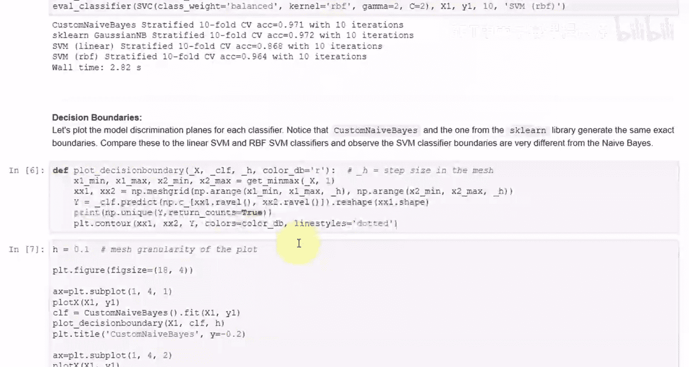

# 约翰霍普金斯大学《应用机器学习｜Applied Machine Learning》中英字幕 p22 21_分类器的决策边界分析.zh_en -BV13xuqzYErx_p22-

🎼。

Now let's see how these classifiers behave in general。

All classifiers generate some decision boundary。 For example。

 our naive base is able to build a PDF here， a two dimensional P based on x1 and x2 and also a Pf here。

 a PDF here， a PDF here and a PDF here， So how do these classifiers work， how do they classify。

 remember the perceptron widget， basically fitting a hyperplane in between the data points and then dividing the space into two。

 Well， the other classifiers do similar tanks。This program here。

 plot decision boundary basically demonstrates how these classifiers behave。

 We have two features X1 x2。 We have four classifiers that we are playing with。

 custom La base Gaussian Mvy from the Sit La Library， SVM linearar SVM RBF。

 at look at all the decision boundaries that they built， a circular Pdf， circular circular circular。

 If I give different standard deviations to F1 and F2 feature 1 and a feature 2 or X1 x2。

These would be eipoid。 And as you see the way custom basease builds the P Dfs and the Gaussian N B builds。

 They're exactly same。 This is just faster。 XVM linear and SVM RBF behave totally different。

 SVM linear uses these hyperplanes for this little class and places some other hyperplanes to others。

 For example， That's why SVM linear makes a lot of mistake。 because， look， in this region。

 light green is winning。 But in this region， all the light greens are classified four dark。

 So I'm losing all these points。 They will go to error Similarlyly。

 all these around the orange ones are classified as orange。 I'm losing them for the light green。

 Similarlyly here Similarlyly here。 That's why SVM linear is making more error。 However。

 we might prefer this。 This is a very， very general。ClI divided up the space。

 the two dimensional features space into these sections。

 and then I'm building my classifiers upon internally，5 choose two classifiers are built。

 but this is the This is the combination of the dividing hyperplanes。 Now。

 let's look at the RBf completely different。 It uses a different kernel。

 I do not have hyperplans anyway anymore。 They are not planes anymore。

But they vigly and the gamma parameter2 is controlling the viglines to classify this data。

 When I look at here， all the ones in this area belong to dark green， orange。

 other ones and the rest is light green。 So our beeff is making less mistake。

 but it's not probabilableistic。 It is still making some mistake。 However。

 it doesn't assume anything。 Ams build， according to the data we have custom naiveb assumes the data。

 the underlying data has normal distribution， and they are independent of each other。 as you。

 as we will see， when we use different data sets， not toy data sets like this。

 This is a toy data set。 It's very easy to classify this。 It doesn't reflect the world out there。

 the data out there， the data files， data sets that we generate in our daily lives are not well mannered like this。

 but。

I need classifiers like these two to classify the real world data better。

 We will see more on the generalization in the following modules when we come to regularization。

 We will see that these two are not that great because they are not general enough。

 but these two are better because they are more general。 We want generality in a classifier。

 We want less overfi。 We do not want underfi。 That's not enough training。

 but we definitely do not what want to overfi。 It's the utmost important concept that we are following in our supervised learning。

