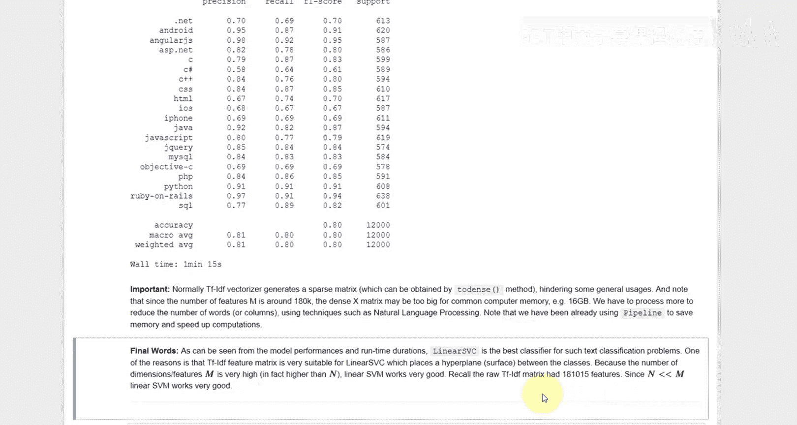

# 约翰霍普金斯大学《应用机器学习｜Applied Machine Learning》中英字幕 p23 22_文本分类技术.zh_en -BV13xuqzYErx_p23-

🎼。

Let's see two real world examples， both of them are text processing and text classification problems。

 but they are real world problems。The first one， the famous rate data set Rers。

 we will use an L K library and an L K corpus of Res。 it's a small version。

 but still it's good enough and big enough for our purposes。 Now。

 we will use T F IDF metric as the features。 We do not have to quote anything。

 Everything is already in the libraries。 When we look at the data。 We will have these classes。

 There are 90 categories。 And the number of documents are 10000。

 Each document is a cube sentences with a title。 This data is old。

 This is a representation of the data。 We are printing only the first 150 characters。So。

 some title and some text。This is， for example， assigned to other category by ourselves。

 This is grain。 This is crude。 Of course， the dataset set is annotated， meaning somebody。

Or a team went over the data and assigns labels。 But look， it's a difficult problem。

The number of categories is 90， and number of documents is 10000 with lots of words in it in order to small our problem size。

 make it smaller。 We are assigning the documents into some bigger categories。 When we sort them。

 we see the category earned 3900 documents it goes like as。

We will pick the first top five categories and then assign the rest of the documents into others in these cells。

 So now we have six categories and these classes。This is prepro。

 right the original dataset doesn't suit immediately to me because 90 categories is too many In practice。

 Reuter's data is used for clustering analysis， for example。And， you know。

 a short summary about TF Idf， basically it uses every word as a feature。

 How many words you have00000 then you have 100000 features in your X matrix， there are10000 columns。

 Look at the frequency of those words in your document。 That's your feature value。

 In order to normalize that we are using how many times you see that word in the totality of the documents and normalizing that。

 For example， D is considered as a stop word， you see D everywhere。

 the inverse document frequency of D would be very， very high， right。

 because the D shows up in almost all documents， then we are using inverse document frequency to normalize the actual frequency of D Suddenly。

 the TfiIDf value of D goes down。 That's what we want。 We want meaningful。

 important terms like alien inflation。To have a hard TF IDF。

 because I will use TF IDF to classify my documents into six categories。Now。

 these cells are just to map the documents into categories。

 convert the categories index from labels like text into numbers and also pull the documents。

 pull the categories like this。 and then look at here。 Now， the rest is。

Building the pipeline of those classifiers。 I'm using kfold evaluation。 Always。

 it's the most reliable evaluation method。 We are using TfiIDf vectorizer on the data set。

 Its pretty advanced vectorizer。 You don't have to do a TfiDf generator on your own to work on this text processing problem。

 So we pulled the TfiD vectorizer。 Our X data matrix is 10788 documents and and features this 30000。

 TfiIDf vectorizer inside， gets rid of the junk word stop wordss。

 it does a lot of good processing for us and then generate the X matrix for us。

 It is hard to beat TfiIDf vectorizer on your own。 We will use support vector machines Line and RBf and then we will use naive base and then we will use random。

Clsifier，So we have five total classifiers， including the logistic regression。 more or less。

 for any kind of problem。 when you start， you should try naivease。Random forest， logistic aggression。

 support vector machine and neural networks。 These are the most important classifiers。

 and they behave a bit differently。 Most of them will generate similar results。

 and then it's a matter of data science task to find out what kind of pipeline to use General support vector machines are slower。

 Lo agress is slower。 deep learner is slower。 but naive base is very fast。 randomand forest is fast。

 It can be parallellyzed。 In this case， for example， there are eight cores。

 I'm using for the random forest， and then it is running in parallel。

 These are the results you have to run these on your own。

 Some of them are slow for the RBf support vector machine which has the kernel computation cannot be parallellyzed。

 unfortunately or at least this library doesn't have it It could be using those kfold 5 choose2 in this case6 choose2。

In parallel is possible， but the library doesn't have it。 It takes 6 minutes， almost 7 minutes。

 So you should see 10 minutes on your machines， but I would like you to run this and see what to expect in a real world problem。

 a difficult problem。This matrixx is huge。10000 times 30000。

 You will need a lot of memory to use this。X is stored as sparse matrix。

 so things are taken care of for you。 Linear support vector machine works very。

 very fast because it's just hyperplanes， nor wly internal computation，13 seconds。

And look at the performance。 It's very high。Nive basease， not bad 80 per cent。 And as we expect。

 support vector machine will always beat naive basease， no matter what in real world data。

 but it's fast。 The first thing I would try would be naive base， because it's reliable。 It's fast。

 not that super performer， but I will have an idea about the problem size。

Random force is very reliable。 It very strong approach 83% cent。

 Logistic aggression is very slow compared to these two， but is a reliable classifier。 It works well。

 And， of course， you have to play with the parameters。 like， for example。

 the solver number of iterations。 and its accuracy is 93% cent。 in this case。

Linear SV C is clearly the best performer in most of the text processing applications with TF IDF。

The first thing you should try for high performance is support vector machine with linear kernel hyperplan kernels。

 In this case， linear SVC function is different from SVC。

 Line SVC is optimized for linear support vector machine。

 This SVC can be used with kernel equals linear， It will be the same thing。

 but it will be very slow because it's not as optimized as the linear SVC。So that's it。 In this case。

 I was able to classify my documents into six categories， and my performance。

 tenfold cross validation in performance was 94%， which is a good one。 It is much。

 much better than one over 6 random performance。 And it does， in a very good time，13 seconds。

 including the feature extraction extraction。 This pipeline builds the conveorizer TF I D transformer。

 and a classifier into a single pipeline。 In my opinion， is very， very fast and efficient。 Now。

 the last example， again， takes processing is programming language detection from forum posts。

 using stack overflow data。 This is a more difficult problem with 20 categories。😊，Again。

 I will use the F IDF generator for features， some examples。This is posted。 C sharpp tag is C sharp。

 Well， of course， someone has to go over all these labels。

 ground truth to be used for supervised learning to check if they are really correct or not。

 That is called annotation， annotating the data set。 It's a very important step。 and it's very。

 very extensive。 The cleared， cleaned annotated data sets are salt for high price tags。 In this case。

 we have it for free。 thanks with stack overflow。Now it's a very balanced problem。

 We have 2000 representation of each category in our full data set。We will use similar pipelines。

 We have 40000 data points。 We have lots of features more than the previous one。 In the previous one。

 it was 30000 around 30000 right，30900 features。 These are the words。 These are the unique words。

 but here there are too many 180000。 These problem incredibly difficult。

40000 times 180000 is the matrix size of x to be dealt with。 I'm using similar approaches， however。

 in this case， if I run a crossval approach it would go very， very slow。 So in this case。

 my evaluation is simpler。 I'm using a test train split so that it it wouldn't run forever。

 The results are here。Again， logistic regressiongress is very slow。

16 minutes for the split evaluation in order to list how the classifier is working individually on each category。

 I'm not using Kfold crossval， but using split 70% training，30% testing given here。

 you have to fix the random state。 Otherwise， every time you run this。

 it will generate different results because a seed would be starting the pseudoran function from a different initial value。

 So I'm sitting this 42， to keep this notebook generating the same results every time it's wrong。

 Well， that net， not that good performance， H Ml， not that good ios， not that good。

 but rubby on rails 95 Android 95。 Overall， it's not that bad。 This is a very difficult problem。

 The highest performance I'm achieving is。And， you know。

 linear SVC is much faster than logistic regression always。

 But for the sake of completeness for comparison purposes， we included all these classifiers。

 And these are the detailed results for our training testing split。

 Now the T F I D Victorizer generates as sparse matrix。 Most of the matrix operations won't work。

 You have to convert it to two dense。 But if you do a crossval like that。 you will be out of memory。

 So this is a real world problem。 It's a really big， difficult problem。

 People work on months and months and months on such problems Here， we demonstrated that it's doable。

 If you know what you' are doing， you can do it very， very accurately， very， very efficiently。

81% is not bad。 The random performance achievement could be one over 20。 It， it's nothing right。

1 over 20。 It's only 5%。 So compare that 5% random performance。

To 81% accuracy and this is without anything。 we haven't optimized any NlP approach or word processing。

 We're just using the TfiIDf vectorizer directly from the library So many。

 many things can be done but if you trust my experience it would be difficult to improve this performance to。

 let's say 90%。 This is a difficult problem maybe we can improve this to 85%。

 That's it Now why did linear SVC word much better than the rest。 The reason is this。 I have many。

 many features compared to the data points。 That's why a decision boundary like this works good because my Pdf is not like this for the Tfi IDf。

 It's very localized in two dimensions。 you wouldn't see a Pdf like this from the TfiIDf matrix which is the X matrix but you would see。

Localized points thus， a direct division of the feature space would work very very nicely。

 If you use word embeddings just for the sake of completeness。

 I'm mentioning this if you use word embeddings in instead of Tfi IDf linear SVC wouldn't work the best anymore because when we use word embeddings we convert this m to a tighter more dense dimensions similar to principal component analysis。

 my number of features would drop from 180000 to let's say 10000 or 5000 then SVC with RVf kernel would work much better because my M would be lower。

 I would be more efficiently using the feature space That's why it would work。

