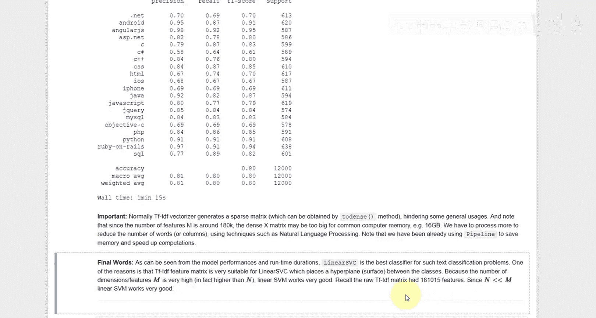

# 应用机器学习：23：文本分类技术

在本节课中，我们将学习文本分类技术。我们将通过两个真实世界的例子，了解如何使用机器学习算法对文本数据进行分类。这两个例子分别是路透社新闻分类和Stack Overflow编程语言检测。我们将使用TF-IDF作为特征提取方法，并比较多种分类器的性能。

---

## 路透社新闻分类

上一节我们介绍了文本分类的基本概念，本节中我们来看看第一个实际应用案例：路透社新闻数据集分类。

路透社数据集是一个经典的文本分类数据集，包含多个新闻类别。原始数据有90个类别和约10000篇文档。为了简化问题，我们将文档归类到几个主要的类别中。

以下是数据处理步骤：
1.  加载路透社数据集的一个子集。
2.  将文档归类到前五大类别，其余归为“其他”类别，最终得到六个类别。
3.  使用`TfidfVectorizer`将文本转换为TF-IDF特征矩阵。该工具会自动处理停用词等。
4.  特征矩阵`X`的维度是`(10788, 30900)`，表示有10788个文档和30900个特征（即不同的词）。

接下来，我们将使用交叉验证评估多种分类器的性能。

以下是我们要比较的分类器：
*   线性支持向量机
*   径向基函数支持向量机
*   朴素贝叶斯
*   随机森林
*   逻辑回归

以下是各分类器的运行时间和准确率结果：
*   **线性支持向量机**：运行时间约13秒，准确率约94%。
*   **朴素贝叶斯**：运行速度快，准确率约80%。
*   **随机森林**：运行速度快，准确率约83%。
*   **逻辑回归**：运行速度较慢，准确率约93%。
*   **径向基函数支持向量机**：运行时间很长（约6-7分钟），未在此列出准确率。

对于此类文本处理问题，使用线性核的支持向量机通常表现最佳。`LinearSVC`是专门为线性核优化的实现，比通用的`SVC(kernel=‘linear’)`速度更快。

---

## Stack Overflow编程语言检测

在了解了新闻分类后，我们来看一个更具挑战性的问题：根据论坛帖子内容检测其使用的编程语言。

我们使用Stack Overflow的数据，这是一个包含20个编程语言类别的数据集。每个类别约有2000个样本，总计约40000个数据点。

以下是数据处理步骤：
1.  数据是平衡的，每个类别样本数相近。
2.  使用`TfidfVectorizer`提取特征。由于编程术语众多，特征维度高达约180000维。
3.  由于数据量大，使用完整的交叉验证会非常慢。因此，我们采用训练集/测试集分割（70%/30%）进行评估。

以下是各分类器在测试集上的准确率结果：
*   **线性支持向量机**：准确率约81%，运行速度快。
*   **逻辑回归**：准确率相近，但运行缓慢（约16分钟）。
*   其他分类器如朴素贝叶斯和随机森林的性能相对较差。

这个问题的随机猜测准确率仅为5%（1/20），因此81%的准确率是一个显著的提升。由于特征维度（180000）远高于样本数（40000），直接对特征空间进行划分的线性模型（如线性SVC）效果很好。

如果使用词嵌入等技术将特征压缩到更低维的密集空间（例如从180000维降至5000维），那么特征之间的关系会更复杂，此时使用非线性核（如RBF核）的支持向量机可能会表现更好。

---

## 总结

本节课中我们一起学习了两个文本分类的实际案例。
我们使用TF-IDF方法将文本转换为数值特征，并构建了包含特征提取和分类的完整机器学习流水线。
通过比较发现，对于高维稀疏的文本特征，线性支持向量机通常是一个高效且高性能的选择。
我们还了解到，处理大规模文本数据时需要考虑计算效率和内存使用，例如利用稀疏矩阵和选择合适的评估方法。