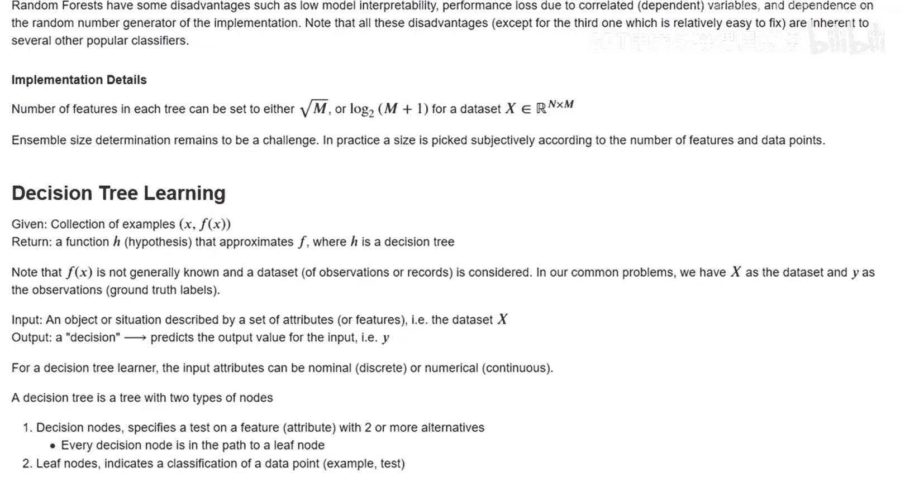

# 约翰霍普金斯大学《应用机器学习｜Applied Machine Learning》中英字幕 p25 1_集成学习.zh_en -BV13xuqzYErx_p25-

🎼。

Sometimes quantity surpas quality if doneright。An ensemble of primitive learners working as a swarm of classifiers can perform much better than a single strong complex classifier。

Not only can the Ensemble classifiers work in parallel。Therefore， producing results quicker。

 but they can also result in a much more generalized， robust classification model。 In addition。

 different types of strong classifiers can also be employed as a swarm， as shown in recent studies。

 in this module， we will show how to build a random force like ensemble classifier from scratch。

Ensemble learning is one of the most powerful approaches in La learning。

If you remember in last module， we looked at several classifiers， individual classifiers。

 they were strong， sophisticated， but they were not ensemble classifiers An ensemble classifiers is composed of multiple weak learners in the range of hundreds or thousands。

 the approach is using a subset of data points as in bagging or boost trap aggregating or using a subset of features as in random force and similar classifications。

 the benefit of such an approach is， robustness， higher generalization ability As you know。

 the most important feature or concept that we want to achieve in machine learning is reduction of overfitting。

 that means the generated models have to be abstract enough。

 general enough to avoid any kind of overfitting the weak learners can achieve them。

 because they are more abstract learners。 As an example， in curse of dimensionality。

 if we have hundred dataset features。Which is a very common number。

 If we want to have five data points on each of those features。

 the joint density function would ideally have to use 5 to the10 data points so that the space would be covered uniformly and exhaustively。

 we know that we will never have that many data points。 Then what's the solution。

 using a subset of those features。 In addition， we will never know those features being dependent or independent。

 We would never be able to get the joint density function。

 So ensemble learning helps when we use a subset of those features for every weak learner。

 and then majority voting， the predictions of those weak learners。

 randomand force is a very popular and very robust ensemble learning approach。

 The number of features。 and the square of it is used as the number of features in each tree。

 So here the weak learners are decision trees。Which are using a subset of data points and a subset of features。

 The ensemble size determination remains to be a challenge。 However。

 the sensitivity of the prediction to the ensemble size is very low。

 there aren't many parameters to tune， even if you use the default parameters。

 say five level of trees，200 or 500 of trees as the weak learners as the ensemble size square root of M as the subset as the size of the subset of features for each weak learner。

 the random force would be general enough with very low sensitivity to these parameters。

 That's one of the reasons why random force is a very popular ensemble learning approach。

 Not that a random force uses multiple decision trees。

 Each of those decision trees are built using the decision tree building algorithm。Now。

 let's see in the next video how those decision trees are formed。

 What does it mean to have a decision tree。And unary learning。

嗯。

