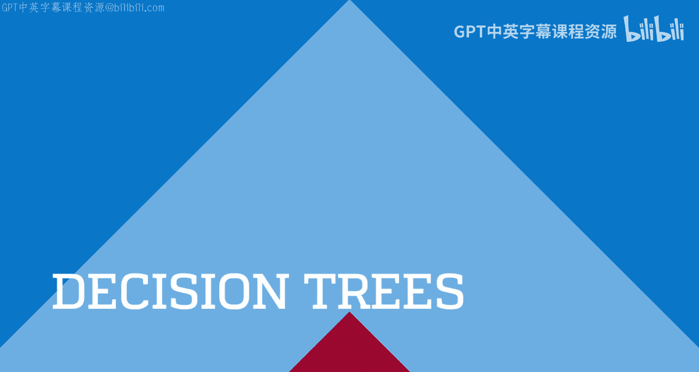
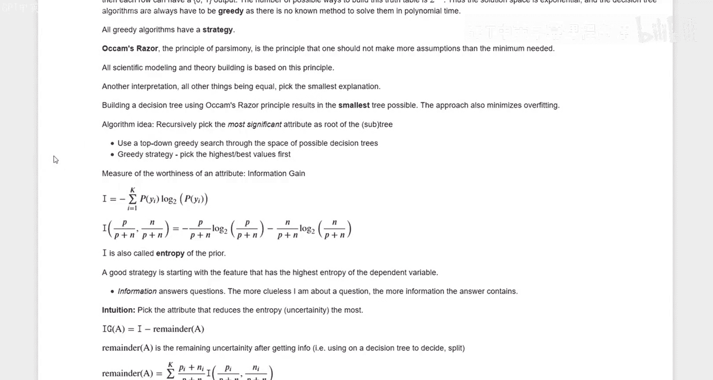
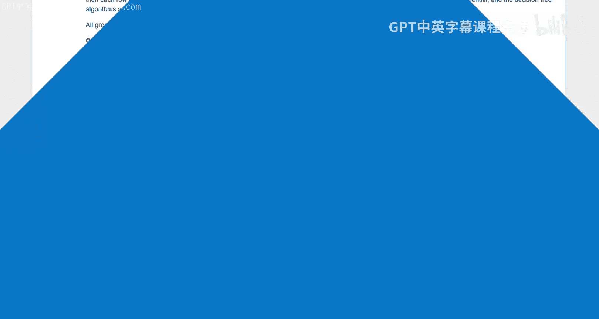

# 约翰霍普金斯大学《应用机器学习｜Applied Machine Learning》中英字幕 p26 2_决策树.zh_en -BV13xuqzYErx_p26-

🎼。

Decision trees are the building blocks of random force classifier。

 and it is useful to investigate decision tree classifiers in terms of algorithm。

 training and visualization。Decision trees are popular classifiers。

 One of the reasons of the this popularity is a decision tree explains the classification very well。

 It's not a black box classifier， Unlike a support vector machine or a neural network。 In addition。

 random forest， which is an ensemble learning approach uses decision trees as its weak learners。

 If we use all the available data set。 If we use all the features， available features。

 we can build a decision tree。This is one example。 Suppose an experiment is conducted where a question is asked to the customers if the food was good or bad。

 if the service was speedy， if the price was okay， and then if the customer tip the wait or not。

 we can collect these data points。 and then we can build a decision tree as here。

 this decision tree is built solely on the table。 Now， there might be some conflicts in the data set。

 the same set of features might have will tip yes or will tip no。 Well。

 that only change the conditional probability of that， yes or no。

 given food speedy price with these values。 Our interest is not。Particular decision3 algorithm。

 but rather how to use it， how to visualize it， and then how to pass the model for classification。

In Psyit learnn， we can build that data into a data frame using panda's library。

 We can use a label encoder for the target， and then we can extract the X and the Y matrices。

 As you remember the previous modules use these approaches。 At the end， our data is like this。

 this data exactly reflects。What the table has， This table was the experimentation and this data is the representation of that experiment in pandas。

 If you realize each of the levels are mapped into numbers，0，1，2。

 This is not a bad thing because clearly we can build， okay as the middle， bad as the low。

 good as the high。 So if I set okay21， bad to0， and good to 2。

 I wouldn't be wrong to mapping these levels into a discrete value， which is a relation。

 the relation is bad， okay， good in disorder， or no， yes， no as 0，1， yes as1。

 So shortly I don't have to one hot and quote this data set。

 because theres a relation between these levels。 bad， okay， good is a natural order。

 Natural ranking to those features。Right or wrong， this is my data。

 and the decision tree can be built accordingly， PsitLn has the decision tree。

 and actually I can pass this information to build the decision tree exactly basically I will just fit the data and then generate the model again。

sitLn using graph this can create those visualization。

 This is exactly the decision tree that I built， and if you realize this is exactly that decision3 that I built manually。

We can install graphs using Conda install Python dashgraphs and we will use the dot function to generate the will tipip3 dot dot file DOt is a format for graphics DOT is a graph description format you can check it out from online resources and it's one of those graph description languages where actually you can create not only these simple actually decision trees but also more complicated graphs。

 nodes ages curves and so In this particular example the tree that is generated by the decision tree is exported using these feature names using these class names to the graph description language file to be drawn the image command willtip classifier is generated here from my decision tree classifier So export graphs module or。

Library function understands this module， dis classifier， and then be able to generate it。

 As you see， the features are food， speedy price。 And remember the coding we had food greater than 1。

5 means food was good。😊，So， it means it's true。True， false。

 I will tip recall that This is the way I code my class。

 and this is the way I code or encode my features。 So bad is 0。 O is one good is2 in this model。

 If the food is okay or bad， I will not tip。Let's see。If that's the case， food is okay。 I didn't tip。

 food is bad。 I didn't tip。Food is okay。 I didn't tip。 So that's exactly correct， right。

 It's also visible here。 It's also visible in the Dec tree learned model。 Now， if the food is good。

 yes， then was it speedy， Was the price O， depending on the situation。

 either I will tip or as in blue class， Yes， or I will not tip， as in class no and orange。

 So this model is exactly the learned decision tree， If I use another example。

 the I data set and build a classifier， this is the model that I get。😊，This model may fit to my data。

 meaning the reclassification accuracy may not be 100%。

 but then this is the model that I'm building when I learn it。And where do I learn here， I Theta。

 I target。And I'm fitting the decision treeclassifier to that data， and then exporting it。

So this is very powerful， this is something to be shared by the subject matter experts。

When we work on a project。If it's black box， it limits the shared discussion with the subject matter expert because we don't have a model like this to show to them you have to convince in so many words。

 so many metrics and so on。But if you show this model to the subject matter expert。

 then that's a very strong discussion point。The subject matter expert might say that， oh。

 the petal width is less than 1。75。 So it's definitely worthyy color and so on。

 which is visible in these labels。And here and here， as well。For each of these nodes。

 Im also determining the class Genie is a particular index of entropy。As you see。

 it will go down as I go through the decision tree here， it's very high。

Because I have not decided on anything。So。By looking at the enthtropy。The decisionary algorithmum。

 actually。Tries to find out how to differentiate these two branches。And in this case。

 the algorithm found out that if the petal w。If I divide the petal data with the petal width。

Equals 0。8 or not。Then I reduced the entropy considerably。For example， here it's 0。6。 here it's 0。

 That means I reduce the entropy by deciding only on the petal width。And here。Entropy 0。5。

 that means I have to do some more comparisons than decisions。As I go down。

The geni index will reflect that genie is a particular index of entropy showing that how important my feature is。

 and the decisionary algorithm finds that petal width is the most important feature。

 which can reduce the entropy much greater than the rest of the features。

Id3 algorithmtum is one of the algorithms who build the decision tree。It literally tries all the。

Combinations of the features。 remember， it has to select one of the features in the first level and the values。

 So exhaustively there might be2 to the m rows in the complete true table because I have that many features。

 if there is also0 one output for each one of1 binary classification。

Then that tro table becomes 2 to D 2 M。 It's huge。 However， as I mentioned using the entropy concept。

 we can reduce。This logic table， considerably and build a tree accordingly。

 decisionion  tree building algorithms are fast。They are using greedy optimization strategy。

 And Oca's razor is one of them。 Oam razor tells you the decision tree。

 the actual tree must be very simple。 You have to reduce the entropy from the top levels of the tree as we go down while building the model。

 The remainder of the details of the algorithm is left for you to study。 But this is the intuition。

