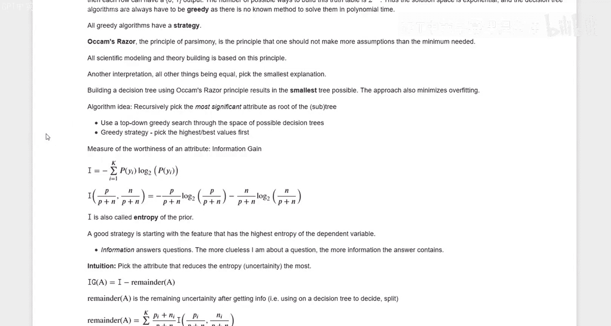

# 应用机器学习：2：决策树

## 概述
在本节课中，我们将要学习决策树分类器。决策树是随机森林分类器的基本构建模块。我们将探讨其算法原理、训练过程以及可视化方法。决策树因其良好的可解释性而广受欢迎，它不像支持向量机或神经网络那样是一个“黑箱”模型。此外，集成学习方法“随机森林”也使用决策树作为其弱学习器。

## 决策树简介与示例
决策树是一种流行的分类器。其受欢迎的原因之一是它能很好地解释分类过程。与支持向量机或神经网络不同，决策树不是一个“黑箱”分类器。

如果我们使用所有可用的数据集和特征，就可以构建一个决策树。下面是一个例子：假设进行了一项实验，询问顾客食物是否可口、服务是否迅速、价格是否合适，以及顾客是否给了小费。我们可以收集这些数据点，并据此构建一个决策树。

这个决策树完全基于表格数据构建。数据集中可能存在一些冲突，即相同的特征组合可能对应“给小费”或“不给小费”。这只会改变在给定食物、速度、价格等值的情况下，结果为“是”或“否”的条件概率。我们的重点不在于特定的决策树算法，而在于如何使用它、如何将其可视化，以及如何应用该模型进行分类。

## 使用Scikit-learn构建决策树
在Scikit-learn中，我们可以使用Pandas库将数据构建成数据框。我们可以使用标签编码器处理目标变量，然后提取X和Y矩阵。正如你在之前的模块中所见，这些方法已被使用。最终，我们的数据如下所示：

这段数据准确地反映了表格中的内容。该表格是实验数据，而这段数据是在Pandas中对该实验的表示。请注意，每个级别都被映射成了数字（0, 1, 2）。这样做并无不妥，因为我们可以清晰地建立映射关系：一般（okay）为1，差（bad）为0，好（good）为2。将这些级别映射为离散值是合理的，因为它们之间存在顺序关系（差、一般、好）或二元关系（否、是）。因此，我不必对这个数据集进行独热编码，因为这些特征级别之间存在自然顺序。

Scikit-learn拥有决策树模块。实际上，我可以直接传入这些信息来构建决策树。基本上，我只需拟合数据，然后再次生成模型。Scikit-learn结合Graphviz可以创建可视化图形。这正是我构建的决策树，你会发现它与我手动构建的决策树完全相同。

## 决策树可视化
我们可以使用`conda install python-graphviz`来安装Graphviz，并使用`dot`函数生成`will_tip_decision_tree.dot`文件。DOT是一种图形描述格式，你可以在线查阅相关资料。它是一种图形描述语言，不仅可以创建简单的决策树，还能创建更复杂的图形、节点、边和曲线等。

在这个特定示例中，决策树生成的树结构通过特征名称和类别名称被导出到图形描述语言文件中以便绘制。`Image`命令`will_tip_classifier`是从我的决策树分类器生成的。因此，`export_graphviz`模块或库函数能够理解这个分类器模块并生成图形。

如图所示，特征包括食物（food）、速度（speedy）和价格（price）。请记住我们的编码方式：`food > 1.5`意味着食物是好的。所以，结果为真（True）或假（False）。我将给小费（will tip）回忆起来，这是我编码类别的方式，也是我编码特征的方式。在这个模型中，差（bad）是0，一般（okay）是1，好（good）是2。

如果食物是一般或差，我就不会给小费。让我们验证一下：如果食物一般，我没给小费；如果食物差，我没给小费；如果食物一般，我没给小费。这完全正确。这在决策树学习到的模型中也是可见的。现在，如果食物是好的，那么服务是否迅速？价格是否合适？根据具体情况，我可能会给小费（蓝色类别，是），也可能不给小费（橙色类别，否）。因此，这个模型正是学习到的决策树。

如果我使用另一个示例数据集（如鸢尾花数据集）构建分类器，就会得到如下模型。这个模型可能完全拟合我的数据，意味着重分类准确率可能不是100%，但这就是我学习时构建的模型。我在这里学习的是X（特征）和y（目标），并将决策树分类器拟合到那些数据，然后将其导出。

## 决策树的优势与应用
这非常强大，是与领域专家共享讨论的重要内容。当我们进行一个项目时，如果模型是“黑箱”，就会限制与领域专家的共享讨论，因为我们没有像这样的模型可以展示给他们看。你必须用大量的文字和指标来说服他们。但如果你向领域专家展示这个模型，那将是一个非常有说服力的讨论点。领域专家可能会说：“哦，花瓣宽度小于1.75，那肯定是维吉尼亚鸢尾（virginica）”，等等，这些信息在这些标签中是可见的。

对于每个节点，我也在确定类别。基尼指数是熵的一个特定指标。如图所示，随着我沿着决策树向下走，熵值会降低。在顶部，熵值很高，因为我还没有做出任何决定。通过观察熵值，决策树算法实际上试图找出如何区分这两个分支。在这个案例中，算法发现，如果根据花瓣宽度（petal width）是否等于0.8来划分数据，就能显著降低熵值。例如，这里的熵是0.6，那里是0。这意味着仅通过基于花瓣宽度的决策，我就降低了熵。在这里，熵是0.5，这意味着我需要做更多的比较和决策。随着向下进行，基尼指数将反映出这一点。基尼指数是熵的一个特定指标，显示了特征的重要性。决策树算法发现花瓣宽度是最重要的特征，它比其它特征更能降低熵。

## 决策树构建算法
ID3算法是构建决策树的算法之一。它实际上会尝试所有特征组合。请记住，它必须在第一层选择其中一个特征及其值。穷举来看，完整的真值表可能有2^m行，因为我有那么多特征。如果每个特征对于二元分类还有0/1输出，那么真值表就会变成2^(2m)，非常庞大。然而，正如我提到的，利用熵的概念，我们可以显著减少这个逻辑表，并相应地构建一棵树。

决策树构建算法速度很快。它们使用贪心优化策略，奥卡姆剃刀原则就是其中之一。奥卡姆剃刀原则告诉我们，决策树、实际的树必须非常简单。在构建模型时，你必须从树的顶层开始，随着向下进行，不断降低熵。算法的其余细节留给你去研究，但这就是其核心思想。

## 总结
本节课中，我们一起学习了决策树分类器。我们了解了决策树的基本概念、如何利用Scikit-learn库构建和训练决策树模型，以及如何使用Graphviz工具将模型可视化。我们探讨了决策树易于解释的优势，以及它与随机森林等集成方法的关系。最后，我们简要介绍了ID3等决策树构建算法背后的核心思想，即通过衡量特征的信息增益（如熵或基尼指数）来构建树结构，并遵循奥卡姆剃刀原则追求模型的简洁性。