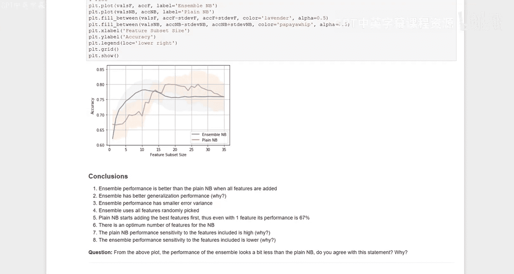

# 约翰霍普金斯大学《应用机器学习｜Applied Machine Learning》中英字幕 p27 3_展示大量弱学习器的威力.zh_en -BV13xuqzYErx_p27-

🎼。

Let's see how an ensemble of weak cliffifiers can challenge regular classifiers。

Now let's see if our claims is correct， let's try to demonstrate an ensemble and show that even though each of the weak learners are not that great。

 the joint， the ensemble power of them using majority voting and such is much stronger than regular classifiers。

 and of course this is all dependent on the data that we're using in the following modules we will look at data exploration。

 understand the data， build an ensemble and then we will use the subset of the features for training。

 that's more difficult than using the subset of data for training。

Because it needs a lot of management， which feature to say with the classifier and such。

 but we will demonstrate all these in the following cells。 We picked Titanic preprocessed data。

 As I mentioned before， not all data sets will reflect the power of the ensemble classifier。

 but this particular data set will We have 891 rows 69 columns。 This is a preprocessed data set。

 most of the variables actually are binary 01， some of them are regular numbers。

 numerical like age and fair。 and of course， not all of the features are that useful。

 as in any other classification problem or data mining data science problem。

 The first thing we have to do is data exploration。 We downloaded the data into a pandas data frame。

 This is the head。 Let's plot a few just to see what's happening survived， not survived。

 is our class。 that's given。 and that's the last column。 Not that not all columns might be useful。

This is the information that somebody gave you。 It's from databases。

 all the customers and their information。 And then we know that if they're survived or not individually。

 When we look at the plots， you can plot each feature with respect to survived or not survived。

 If we look at the age， we see that older people unfortunately did not survive that。

 but some younger people like babies， maybe they survived more。 This any sogram。

 We look at the six females which are zero survived more than males。

 and then when we look at the far as the far goes down not survived increases class one ticket。

 first class passengers， some of them survived some of them not， However。

 compared to the third class customers or travelers。

 there's a higher chance that they didn't survive。 So this is the data we are working on。

 We can rank this and pick some useful features， feature ranking data reduction and so on。 However。

 in。Asble learning， we don't have to because the random forest or the ensemble will actually simply not use the useless features In this example。

 we are using a naive base as a primitive learner。 These are the standard cells that we always have pull the x values from the data frame pull the y values from the data frame use a tenfold crossval。

 here is my Gaussian naive base When I run Gaussian naive base in this data as it is accuracy is 45%。

 and here is the standard deviation。 And of course。

 I save all the accuracy score in an array pass to the evaluation。

 Thus we are able to measure the mean and the standard deviation。

 This standard deviation is important。 I'm making 1% or let's say 2% error for each of the classification。

 It can be 43% it can be 47%。 When I switch to linear SVc80% not。

At another linear SVc when the class weights are balanced，74%。 If I use an RBf kernel，66。

 If I use another RVf kernel with different parameters， different gamma parameters。

73 logistic equation 81 neural network8 the bestclass fire 84% so that means ensemble learning does a better job in general with this kind of data。

 Now let's demonstrate the ensemble of primitive learners where each of the weak learners than a Ubase class file and then we will use a subset of features。

 not the data points in a script like this in the following cells getting a sample of the data points is easy。

 you will just pick a smaller training set train your model and then use each of those weak learners in an ensemble for prediction and a majority what at the end However。

 how would we do the subset of the features and actually。

Using the subset of features for these weak learners is really abstracting the learning process。

 So random force is powerful because it does both subset features and subset data points。

 it wouldn't be as powerful if it is only one of them。

 we are also computing the priors for the unbalanced data， we have only 61 in this case。

 not survived zero value and 38% survived。 It's not that unbalanced， of course。

 if you ask me it's an balanced data。 However， if I give these priors to the naive base。

 it will do a better job。 I'm helping the naive base My evaluation is coming from the previous cells am crossval。

 this is my weak learners I'm picking features randomly weak and B fit weak and be predict。

 Not that each of these classifierifies are weak learners。 I need an ensemble of these maybe。

Hundred of them， and that is reflected in the n ensemble。 That's my ensemble size。 For example。

 I will pass hundred to this value。 When I generate random subset of the features。

 Im using choice function from random without replacement。

 I cannot have the same features listed as twice in my list， so it has to be without replacement。

Evaluation week， This is not directly can be used as in the previous evaluations。

 because I have to save my list of columns or list of features with each of those individual weak learners。

 So when I generate the weak learners， I have to save which features it uses with it as you examine this code。

 you will see that for each of the ensemble members。 I'm generating a list of columns。

 and then I'm passing those columns， the regular tenfold training and testing data sets and then saving that classifier passing that classifier with the columns to have the accuracy。

 This particular evaluation does not do an ensemble evaluation。

 It only does evaluate the weak learners individually。

 I have not saved any classifier or columns here。And why am I doing this。

 Just to see a pure naive base。 And then the weak learners。

 If I do the weak learners Does it improve at all。 Naive base was 45。 Now， it's 48。

 It at a very low standard deviation。 I have a very high standard deviation here。

13% that's expected each of those weak learners are using a random subset of features。

 Some of those features are useless or working against the class。 The performance increased。

 because probably some of those weak learners are doing great by chance they found the best features。

 standard deviation increased because I have a lot of randoms in that uncertainty in that。

 If I set the number of features with three one of those weak learners might receive three features which are completely same value like 0。

 So this particular cell would fail。 if I run this many times with only three features。

 I will see that error。 And in this example， I used。😊，5 features here。 numberumb of features is 5。

 size of the ensemble is 00。 I have 100 weak learners。

This cell demonstrates how to build the ensemble of the weak learners。 First of all。

 ensemble fit receives the ensemble columns wherever I generate that classifier。

 Some information is pulled directly from the actual ensemble features that it was passed to the length has to be the anassesemble。

 It's a list of features that will be used for weak learners weak learners will use this list of features。

 Each week learner will use one of them。 I will generate the list of the features before creation of the ensemble classifiers。

 Ensemble classifier is another list which will be the list of the weak learners。

 and here I'm generating all of them weak MBfi from the previous cell using the ensemble features。

 Part list of features。 the J index and X Y is my training and testing dataset set at the end。

 ensemble MBfi will generate a list of classifier model。

Wwhich were fit by week and befi and the size of it will be an ensemble。

 Each of those will use a particular feature list， which I received in the ensemble columns。

 so this is a list of list of features Preic well use that list and again the same feature list list of list of features。

 it will predict each one of those and then it will majority ws。

 each of the output of those weak learners and then it will return the maximum score and the index the class which was predicted as by the most of those weak learners in the ensemble Now this is interesting when we evaluate the ensemble we didn't see an improvement In fact。

 our performance dropped a lot Not that this is an naba weak learner it does not have the advantage of a decision tree learner where the entropy is used to pick the right features。

 A nau basedase learner uses all the features available without。Actually， selecting any one of that。

 the naive base evaluates each of those features equally， and its performance is like 39%。

Which is less than the previous results。 Its standard deviation is very low， almost 0。

 and in this particular example， there are 200 weak learners in the ensemble。

 I am doing 10 iterations， and it hard to collect statistics。

 and I'm using seven features for each of those weak learners。Do I have a bug， No。

 I do not have a bug， but that's what's expected。 The useless features are hurting this particular ensemble a lot。

 Why random force is not affected by this because of the decision tree algorithm。

 Each of those weak learners are smart enough to differentiate between a really bad feature and a good feature。

Nivebase is not。 Another question is that why naive Base classifier works with all the features much better than individual weak learners。

 Because when we do the naive base fully， we are using all the features at once。

 So the good features take over。 But in the weak learners in the ensemble。 It's all over。

 Many of those weak learners do not have any access to the good features。 So how can we improve。

By feature ranking by reducing the number of features。

 when I rank using pure correlation in one of the assignments earlier with the correlation。

 When I look at the correlation with respect to the class， it will give me an idea。

 about the value of that particular feature。 Fair has the biggest one that is also visible here。

 When I look at this particular plot。 It's obvious that as far goes up， survived not not survived。

 is discriminated by the class survived as the fars goes up， survived or more as the fars go down。

 not survived is more as seen here。So this is one of the most important features。

 The correlation also shows that fair age， family size tickets， and all those。

 it shows these set of features show a good correlation with the class， these do not actually。

 it has zero correlation。 Probably maybe it's a single value， ticket。

 and when we pick when the correlation is less than or equal to 2， I get rid of all these features。

 How many I had68， now I have 35。 Not that this feature reduction is very， very simple。

 We can have better feature reductions。 But even this is enough to improve my ensemble。

 And then again， why did I need this， because in my ensemble the weak learners are naive based classifiers and they are really hurt if we do not pick the features。

 right， the decision trees in a random forest classifier are much better because they are impervious to the bad features。

 A pure ensemble naive based classifier improve to 76%。

Performance and we had a pure naiveba class fire without an ensemble directly using the reduced the ranked features。

891 data points and 35 features directly has the performance of 76%。

 It's much better than the previous low performance of naive basease Rand forest its same it didn't change anything。

 R forest was smart enough to pick the right features。

 It uses Ocam's strategy information gain Genie index to be able to select the right features。

 So it was always high and not that these two particular results are from that reduced data set XPP pre processed。

Now， let's see how XPP is showing the ensemble nab performance。Here， this is without ensemble。

 Jump to 70%。 It's pretty good。 And this is the ensemble。 The size of the ensemble is 211 features。

10 iterations for statistics， jump to 78。 It didn't reach to 84， but it is much better than 76。 and。

 you know， I can safely to say that because 76 was 76 plus minus 4。5%。 Now I have 78% plus minus 3。

5%。 Did you realize the lower standard deviation。 So 78% here is much better result than 76 more robust than 76。

 You might say that I hand picked the number of features here 11。 But about if I pick 579，20。

inventoryventory。Okay， let's build the experiment and compare the performance In these cells。

 I set up the experiment。 I will basically change number of features from a few to 35 to see how the number of features actually affect and not that plain na base direct na base implementation and ensemble nau base is the implementation that we had before in the abovebo cells this is the experiment that you can come up with I mean the extreme experiment that you can come up with if we don't have a bug here this shows a very interesting plot for one plane nau base have better performance but it's very sensitive to the features when I pick all the features actually it hurts these features work against the classifier but these features are probably the good features like up to 25 and here the order of the features is the order of the correlation So however I ranked above here in the experiment this is the first feature to you。

These two are the second features。 these three are the third features。

 these four are the first four features and so on。 so I'm helping the classifier in both cases。

 That's straightforward。 that's what has to be done anyway because we are feature ranking and then we are using that rank to build the classifier even with a few features naive base does a super job It starts from almost like 67%。

 I prefer blue because it's very robust。 Its standard deviation is lower than the plain naive base where this band is always higher my goal does not have to be the best accuracy but rather my goal has to be the most abstracted most generalized model and in this case the ensemled naive base actually gives that to me it's very insensitive to the features as you see it plateaus after 15 using all the features here or using only 15 of them here and。

Still having a good result of 76% Our conclusions of this demonstration。 and again。

 not that we used weak learners as nau base classifiers。

 which are by themselves very limited classifiers anyway compared to the decision three classifiers So our experimentation。

 our approach was really pushing it to the limits Our results ensemble performance is better than the plain nau base when all features are added has better generalization why because our standard deviation is lower Generalization is much better ensemble uses all features randomly picked here if I pass 35 plain na performance is very sensitive to the features included As you see it's all over Even with like5 to 10 features。

 the ensemble learning really improved considerably with a lower standard deviation with a lower variance of the error the red and the band is the standard deviation here for the plane。

BaseAnd the blue band here is the error rate is the variance of the error for the ensemble learning。

 And as you see， it goes more and more as I add more features。

 This concludes our ensemble learning approach。

