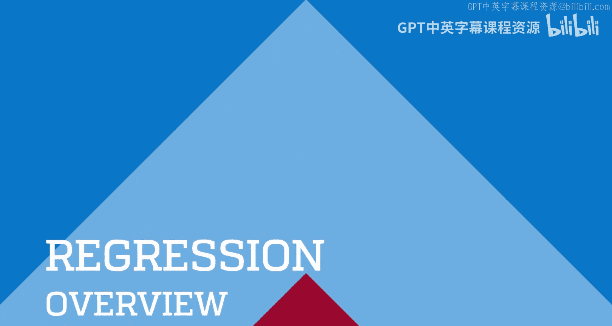

# 应用机器学习：4：回归分析概述

在本节课中，我们将学习回归分析的基本概念。回归是一种用于预测连续数值输出的监督学习方法。我们将介绍回归的类型，解析线性回归方程，定义其损失函数，并探讨线性回归的局限性。此外，我们还将通过代码演示如何从零开始实现多项式回归和逻辑回归。

---


## 回归问题定义



某些问题需要计算实际的数值。

例如，预测季节性流感的到达率或预测下周股市的可能指数。

这类问题可以通过使用回归分析来解决。

---

## 回归类型与线性回归

在本模块中，我们将列出回归类型，解析求解线性回归方程，定义其损失函数，并演示线性回归何时可能令人困惑或不适用。

线性回归的目标是找到一条直线（或超平面），使得所有数据点到该直线的距离之和最小。其核心公式如下：

**公式：** `y = β₀ + β₁x₁ + β₂x₂ + ... + βₙxₙ + ε`

其中，`y` 是目标变量，`x₁` 到 `xₙ` 是特征变量，`β₀` 是截距，`β₁` 到 `βₙ` 是系数，`ε` 是误差项。

损失函数通常使用均方误差（MSE）：

**公式：** `MSE = (1/n) * Σ(yᵢ - ŷᵢ)²`

其中，`n` 是样本数量，`yᵢ` 是真实值，`ŷᵢ` 是预测值。

---

## 超越线性回归

上一节我们介绍了基础的线性回归，本节中我们来看看当数据关系非线性时的情况。

我们将从头开始编写代码，并使用多项式特征和SciPy优化库来演示二次回归和逻辑回归。

以下是实现二次回归的关键步骤：

1.  将原始特征转换为多项式特征（例如，`x` 转换为 `x²`）。
2.  在新生成的特征上应用线性回归模型。
3.  使用优化算法（如梯度下降）最小化损失函数。

**代码示例（概念）：**
```python
# 伪代码：使用多项式特征
from sklearn.preprocessing import PolynomialFeatures
poly = PolynomialFeatures(degree=2)
X_poly = poly.fit_transform(X)
# 然后在 X_poly 上训练线性回归模型
```

---

## 逻辑回归

逻辑回归是一种流行的分类方法，它基于逻辑曲线对数据集特征进行拟合。

我们将利用逻辑回归分类器来开发一个预测模型，该模型可以根据患者的诊断数据预测癌症是否会复发。

逻辑回归的核心是将线性回归的输出通过一个Sigmoid函数映射到(0,1)区间，以表示概率：

**公式：** `p = 1 / (1 + e^(-z))`

其中，`z` 是线性组合 `β₀ + β₁x₁ + ... + βₙxₙ`，`p` 是正类的预测概率。

损失函数通常使用对数损失（Log Loss）：

**公式：** `Log Loss = - (1/n) * Σ [yᵢ log(pᵢ) + (1-yᵢ) log(1-pᵢ)]`

以下是逻辑回归模型的典型工作流程：

1.  计算特征的线性组合。
2.  将结果输入Sigmoid函数，得到概率。
3.  根据概率阈值（通常为0.5）进行分类决策。

---

## 总结

本节课中我们一起学习了回归分析的基础知识。我们从定义回归问题开始，详细探讨了线性回归的原理、公式和损失函数。接着，我们了解了线性回归的局限性，并介绍了如何处理非线性关系的二次回归。最后，我们学习了逻辑回归，它是一种用于分类任务的强大方法，通过Sigmoid函数将线性输出转化为概率。掌握这些回归技术是构建有效预测模型的关键步骤。