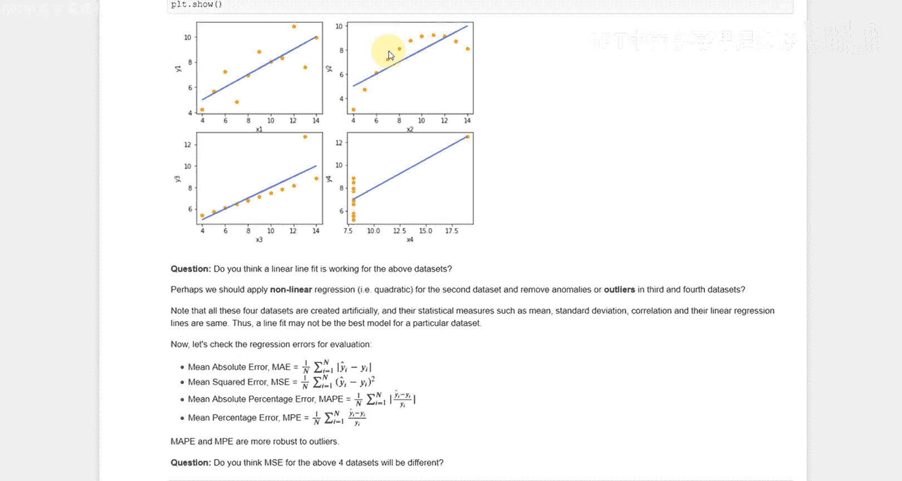

# 约翰霍普金斯大学《应用机器学习｜Applied Machine Learning》中英字幕 p29 5_线性回归.zh_en -BV13xuqzYErx_p29-

🎼。

Dear students， in the previous modules， we have seen supervised learning where the output was a categorical output。

We were trying to predict if the output would be class A or B， or in a multiple categorical version。

 class A， B， C， D， or E。Now imagine we want to predict the actual value of the output， for example。

 house prices， stock markets， average age， we cannot categorize the dependent variable beforehand。

 we do not want to divide the space into two binary class  zero and binary class1。

 but rather we want to keep the dependent variable to be able to have a trend like a mathematical expolation without specifying a region in the variable space。

In historical analytical solutions for economics or similar application fields。

 regression was the main tool rather than categorical distinction using a particular classifier Now how can we do regression？

We can have linear regression where the input independent variable is single dimensional x is element of R in this case。

 or multiple linear regression where x is element of RM and that is very typical for our classification problems or machine learning problems where we have M features or multivariate linear regression where the dependent variable y is a dimension greater than1。

 this is out of our scope。We will focus on the linear and multiple linear regression in this module。

 Now， this problem behaves nicely。 It's a linear line。

 Y equals B0 plus B1 x that we want to fit to our data。

 There is a direct solution to that optimization problem where the cost is L2。 L2 meaning。

We take the square of the errors and then sum up。 L1 would be the absolute value of it。

 There's no direct solution for that。 But when we use our cost function as this。

 there's this direct solution that we will apply in this。Sell。We have some candidate data， input y。

Is your dependent variable。Input X is your independent feature， single dimensional。

It behaves like this in a perceptron。We would fit a line in between if we knew these ys are 0 and 1。

 for example。 So it's a classification problem when we try to divide the space into two。

 but in a regression problem， we want to fit a line or a curve。To this， let's say。

 behavior of the variables。 If we want to fit a line， it is linear regression。

 And here a line is fitted using。This solution。And in the second， in the third plot。

 we computed the residues， the each of the error between the actual and the predicted value。

 and then computed the total error here and an annotated it。

 we can find out the new y for the new X using this line。 For example， if I receive x S 5。

 Then the predicted y would be somewhere around 2。75。 I can compute that value using this line。

I've already computed B0 MB1。 So I know the line。 Okay， how does it compare to other methods。

 What are the advantages of regression， What are the disadvantages of regression。Advantages。

 it's obvious。We have real values。 We have actual values using this model。 There is no category。

 If you want to apply linear regression to a particular classification problem。 It's possible。

 It's called logistic regression， for example， we will see that momentarily。 However。

 we have to modify the problem a bit differently。 As you see， there's no class here。

 only the y variables。 I do not know if y equals 3 is class 2 or not。

I do not know if input y when it's 0。5 is class 1 or not， because I do not have that information。

 however， I have the y values， and then I' am fitting x Y values a line in this case。

The disadvantages of the regression is in the following example from pretty early times。

 Ancombi's quartet。Is analyzed to see if a linear regression is a good model or not。 For example。

 these four sets of variables。Have these linear regression lines， Not as something。

 These lines are exactly same because the data is fit to the line。Accordingly。

 all of their mean and standard deviation are same。

 So the statistical properties of these four sets are same。 Their behavior is very different。

 In this case， it's like a regular data。 In this case， it's quadratic。 In this case， it is line。

 but there's an outlier。 In this case， it is， again， a line， but there's an outlier。

 If I can get rid of these two outliers。The first line would be close to the regression line。

 The second line would be totally different。 Now， clearly。

 without looking at the second third moments， statistical moments。

 we cannot say if this is a good fit or not。 We compute the residues， but then again。

 the residues might be very close。 Thus， we have four different measures。Mean absolute errors。

 square errors mean absolute percentage errors and mean percentage errors defined as in these metrics。

 When we compute these metrics for the above input data。 We have these outputs。

 M Ae are varying M C incredibly close mean square errors。 Well， of course。

 because the data is set accordingly。 It mean and standard deviation are same。

 We cannot use M C to differentiate between these four models。 M P E are very different。 for example。

 I can see a clear distinction on the third one compared to the one to and4 M is also different for the second one。

 and M A E actually gives a good indication that these are different。 the best one is the second one。

 The first one is the third one。 Let's see。The best one is the second one。

 and the first one is the third one。But it's not verse for the fourth one。0。9。

So the best strategy is looking at all these metrics。

 looking at visually adding more metrics for a second moments， third moments or fourth moments。

 and then deciding on。We can also do some outlier analysis。

 Look at the differences between the centroids and the actual data points。 If I cluster， for example。

 this one would cluster nicely on this ellipoid。 This would be a second cluster。

 This one would cluster nicely again， an ipoid。This would be an outlier。 This wooden cluster。

 this wooden' cluster。 but then my absolute error and squt error gives an indication。

Now， let's see logistic regression in the following video。

