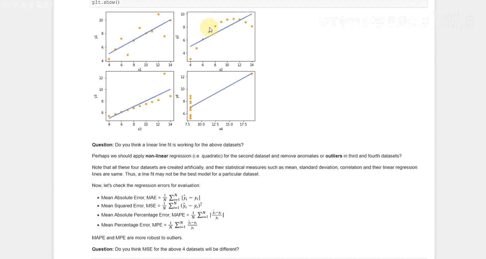

# 应用机器学习：5：线性回归

在本节课中，我们将要学习线性回归。这是一种用于预测连续数值输出的监督学习方法。我们将了解其基本概念、如何求解、评估指标以及它的优缺点。

## 从分类到回归

在之前的模块中，我们学习了输出为分类的监督学习，例如预测输出是A类还是B类，或者在多分类问题中预测A、B、C、D或E类。

现在，设想我们想要预测输出的实际数值，例如房价、股票价格、平均年龄等。在这种情况下，我们无法预先将因变量（输出）归类。我们不希望将空间划分为“0类”和“1类”这样的二元类别，而是希望因变量能保持其数值特性，从而在变量空间中呈现出类似数学外推的趋势，而不是划定特定区域。

在经济学或类似应用领域的历史分析解决方案中，回归是主要工具，而不是使用特定分类器进行类别划分。

## 什么是回归？

那么，如何进行回归分析呢？我们可以使用线性回归。

*   **简单线性回归**：输入的自变量是单维的，即 **x ∈ ℝ**。
*   **多元线性回归**：输入的自变量是多维的，即 **x ∈ ℝ^M**。这对于我们拥有M个特征的分类问题或机器学习问题非常典型。
*   **多变量线性回归**：因变量y的维度大于1。这超出了本模块的范围。

在本模块中，我们将重点讨论简单线性回归和多元线性回归。

## 线性回归模型

这个问题处理起来很直观。我们试图用一条直线 **y = β₀ + β₁x** 来拟合我们的数据。

存在一个针对该优化问题的直接解法，其成本函数是L2范数。L2意味着我们取误差的平方然后求和。L1范数则是取误差的绝对值，但L1没有直接解法。当我们使用L2成本函数时，存在我们将要应用的直接解法。

## 拟合过程

我们有一些候选数据。输入y是你的因变量。输入X是你的自变量特征（单维）。在感知机中，如果我们知道这些y是0和1（例如），我们会在中间拟合一条线来划分空间，这是一个分类问题。

但在回归问题中，我们希望拟合一条线或曲线来描述变量的行为。如果我们想拟合一条线，那就是线性回归。这里，使用上述解法拟合了一条线。

在第三个图中，我们计算了残差，即每个实际值与预测值之间的误差，然后计算了总误差并进行了标注。我们可以使用这条线来预测新X对应的新y。例如，如果我收到x=5，那么预测的y大约在2.75。我可以利用已知的β₀和β₁来计算这个值。

## 回归的优缺点

线性回归与其他方法相比如何？回归有哪些优点和缺点？

**优点**很明显：我们得到了实际数值。使用这个模型，我们得到的是实际值，而不是类别。如果你想将线性回归应用于特定的分类问题，也是可能的，例如我们稍后会看到的逻辑回归。

然而，我们需要对问题进行一些不同的修改。如你所见，这里没有类别，只有y变量。我不知道y=3是否属于第2类，也不知道当y=0.5时是否属于第1类，因为我没有这些信息。但我有y值，然后我（在这种情况下）为x和y值拟合了一条线。

**缺点**在以下这个很早的例子中有所体现：安斯库姆四重奏。它被用来分析线性回归是否是一个好模型。

例如，这四组变量都有这些线性回归线。这些线是完全相同的，因为数据是根据线来拟合的。相应地，它们所有的均值和标准差都相同。所以这四组数据的统计特性是相同的，但它们的行为却非常不同。

*   第一组：看起来像常规数据。
*   第二组：呈二次曲线关系。
*   第三组：呈线性关系，但存在一个离群点。
*   第四组：再次呈线性关系，但存在一个离群点。

如果我能去掉这两个离群点，第一组的线将更接近回归线，而第二组的线将完全不同。显然，如果不看二阶矩、三阶矩等统计矩，我们无法判断这是否是一个好的拟合。我们计算了残差，但残差可能也非常接近。

## 评估指标

因此，我们有四种不同的评估指标：

*   平均绝对误差
*   均方误差
*   平均绝对百分比误差
*   平均百分比误差

其定义如下列度量标准所示。

当我们为上述输入数据计算这些度量时，我们得到这些输出。平均绝对误差各不相同，均方误差非常接近（当然，因为数据集是据此设置的，均值和标准差相同）。我们不能用均方误差来区分这四个模型。平均百分比误差非常不同，例如，我可以看到第三组与第一、二、四组有明显区别。平均绝对百分比误差对第二组也不同，而平均绝对误差实际上很好地表明了这些模型是不同的。

最好的模型是第二组，最差的是第三组，但第四组是0.9。因此，最佳策略是查看所有这些指标，进行可视化分析，添加更多关于二阶矩、三阶矩或四阶矩的指标，然后做出决定。

我们还可以进行一些离群值分析，查看质心与实际数据点之间的差异。例如，如果进行聚类，第一组数据会很好地聚类在这个椭圆体内，第二组会是第二个聚类，第三组会再次很好地聚类在一个椭圆体内，但那个点是一个离群值。第四组不会形成好的聚类。但我的绝对误差和均方误差给出了指示。

## 总结

本节课中，我们一起学习了线性回归。我们了解了它如何从分类问题延伸到预测连续值的回归问题，掌握了简单和多元线性回归的基本模型 **y = β₀ + β₁x**。我们探讨了使用L2成本函数进行拟合的直接解法，并通过安斯库姆四重奏的例子认识了回归模型的优缺点。最后，我们介绍了多种评估回归模型性能的指标，如平均绝对误差和均方误差，并认识到需要综合多种指标来全面评估模型。

现在，让我们在接下来的视频中看看逻辑回归。