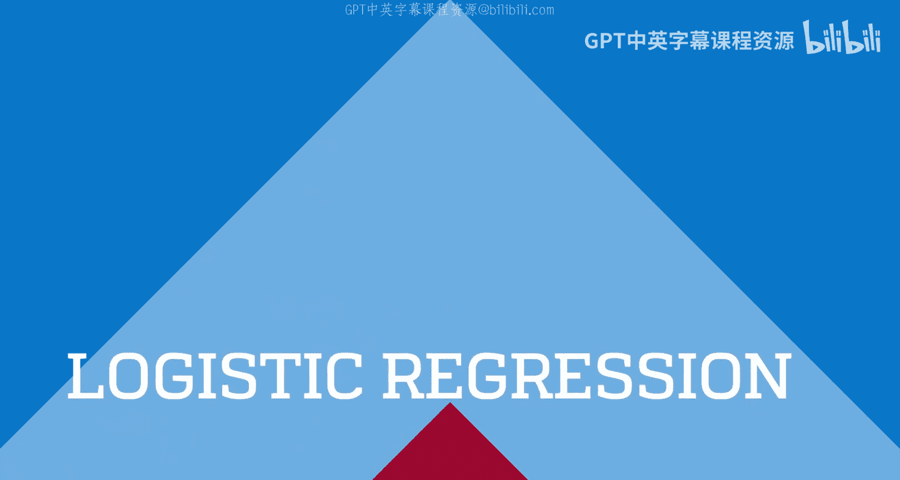
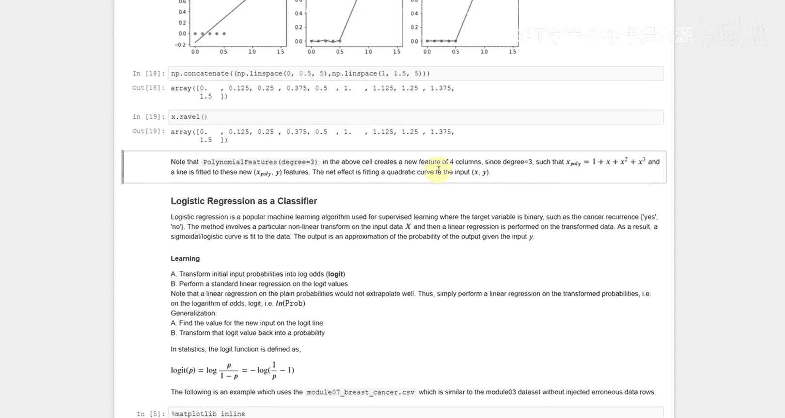

# 约翰霍普金斯大学《应用机器学习｜Applied Machine Learning》中英字幕 p30 6_逻辑回归.zh_en -BV13xuqzYErx_p30-

🎼。

Reggression is a cure fit to the data Log regression was invented when researchers and engineers wanted to apply the cure fit to a probabilistic variable。

 a dichotomy drawing values 0 or1。A linear regression cannot be used when the acceptable range is 0 and1。

 because the linear regression line can extrapolate in either direction。 However。

 a sigmoid function would work much better。You remember the sigmoid line。

 sigmoid function from neural networks， or we will see that in the following modules。

 And also in the following cell， we show that a linear regression。

 a quadtic regression and the sigmoid regression or logistic regression differences now。

In this example。Our variables are set， as in this plot。The x values go from 0 to 1， and the y values。

 like a probability tip， takes value from the set of 0 n1。

Imagine I'm not using probability density functions in like in naive base。

 but I'm collecting the probabilities， and I'm fitting a curve to that。

 Why am I fitting a curve because I can deal with missing data。

 I'm not fitting a particular Gaussian curve as in the naiveese example。

 But Im fitting a curve directly into the probabilsistic values， In this case， a logistic regression。

This particular cell also demonstrates the polynomial features。 For example。

 if I fit a linear regression to this data， it's not that good。I'm not covering these input values。

 where it takes。Numbers between 0 to 0。5。And tears。1 to 1。5。 Of course， this can be anything。

 This is this X axis。 is your feature。 It can be anything， or we can scale it to 0 and 1。 However。

 the y is a pro variable。 It takes values from 0 and 1 set。

 So there is a probability associated to that。 If I fit a line directly using linear regression。

 the line is like this Quadtic regression。 Well， not bad。 if I increase the degree to 7。

 it fits better。 For example， I can change it very very easily。

We are using the methods directly from the SKLn linear model for polynomial features。

 I have to convert the input features to polynomial features。 I'm adding more columns。

As in the situation。Since degrees 3， I set it myself， the equation is  one plus 3 degrees。

 If this was 7， it would be 1 plus 7 more variables， depending on the x's。

 X to the one x to the2 x to the3 x to the4 goes like that。Now， let's increase that degree to 7。

And then rero this。I have to rero the whole notebook， of course。I have not。Included the。Libraries。

 when I download this notebook on my machine。The output is there， but the libraries are not imported。

And then I'm running this。You see， it's not degree3， of course， I set it to degree7 now。

And it is a better fit， but still， there are ripples。

 If I fit a logistic regressionggression to this。It will be behaving like a sigmoid function。

I do not have to code anything in the previous cells。 I calledd the linear regression。

 but not in this cell。We have linear regression polynomal features for the quadratic。

And for the sigmoid， I have the function。This sigmoid function is scaled by a and shifted by B。

 those are two parameters to be optimized。And then I fit a curve using the sigmoid function。

 and my input and output variables are x and y， the cur fit from optimization uses an internally selected optimization function。

 and then it will find out the A and B for me， any variable after the X are the set of variables to be optimized。

 if I have A， B， C D， E， I have five parameters to be optimized。This curve fit。

 they return those five optimized parameters in the pop T。 Thus。

 I am using my sigmoid y predictions using that sigmoid function and passing those parameters。

 in this case， to AM M B。 this the tuple， when I call it star tuple。

 it opens up each of the value inside it。 So in this fashion， my length of the tuple is variable。

If there are5 parameters， ABC DE。This P T will have five values to be passed to this soid。

 There is one unfortunate variable format。 The linear regression and the a polynomial and linear regression uses。

X S 2 d arrays， and then it needs a column vector， however， the cur fit it uses an array。

 a single dimensional nui vector， let's say， so thus here this is buildingmp concatetnate linear space linear space。

 this is building a 1 d vector with 10 values new axis adds the second dimension of size 1。

And then it takes the transpose of it。 Similarlyly， Y is treated accordingly。

 The best way to check how these work is to。Create a cell after this cell， for example。

 and look what I have。X is this two dimensional array。 How do I know。

 Because of these two square brackets around it， And it's a column vector。

 My original x was only this， the combination of。This much。If I run that。It's a single array。

So these linear regression library functions they do not like。This format directly。

How do I know reading the APIs， unfortunately there's no other way it's someone else's program。

These library functions， I have to learn them by using the APIs， the documentation。

 reading and then trial and error。 if I pass this particular X。To the curfe here， it doesn't like it。

 so I take it back to the original form。Let's create another cell and compare。

You see xral is same as my original array without those 2D and column transformations。Still。

 these are incredibly powerful library functions that I want to use。

So the logistic regression fits nicely to the probabilistic variables。

 How do I use it as a classifier。

