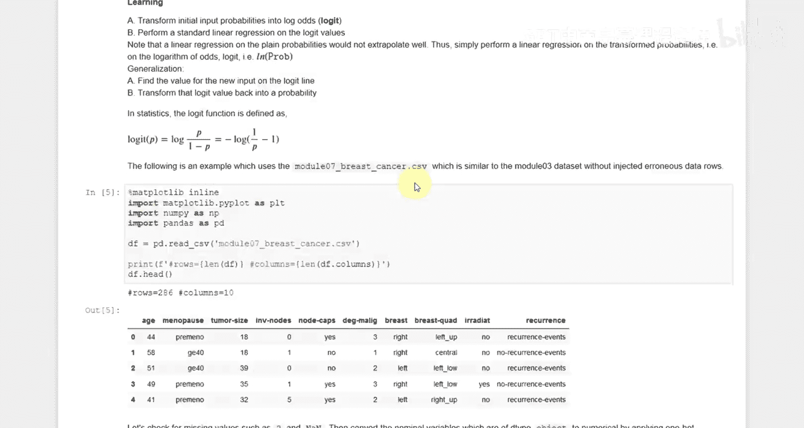

# 约翰霍普金斯大学《应用机器学习｜Applied Machine Learning》中英字幕 p31 7_逻辑回归分类器.zh_en -BV13xuqzYErx_p31-

🎼。

Previously， we have seen other classifiers for supervised learning such as random force， Naive Base。

 SVM， neural networks。But logistic regression is also a very powerful classifier based on regression and the input probabilities。

 how do we use it as a Cifier we will demonstrate with a particular data set。Now。

 if I know that I cannot fit a particular probability density function。

 then logistic regression is a good candidate。 It solves an optimization problem to fit a sigmoid base Lo cure to the data and the data is probabilistic。

 It is transformed into probabilistic representation。 You see， support vector machines， for example。

 are distance based。 We do not care about any proba distribution。 Naive base is pure probabilistic。

 We assume the features are based on Gaussian distribution。 Lo regression is in in between。

 We assume there are some probabilistic features， but we do not assume anything about that proba Rather with fit curve into that probabilistic data and logistic regression。

 That's why it it's very powerful because it doesn't assume anything Today。

 we do not assume anything about the underlying distribution because we cannot。

Because we will never know the reality， thus not assuming anything is a winning strategy when it comes to classifier pick In this case。

 were using module 7 breast cancer data， it is similar to the data in module 3 without the erroneous data rows。

 we compare everything to probabilityty in terms of features， and of course it's a binary classifier。

 So if features value x is4 class 0， it's p if it is for class 1 then it's 1 minus p。

 we take the logerim of those proties， which are called logit log odds。

And then fit the cure accordingly， we will not focus on the details of the implementation of a logistic regression classifier。

 but we will use directly from the library。Sit learn as linear model logistic aggression。Now。

These cells show preprocessing of that particular data set a bit differently from module 3。

 First thing we do is explore the data。 We load the data into our data frame。

 pandas is very powerful。 We look at the data。 There are numerical variables H。

 There are categorical variables like menopause numerical numerical。 we have binary variables。 Yes。

 no， we have to convert everything to numbers。 Of course， for the categorical ones。

 we will convert using one hat encoding。 I know that recurrence。

Is the dependent variable by looking at the patient diagnosis， parameters。

 I am trying to predict the recurrence of the cancer。 Does it recur or not。 So the first thing。

 we are checking if we have any nauns or question marks。

 Que mark can be for some categorical Nn can be for numerical。 And of course。

 the object represents the string， right， for each of the menopause， not caps， breast breast qua。

 irradiation will be objects because they are string values。

 I will drop the question marks and the Nuns， and then check how many rows and columns we have。

 Of course， we have 10 columns。 We have not done one not encoding yet。

 and we have 286 at the beginning，2，77。 now， we dropped some rows。Convert everything to numeric。

This particular function。Creates the names in a well mannered fashion so that I will know like this menopause greater than 40。

 menopause less than 40，1 hat encoded T T variable name。

Add the category and then build the one hot encoding。 So after two numeric in this fashion。

 I still have everything think at my disposal。 I mean， I can see。The actual variables。

By looking at this， because I kept the variable names。

 the category in the name so I know G411 in these two data rows and add00 on the other column of course。

 the one at encoded variables 1，2，3 menopause will be mutually exclusive clearly okay。

 so I created the data set recurrence。Will be handled separately， of course。

 because it's a dependent variable。 The first thing I am doing is checking if the problem is balanced or not。

 Ily， I would have 50% no recurrence，50% recurrence。 In this case， it is like 3070， not that bad。

 But if this was like 99 versus 1。It would be a very difficult problem。

 I wouldn't use accuracy directly。 I would use F1 score only small category like recur with 1% in this problem。

 I could use F1 score as well on the recurrence events。 but I didn't。

 we are using regular crossval and accuracy， which is okay。 It's almost balanced。

 Now the rest is the classifier 10% clock cross fault。

 if you remember our accuracy was around 70% in module 3， we didn't improve upon that， however。

 we using logistic regression to demonstrate more things like， for example， ranking the variables。

 we can rank the variables。 by looking at the residue。In the curfe， these cells demonstrate。

 The first one demonstrates the accuracy。The second one demonstrates the gain of each of the feature。

 I am sure if we show this to a particular subject matter expert from cancer treatment。

 degree malignants would be immediately known to the subject matter expert and the tu size。

 Those probably are the two and the imverted nodes。

3 most important features to tell about the status of a cancer patient。 Now。

 how would we use this model that we trained for unknown data。 We have to build the data accordingly。

 In this case。We built two new data points in this fashion。I created a new data frame。

 I have two data points， and I'm passing it as a data frame。 And， of course。

 this is in the original format for the subject matter expert， the original format is important。

 Not the one one had encoded， which was prepared for particularly the logistic regression library。

 So I built this made up data points。 There are two data points in this fashion。

 I do not know which one will have recurre or nor recur， depending on our model。 The first thing。

 of course， we convert this to the models format。 The model was one had encoded。With did do。And then。

 we check。The predict， this whole line takes the values predicted inverse transform because I encode it with the label encoder and un print the results。

So that shows me the first data point is not recurring， the second data point is recurring。

You see the degree malignant。 It's 15 here。 I bet if I increase this from 4 to 10。

 the first one will be recurd as well。 That was the most important feature， as ranked here。

If one analyzes this whole pipeline。It includes almost everything。

 This is supervised learning pipeline， of course， using logistic regression and regression at the core of the learning method。

 that's all for this module。

