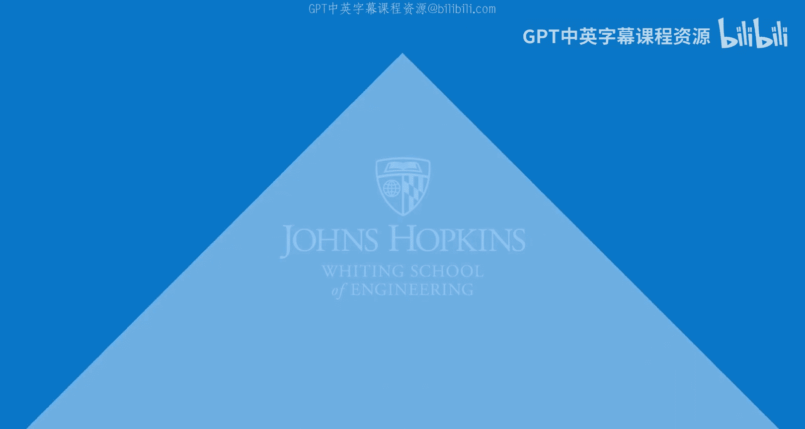

# 约翰霍普金斯大学《应用机器学习｜Applied Machine Learning》中英字幕 p32 8_无监督学习概述.zh_en -BV13xuqzYErx_p32-

，🎼In this module， we will study un superervised learning。As the counterpart to supervised learning。

 unsupervised learning attempts to build the underlying problem to distribution of a dataset。

🎼Based on its features as random variables。Unsupervised learning can also find out outliers and centroids of densities。

🎼We will first define distance and similarity metrics that clustering algorithms have to utilize。

 then briefly describe popular unsupervised learning algorithms such as K meanss， D scan。

 hierarchical clustering and expectation maximization Further we will define a few metrics that provide information about the quality of generated clusters。

Including 3D visualizations and enddoograms。🎼We will use the same artificially generated data set of supervised learning module and apply a clustering to it。

🎼Then we will show how clustering is performed on the I data set by utilizing several different clustering algorithms In parallel。

 we will also demonstrate how to use the elbow method。

To decide about the number of clusters to be generated。

