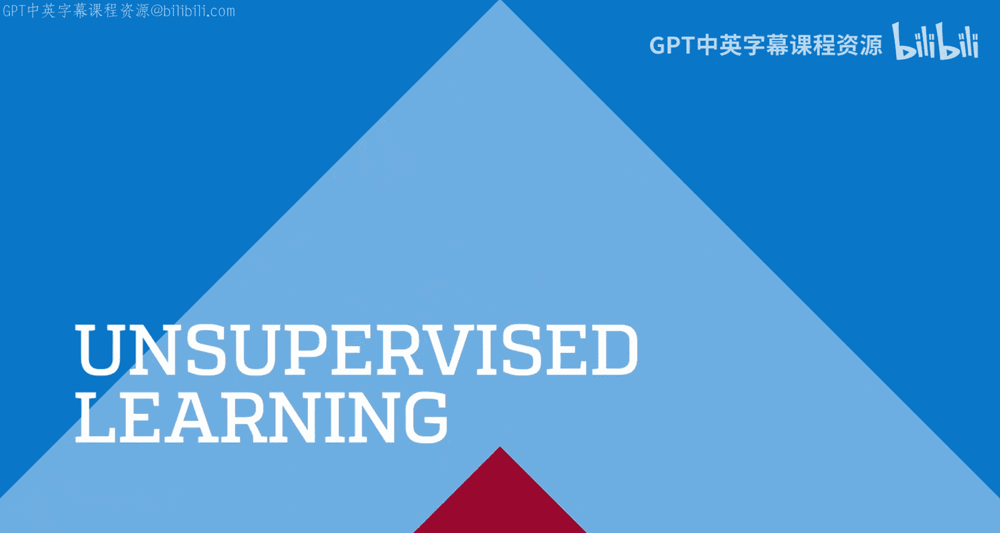
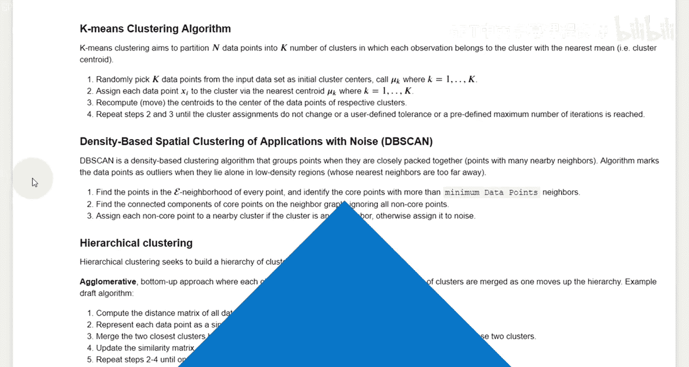

# 约翰霍普金斯大学《应用机器学习｜Applied Machine Learning》中英字幕 p33 9_无监督学习.zh_en -BV13xuqzYErx_p33-

🎼。

Dear students， in this module， we will look at unsupervised learning。In contrast。

 unsupervised learning does not have the ground root or labeled data as in supervised learning。Now。

 we may have the ground truth but still apply unsuperprivised learning。

 the ground route will then be used not in learning but in evaluation。

So you don't have to use unsupervised learning if you don't have the ground truth or have to use supervised learning。

 if you do have it， depending on the situation， we might be interested in different things。

Where supervised learning provides certain things， unsupervised learning provides other things。

For example， in unsupervised learning， we can answer what is the normal in the data。

 What is the baseline， What can be the population probability to density function。

Or we can filter our data set using animal detection， which is provided by unsupervised learning。

We might have ground truths， we might need to apply supervised learning to develop a model。

But we can employ unsupervised learning on the labeled data to find the outliers。

 It's a mix and match situation。 We can apply supervised or unsupervised learning no matter whether we have the ground truth or ground truth in the dataset set。

But we can decide which one to apply or sometimes both， depending on what we want to do。

We can talk about types of clustering， hard clustering， soft clustering， generally in this lecture。

 in this course we will do hard clustering， we will not use fuzzy clustering where a particular data point can be a member of any cluster more than one cluster。

But having a membership value to those clusters。 Now， let's look at major clustering algorithms。

 The first thing we need is some kind of distance or similarity metric。

 a distance or similarity metric。 How to have these properties。 It has to be non negative，0 or more。

Up to infinity， it has to support identity， meaning the distance between two data points would be0 if those data points would be same symmetry。

 distance between a to B and the distance between B to A are same are equal and the triangleic inequality。

Given a third point， Z， the distance between x to y， like a hypotenus。

 has to be shorter than the sum of those two distances from A to C and then C to B。

These are some popular metrics， Euclidean distance。

 Manhattan distance is just the absolute value instead of squares。Chibbushave distance。

 cosine similarity， which is very， very popular for text clustering jaard index。Now， as you see。

 the first four are distance based or similarity based。 there can be also probabilties。 However。

 Jaard index is a set similarity。 In this case， X， C， K， these are sets。

Xi is an element from a particular set and C。Is the representative set for that representative element or cluster centroid in this case。

 from that particular set， C K can also be the full set instead of the centroid of that particular set。

 Now， when we look at。Popular clustering algorithms we see that there's K means， DB scan。

 which is density based， hierarchical clustering， and some probability based expectation maximization。

The first thing I would try would be gaming meanss， it's fast， paraizable， it's reliable。

 it creates clusters like es or circular clusters around the centroids。

 and most of times it works fine。Dense the based clusterings are applied when we know that the data points are based on some density。

 The textbook has very good examples on this。Hierarchical clustering is a more general approach where the clustering generates every possible cluster in terms of every possible cluster size。

 we can pick the best cluster that suits our needs， but one clustering can generate all of them。

Expectation maximization is based on the PDFs， either ML or map estimates。

And this is a very slow algorithm in general， we have to apply k means first。

And unheerarchical class ring next。Depending on the situation。

 if we know that there's an underlying probability distribution， we can use expectation maximization。

 or if we know that theres no probability， but it's like density，Then we can use DB scan For example。

 DB scan is a popular approach in databases as you can think of the databases can have many data points similar to each other。

 say a transactional data for example， and then the DB scan can work well in those there is no PDFf associated at all。

 Its spacebased spatial clustering based on the number of data points around a centroid。

 the epsilon neighborhood of a point is defined as the epsilon distance of a particular data point where we can talk about minimum data points in order to consider a data point either a centroid or a particular element to be included in the cluster。

 it has to have a minimum data points to other data points close to each other。

 So it's a very good algorithm that can detect outliers not based on any kind of。

the distribution or circular distance as in K means now。

 unsupervised learning and all the algorithms could easily be a full course on AI or machine learning in this single lecture。

We will focus on how to apply them， rather than examining the algorithms the different approaches。

