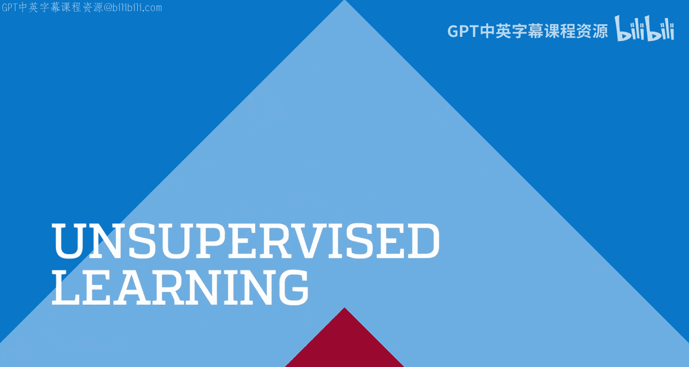
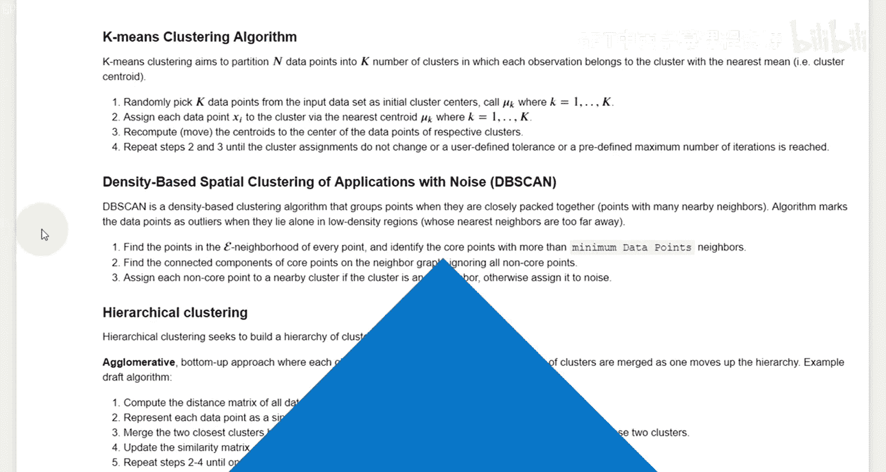

# 应用机器学习：9：无监督学习

在本节课中，我们将学习无监督学习。与有监督学习不同，无监督学习没有标注数据或“标准答案”。我们将探讨其核心概念、常用算法以及如何根据任务需求选择合适的方法。

## 概述

无监督学习不依赖标注数据。我们可能拥有标准答案，但仍应用无监督学习，此时标准答案仅用于评估而非训练。是否使用无监督学习，取决于具体任务目标。有监督学习能解决某些问题，而无监督学习则能回答另一些问题，例如：数据中的“正常”模式是什么？基线是什么？数据的概率密度函数是怎样的？我们还可以利用无监督学习提供的异常检测功能来过滤数据集。

## 核心概念与度量

上一节我们介绍了无监督学习的基本思想，本节中我们来看看其核心的度量方法。

首先，我们需要某种距离或相似性度量。这些度量必须满足以下性质：
*   **非负性**：距离值必须大于或等于0。
*   **同一性**：两个相同数据点之间的距离为0。
*   **对称性**：从点A到点B的距离等于从点B到点A的距离。
*   **三角不等式**：给定第三点Z，点X到点Y的距离（如斜边）必须小于或等于从X到Z与从Z到Y的距离之和。

以下是几种常用的度量方法：
*   **欧氏距离**：`d(x, y) = sqrt(∑(xi - yi)^2)`
*   **曼哈顿距离**：`d(x, y) = ∑|xi - yi|`
*   **切比雪夫距离**：`d(x, y) = max(|xi - yi|)`
*   **余弦相似度**：`similarity = (A·B) / (||A|| * ||B||)`，在文本聚类中非常流行。
*   **杰卡德指数**：一种集合相似度度量，`J(A, B) = |A ∩ B| / |A ∪ B|`。

前四种是基于距离或相似度的度量，也可以基于概率。杰卡德指数则是集合相似度，其中X和C是集合，Xi是集合中的元素，Ck可以是该集合的代表元素（如聚类中心）或整个集合本身。

## 主要聚类算法

了解了距离度量后，我们来看看几种主要的聚类算法。

以下是几种流行的聚类算法：
*   **K均值聚类**：快速、可并行化、可靠，能生成围绕质心的类球形或圆形簇。
*   **DBSCAN**：基于密度的聚类，适用于数据点基于某种密度分布的场景。
*   **层次聚类**：一种更通用的方法，能生成所有可能的聚类结果（不同聚类数量），我们可以从中选择最适合需求的一个。
*   **期望最大化**：基于概率密度函数，使用最大似然或最大后验估计，通常速度较慢。

## 算法选择与应用场景

我们已经了解了各种算法，现在讨论如何根据具体情况选择。

通常，我会首先尝试K均值算法，因为它快速且在大多数情况下效果良好。当我们知道数据点基于某种密度分布时，可以应用基于密度的聚类（如DBSCAN）。层次聚类能生成所有可能的聚类，我们可以从中挑选最佳结果。期望最大化算法基于概率分布，通常较慢，可能需要先运行K均值进行初始化。

选择取决于具体情境：
*   如果知道存在潜在的概率分布，可以使用期望最大化。
*   如果知道没有概率分布，而是基于密度，则可以使用DBSCAN。例如，在数据库领域，DBSCAN是一种流行的方法，因为数据库可能包含许多彼此相似的数据点（如交易数据），DBSCAN在这些没有关联PDF的场景下效果很好。

DBSCAN是一种基于空间密度的聚类算法。一个点的ε邻域定义为该点周围ε距离内的区域。算法要求一个核心点在其邻域内必须拥有最少数量的其他数据点。这是一个非常好的算法，可以检测异常值，且不依赖于K均值中的那种分布或圆形距离假设。

## 总结

本节课中，我们一起学习了无监督学习。我们了解到无监督学习不依赖标注数据，可用于发现数据中的模式、基线和异常。我们介绍了核心的距离与相似性度量，并探讨了K均值、DBSCAN、层次聚类和期望最大化等主要算法及其适用场景。无监督学习及其所有算法本身就可以构成一门完整的AI或机器学习课程，本讲座的重点在于如何应用它们，而非深入剖析每种算法的细节。