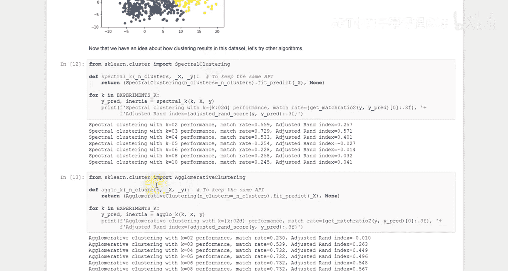

# 约翰霍普金斯大学《应用机器学习｜Applied Machine Learning》中英字幕 p34 10_无监督学习实例演练.zh_en -BV13xuqzYErx_p34-

🎼。

Measuring the quality of clustering is based on distance metrics。For example， in cluster separation。

We look at entire cluster distance， compute distance between each cluster and then take the average of it。

 cluster cohesion， again， its intra cluster。Look at the average of distance between the elements and the centroid of that particular cluster。

 if we have k capital K clusters， then we have capital K many intrac distances in this notebook。

 we will look at clustering scoring using accuracy and random index R index is more sophisticated not necessarily providing you an excellent metric。

 there is no excellent metric in my opinion for clustering。

 looking at the looks of the clusters as we will see in a moment。

 looking at the cluster separation and cohesion and some scoring if we have the ground truth of course。

 will help， but rather coming up with a confusion matrix like universal evaluation method in unsupervised learning。

 there is no a single metric that can explain the quality of the clustering we have to look all of them and。

Times visually。Now， in this worked example， we are creating the same data set that we used in supervised learning。

 If you remember， this is the exact same data set we used。There are five clusters or five categories。

 There are distance based。 There are two features， and they are generated by this many samples with these standard deviations around the center。

And also， the center locations， as in this list。So the first thing we apply is cas。 Kas is， again。

 repeating an excellent starter cluster， and probably the single cluster that would work very very nicely in many respects。

 You can specify how many clusters you want。 You can initialize according to some criteria。

 For example， apply some kind of initial clustering to determine the initial centroids。

 Kaing means is iterative。 You have to run so many times until no wigglings。

 no movements occur anymore。 We also use a seed。Because it can be used for shuffling auto datata points and so on。

 the API for sakeit learnn for clustering or for supervised learning algorithms is same。

 you just created you fit and then predict in this fashion Now certain implementations of the clustering algorithms have also inertia inertia is the amount of change in the centroids It's a good indicator to see if the clustering converged or not As you can guess。

 the inertia will get less and less as clusters become rigid as we create the final clusters with iterations going on Now we created this match ratio function to compute the contingency matrix。

One cluster string issue， not the issue， but something to be worked on is the cluster IDs mapped to the ground route when we run the cluster string it will give us some IDs cluster Is from zero to so many clusters in this case n clusters however those Is may not match the ground route if we just compare one to one。

 we will not make a correct comparison so we will use the contingency matrix from nuy to find out which ID maps to the original this function works well。

 we will use the nuy arm arc max of that contingency matrix of Sk learn to find out the mapping between the cluster I generated by the algorithm and the cluster Is of the ground route we will update the predicted accordingly basically it's just reshuffling of the IDs and then match will work so。

Small function will map the IDs to the ground route correctly using contingency matrix and then update the predictions。

 compute the match and return the match， which is an accuracy with the updated predictions we will run the experiments for cluster sizes from2 to 10 jumping you know 7 and9 this very typical it's like dynamically scaling case so that we don't have to run linearly and you know consume too much unnecessary time When we run it。

With different cluster sizes， meaning number of clusters to be generated。

 the accuracyies here adjusted random leus here。 Well， do we think the match rate is correct。

 even though we generate tank clusters， Well， we will answer that momentarily。Now。

 the textbook talks about the elbow method using the inertia。 This is a good demonstration。

 We run for this case， from  one to 30， not jumping around because we will plot。

 This is the accuracy。 blue， and this is the inertia generated by the clustering algorithm as number of clusters increase。

 the inertia drops down， of course， and a good elbow would be here， which is5。

 which is the actual number of clusters in the ground truth， right。

The original would be here in terms of accuracy， however， as I gave you a hint。

 this accuracy is not entirely correct。And this shows it。 Well， if I map using that function。

Match ratio。Look how the clusters are formed。But this is not provided by the。Clluing algorithm。

 I used the ground route to map these points to the actual data points， which I kind of treat myself。

 This is not the correct way of evaluating this。 There are five clusters nicely mapped to the ground route。

 if I didn't have the ground route。 I would have no idea this nice clustering。

 So I will update the match ratio to use the contingency only once。

Once a particular ground root ID is mapped to the generated clustering ID。

 I will not touch it anymore。If I map accordingly， these are the actual clusters that are generated。

 this is with K。7even。And there are 1，2，3，4，5，6，7 clusters generated。 Now。

 I can decide if this belongs to that cluster and similarly these。 However。

 the big cluster is divided into four clusters。 actually。

 I will pick only one of these clusters mapped to the ground root。

 and only one of them will be correct。3 will be incorrect。

 This particular function takes the first one available from the contingency matrix。

 not necessarily the biggest one。 It can be updated to map to the biggest cluster available。

 But this is a correct evaluation。 When I updated my accuracy accordingly。

 you see the accuracy maximizes at K4 drops a bit and then stays there。 Any other small clusters。

Is not mapped to the ground truth and doesn't increase my accuracy。 Rand index converges around 0。5。

It basically applies this method。For our purposes， it is a more sophisticated contingency。

 We will leave the details in this notebook。And when they plot。This is the real evaluation。

 the correct evaluation。 the accuracy maximizes here and then drops down。 And， of course。

 this can be improved a bit by mapping the biggest cluster to the ground root。

 not the first one as I implement above。 Again， the inert same is just to give you an idea about the cluster size that you have to decide。

 we have the ground truth in this data。 So we know K5 is the best or excellent one。

 but the inertia also reflects that。 I would pick4 or6。 Still， I would be doing okay。

 When I cluster with 51，2，3，4，5， Unfortunately， these two clusters are combined。

 Now I am doing a correct evaluation。 and above results reflect my performance。

 The following cells also demonstrate spectral clustering， which is a good approach。

 strong approach depending on the data and the hierarchical clustering。

And the results are here。

