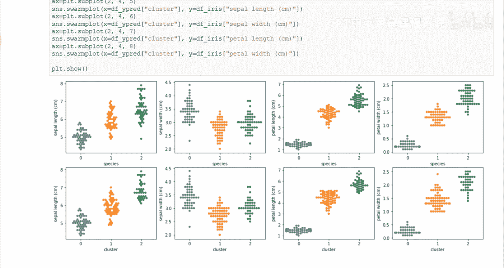

# 约翰霍普金斯大学《应用机器学习｜Applied Machine Learning》中英字幕 p35 11_无监督学习可视化鸢尾花数据集.zh_en -BV13xuqzYErx_p35-

🎼。

Unsupervised learning， visualizing I dataset set。Now let's look at another real world data set called the I data set。

 This is the famous flower data set which many machine learning notebooks and lectures use。

So S scaleL data sets have it， of course we use pandas to process it， and here is the data。

 as you see it's numerical， there are four features plus the category， and it's equally balanced。

We have same amount of data in three categories。 We use SNS because， you know。

 it's pretty easy to generate any kind of plot using pandas with SNS and to be honest。

I wanted to show another plotting library， Seabornour。This is the data we have at hand。

These are four features mapped to the categories。 as you see they overlap in every feature。

 maybe except for this， Setosa doesn't overlap petal length wise with the other two。

So if the machine learning algorithm is good enough。

 it will use petal length to differentiate between Setosa and the other two classes。

 there's also a good separation for petal width。For Setosa。

 these two classes Ver call around Virginiaica。The overlap in every feature。

 but of course using four features combined might differentiate between between these two classes。

 and of course， this lecture is not supervised learning， is's not about supervised learning。

But rather， it's about unsupervised learning。 if you don't have the ground truth。

 can we cluster this dataset set。Now， the first thing is visualization we looked at。Tody。

And let's see if we want to generate a 3D visualization。

 how it would look for the visual visualization widget to work， the widget， not the plot。

I have to switch to the notebook。This was in line in line was generating an actual picture without the widget and I was saving the picture with the notebook。

 Now I'm switching to the notebook version so I can use the widget。I changed it the first time。

It's empty。I have to run the cell second time it was set to in line before this notebook。

 not initially to notebook， but in line。So now the widget is working。

I'm using the first three features to show this visualization。I can make it bigger。Ans。

I can hold the left mouse button and rotate it like this。 So you see there is a good separation。

Between Sentosa and the rest。These two。Versicola and Virginiaica， it's pretty much， you know。

 overlapping。At least maybe 5 to 10% of the data， I can change the sample width。

 which is a lot of overlapping to petal width so that it has more separation between these two these are for observations of course。

 nothing else。Pal。Wt。Sori run。Maybe it has more separation now。 I'm looking at three features。

 Of course， if you have 30 features， this wouldn't work。 However， you can rank the features。

Pick the most important ones and then visualize in this manner。 You can also add labels X， Y， Z。

 but for our purposes， is' not that important。 Now， let's see how the quality matrix。

Apply to this clustering that we we were going to do。 We pulled the data。

 We did some mapping from you know settoa versicicular Viica text labels to 012， for our purposes。

 we want integers in the clustering， we pulled X without a ground root。

 we pulled Y only with ground root and y is used not in training。But in testing or evaluation。

 you might have noticed we are not using why in our clustering little programs just to keep the API same for classification and clustering。

 Now， a good idea is to check how many different clusters are generated directly from the Y K M。

 which are the predictions。 in this case3。Well， of course， because I set the number of clusters to3。

 these are my metrics。 you can check if these match with the formulas above。

 I'm hoping there are no bugs， So it must they must match a question for the quality matrix。

 Of course， we compute distances。 that distance may not be same with the distance that the clustering uses dense thebased Db scan for example。

 it uses number of elements， number of data points around a particular data point。

 Well that distance has nothing to do with the distances that we use for quality。

Ass in these formulas。These are distance based Strly。 They are not density based。 However。

 you can come up with density based metrics。For example。

 instead of using the distance directly like a Euclidean distance。

 you can use the number of data points that are epsilon neighbor to a particular data point。

If you use Kmins， of course， these quality metrics will apply。And when we'll look at。

The particular distance。We came up with this Lambda function。 It's such neat definition， right。

 using the Lada， it's very simple。What is that distance， What does it correspond to。

 I'm not giving the answer。 I expect the students being able to match this distance。

To one of the distances above in the cells。 Now， let's look at the performance again。

 K means we are clustering the Irish data set， not the artificial dataset set any more。

 We reused X and Y。You have to be careful when you run the cell and the cells above these。

 if you don't follow the order because X and y names are used， there might be a mix up in this case。

 K equals 3 is the best one right because that's the original。And look， clustering was so easy。

 The performance is almost 90% cent。 And， of course， we are using the ga get match ratio 2。

 which uses the contingency correctly。😊，Now let's compute those quality metrics for k2，345。

We have these quality metrics okay average entire cluster distance is going down well。

 of course it will go down as I have more clusters they will be closer to each other in the average and also as I have more clusters my intradistance is getting smaller and smaller because each created cluster will be a smaller one it goes like this both of them drop well maybe I should continue till number of clusters go to 10 2030 right well of course not there they are too many clusters one can have a ballpark idea by looking at the average distance between any element to the cent of the data and then comparing that to this intradist to see where we should stop similar to the elbow method another criteria could be how similar sizewise those clusters are in this case for example0。

40。50。40。6 in this case， 0。60。40。6， and similarly these so these are close to each other。

 maybe I should pick 5。But then this might be entire cluster distance might be too small。

 you see all this discussion， entire cluster distance， intercl distance。

 or if I have the ground root ran index， mat ratio or accuracy， they are very， very subjective。

 it all depends on the problem at hand， sometimes the best thing is looking at the shape of the cluster and then see if we have circular or illoid shapes that do not overlap that much。

 maybe we have to stop there。So depending on the problem， the data scientists， the AI engineer。

 have to work。On the number of classes using many metrics at hand。Lastly。

 we will look at the ground root figures as we displayed above。 These are the same four figures。

 plots that we displayed above and the actual clustering。How do they map。It was 90% accuracy。

 so I expect some very good mapping in the second set of plots， same features as above。

 but clustering IDs are used， 012， and of course the updated contingency is used to map these。

So what it tells me， this data point， for example， is mixed up in one。😮，This is added to here。

 and also， this particular data point， same with this one， probably was added here。

 I lost probably this part。By having some data points from the second species to here。

And it causes as， if we have the ground truth， we can analyze。

 we can look at plots in this fashion to see what kind of mappings。

 what kind of data points we have lost。If you do not have the ground truth。We have to。

Be content by using the quality metrics。There is no other way。That concludes this module。

