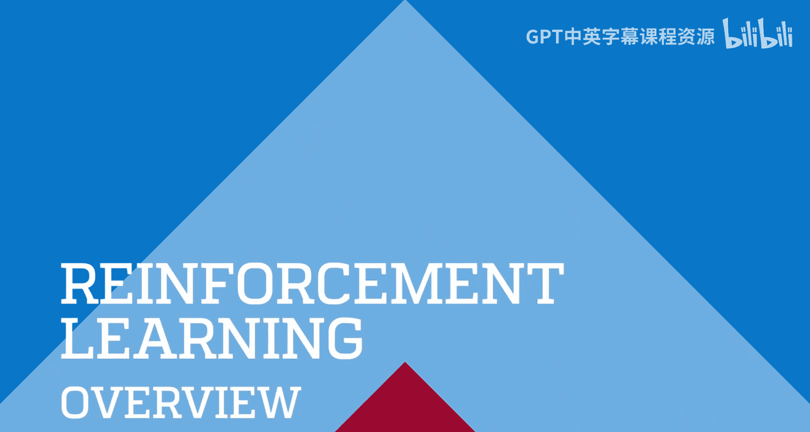
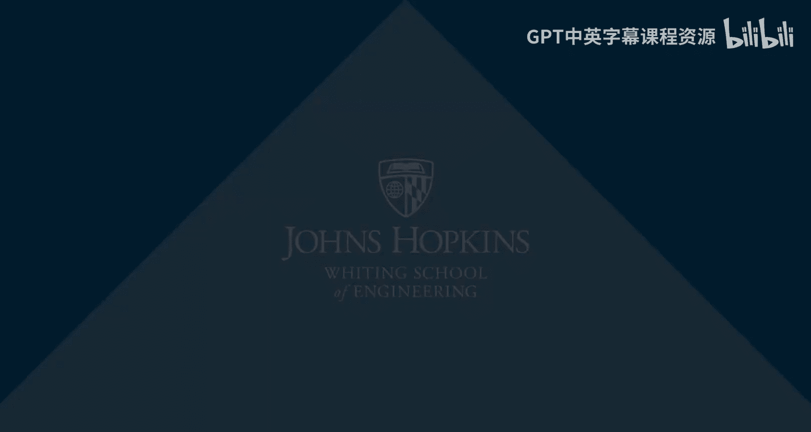

# 约翰霍普金斯大学《应用机器学习｜Applied Machine Learning》中英字幕 p36 12_强化学习概述.zh_en -BV13xuqzYErx_p36-

。

🎼In this module， we will study reinforcement learning。🎼The third learning method。

 completing the picture for major learning strategies。

 together with supervised and unsupervised learning methods。

Reinforcement learning is the most natural way that humans utilize when they are learning to live in their environments。

🎼When a ground truth is not available or applicable， but rather an environment exists。

 guidelines can be learned using reward and penalty in that environment in order to maximize benefits or minimize costs respectively。

🎼Reinforcement learning is a typical learning strategy to teach a computer how to play board games。

 such as Ba yamon or chess。A good example of reinforcement learning from the industry is the Alpha Go。

 which is the first computer program that defeated the Go World champion。

 an impressive step in AI progress， especially given the incalculable complexity of the Goge。

We will first describe reinforcement modeling and learning environment by defining the terminology and describing a few typical reinforcement learning problems。

Such as Tit to and elevator control。🎼Then we will list a few techniques to build up a mathematical model of Q learning that is based on states and actions。

 Finally， we will implement a Q learner to learn and play masterfully， the gamenym。😊。

