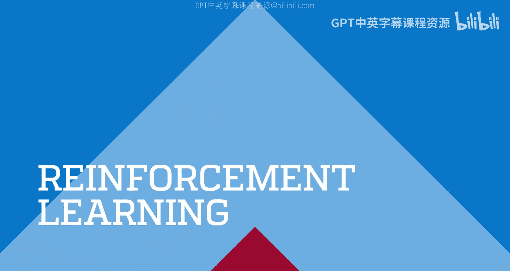
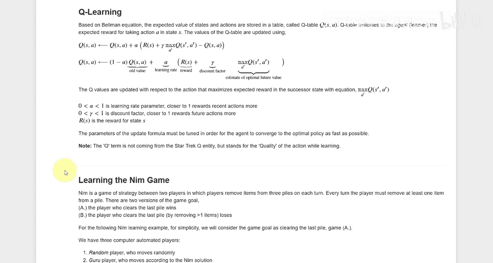

# 约翰霍普金斯大学《应用机器学习｜Applied Machine Learning》中英字幕 p37 13_强化学习.zh_en -BV13xuqzYErx_p37-

🎼。

Dear students， in this module， we will study reinforcement learning。

 This learning method is the third kind， in addition to supervised and unsupervised learning。

 Supervised learning needs feedback。 unsupervised learning is about the baseline。

 and reinforcement learning is modeling of an environment by reward and penalty。

Reinforcement learning is the one major strategy organisms use to learn their way of living on art。

Reinforcement learning may be the only way of machine learning model development when a data is not available。

 but environment responses to actions can be measured as feedback。Such as in board games， robotics。

 multi agent systems and learning classifiers。Thus。

 reinforcement learning is also known as policy learning。As you remember。

 we started from the data itself by preprocessing。And then we looked at evaluation。

We studied supervised learning and then ensemble learning， and then unsupervised learning。

Reinforcement learning is the third kind of learning in supervised learning。

 we have a feedback and then using that feedback， we optimize a particular cost function。

Minimizing the error between the target output and the actual output。

In an unsupervised learning approach， we learn the baseline。

 such as the probability distribution function of a particular data set in reinforcement learning。

 the situation is a bit different from either supervised learning or unsupervised learning in reinforcement learning problems。

 There is always an environment。 This environment generates the data dynamically。

 and then the environment responds to our actions， and then the environment also guides the reward or penalty so that the agent which interacts with this environment receives a feedback to its actions。

In a way， it is like supervised learning。 However， we do not have a data set to learn from。

 but we have an environment that we are learning from。 This environment can be limited。

 This environment can be infinite。 For example， in life。

 we apply reinforcement learning as we grow up， We learn from our families from our mentors， Par。

 So we are learning the life。 The environment is life itself。 However。

 the environment doesn't have to be infinite。 The environment can be limited， such as in games。

 For example， in tick taactal game。 The environment is very limited。

 The number of possible positions that can arise in techactact tool is a limited a small number。

 Fe of reinforcement learning encompasses trial and error search。

 as we wander around the environment we try different things。 This is called exploration。

 And then by learning certain things， we receive rewards or again。😊，During that learning。

 we might receive penalties so that we can adjust our policies。 At the end。

 we exploit what we learned to maximize our benefit or our reward each time。 For example。

 in an environment， a living being wanders around， explores its surroundings and now finds the food source。

 which is the reward and then starts exploiting that solution to receive the food。

 These pieces such as explore， exploit the agent interacting with the environment are the pieces of reinforcement learning。

This is also called agent based learning。 The environment can be stochastic meaning there's a chance the environment responds in one way or the other。

 or the environment can be totally deterministic as in games， for example。

 A good example for stochastic environment could be， again， life or from games backham。

 where there's a chance factor， a dice is thrown and then depending on the dice， the action is taken。

 It's stochastic， because we are not sure if the environment will respond in a beneficial way。

 So there's a stochastic chance， the environment will respond in certain manners。

 if this was deterministic as in chess or goal game， environment would always respond the same way。

 in a deterministic manner。 Elments of reinforcement learning。

 policy is what to do is in the domain of reward， reward what is good and reward is in the domain of value。

 value。What is good because it predicts reward is in the domain of model so we can talk about coming up with a policy that would reward a particular action and by the collection of those rewards and actions or actions and rewards the model is built reinforcement learning examples Tit2 game it's three by three board and we place circles and crosses played between two games I'm sure everyone knows Ti2 be Gamon is game of chance and strategy and Td Gamon is the world's best be gamon playing program it is built by reinforcement learning elevator control is in this reference we have four elevators in here1 floors button states positions where the elevator is either going down or up standing still directions。

 positions directions， motion states of cars I it moving or not and then the number of passengers in the car the number of passengers waiting at each floor so。

How would you maximize your benefits， Coming up with such an optimization problem is very difficult。

 It would not be a complex optimization in the first place。

 So the best way to learn such things are reinforcement learning。

 a reward can be1 per time step for each person waiting on the floors。 Every floor。

 there is a person waiting and every time step， however that time is it can be per second。

 penalty is incurred。 There are around 10 to 22 number of states。

 Even such a small problem elevatoror control with only four cars number of states is huge。 And。

 of course， you can assume 10 people at most waiting at every floor。

 The reference has more information。 Another example can be dynamic channel assignment。

 How do you use the bandwidthit efficiently so that you can optimize the telecommunication network。

Now， when look at the games。 Games are perfect problems for reinforcement learning。 Tiacto backgamon。

 chess 3D chess is in Star Trek or game of ga。 The number of possible positions are enormous in chess。

 for example， is 10 to the 53 and in 3D chess it is similar because it's just a partition of the original board。

 However in Ga it's 10 to the172。 There is no way to store this kind of information for every position that a goal game can take。

 So how do you think alphago and similar reinforcement learners are solving or learning the game go。

 Well， most problems most positions in the game of go。

 they look alike So the reinforcement learning is built in such a way that it is finding out these patterns by playing the game as it plays it is beaten or as it wins the game。

 Pat are stored。 It's not storing the entire board。But rather。

 it is storing patterns that happen on the board， and the reinforcement learner engine is looking for those patterns to maximize the benefit。

Evaluating actions or instructing by giving correct actions。 These are two different things。

 Evaluative feedback depends completely on the action taken， such as in optimization。

 When we minimize a particular cost function We are evaluating that cost function and it depends completely on the action taken。

 which is the parameter that we are optimizing。 However。

 in supervised learning such as in random forest us， the feedback is instructive， but of course。

 in supervised learning， there is also support vector machine。

 where it solves an optimization problem。 In that case， it's evaluated。 An example is anarmed bandit。

 not every problem can be an optimization problem because there is an indeterministic。

 there is a stochastic element to it。 For example， consider the unarmed bandit problem。

 One armed bandit is known as a slot machines and a gambler using a couple of slot machines together is trying to build a strategy。

 a policy to maximize。The gain from that gambling。 So the questions can be keep playing on the same slot machine。

 Sw the slot machine to another one as we all know。

 these slot machines have certain AI in themselves， certain model in themselves。

 So they make the player win from time to time。 But in general。

 they make the player lose more than they are winning。 So how do you beat that model。

 That's the problem of the unarmed banded problem as the gamblers perspective。

 If you know how to beat the system in a way， that's our。Greedy action。 That's our exploitation。

 We know how to be the system， We take the best action， but is it a local optimal。

 If it's a global optimal， no problem， we apply the same action， Maximise the benefit all the time。

 but not necessarily。 it could be the global optim。

It can be also a local optimum where we have to explore a bit to reach to a better optimum。

 We do not take the greedy action every time， which is the a star。 When we do that， its exploration。

 Maybe we pick the second the third， the fourth best action in order to search the space better。

 This is not always applicable， Of course， in chess game， for example， if your king is under attack。

 You cannot explore the board to make another strange board thinking that you would win the game。

 but in certain problem， such as Bagamen， you might take the chance to learn more by exploring。

 because not necessarily you will always lose that game by not making the best move。Now。

 Q learning is quality of the action learning。 We have actions。

 and then we have states in Cheess game， for example， the state can be the position of the board。

 A can be the move of the piece。 we have to have an evaluation the Rs by looking at the board。

 if I'm winning Rs for that particular state will be maximized or will be a high number。

 Every time I update my Q table， which is Q state action table with this formula。

 If something is winning， then update my table with the new state and action。

 meaningan when I reach that particular state。 If I have 10 actions available。

 one of them is better playing than the other9 this update mechanism。

 I'm updating my Q table when the next time happens， that state happens。

 my action will be the winning action1 out of that time Al is the learning parameter。

 gamma is the discount factor。 these two control the way of learning can。Not be always 0 or1。

 because that affects the performance。 The learning rate will be very high。

 It will be similar to overfitting， like changing my actions all the time。

 but alphapha cannot be very small than it means I'm not learning quickly enough。

 I have to do the same thing 20 times in order to update my Q table in the next section。

 we will apply Q learning technique to learn the Nim game。

嗯。

