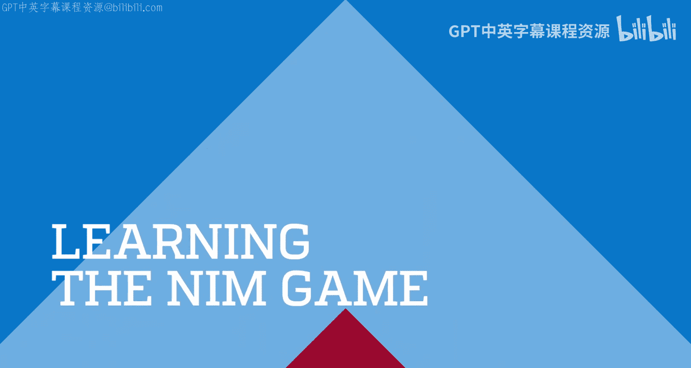
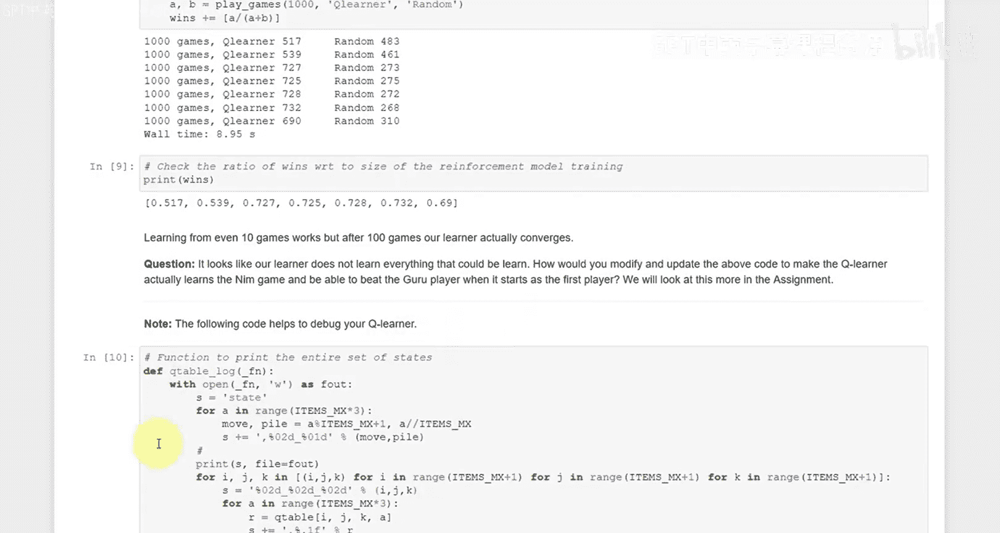

# 约翰霍普金斯大学《应用机器学习｜Applied Machine Learning》中英字幕 p38 14_学习尼姆游戏.zh_en -BV13xuqzYErx_p38-

🎼。

NIim is a game of strategy where each player takes a number of items from three Pis。

 the player who has to take the last item loses， let's see how to develop a reinforcement Q learning model to beat this game。

We need an environment where three players are defined where the first one is a random player。

 Second one is the group player， and its moves are mathematically shown to be the solution to the Nim game。

 Not that this may not be available in other games or in other problems。

 And the third one is our cu learner。The random player makes movesose randomly in a way that the random player continuously explores without learning anything without any possibility of exploitation。

 Guru Play makes perfect movesose， and Q learner makes Moose using the equation 1。😊。

Greedy action and the maximum that makes this cu table is exploitation。

We will see how we train Q learner through equation 3 in the game playing environment for the game player environment。

 We need three engines。We have three player functions。 another function is to play the games。

 Basically， play gamess runs the engines and collects the results as a number of wins so that we can know which player wins most of the games。

 That's our evaluation。 How many times the player wins compared to the other player。

 Play game includes two player， as can be seen in the following results。

 starting player has a clear advantage。 It has more wins。😊，For example， when guru plays against guru。

The beginner player， the starting player， always wins， as can be seen。

 starting the game has a clear advantage in this version of the namem game。

 It is also the case in chess game。 Nim chew learner function is our true learner player。

 which choose the trained learned Q table to make movesose。 Again， it uses equation 1。😊。

Our Q learner uses the trained learn Q table directly。 The Q table has three states。

 The Q learner has one state。 The table has three dimensions representing the states of the piles。

The stuple can be considered as a single state。If there are more piles。

 a different version of Nim game， say five piles， then there will be five dimensions。

 This is just the detail of the implementation we do not have to do in this manner。 Now。

 some details about the training code。That's where the magic is。

 That's where equation 3 is implemented。 We need two pieces， one， how to represent the states。

 and second， how to represent the actions。States are represented by the three dimensions in the Q table。

 Q table has first three dimensions as the state of the piles and the fourth dimension as the action to be made。

 It can be seen here。 These three states are piles。

 it can be considered as a single state of the game， and the action is the action to be made。

 This can be empty for starters。 Then exploration will take over。

 action is coded in pile times the maximum number of items。

 This will not lose generality as can be seen here。

 it for simplicity to represent the action as a single integer so that it can be indexed in the Q learner table。

 Q table。 Every action means take this many items from pile that This is the definition of the Nim game in chess。

 It could be make a move with this piece into that square on the board Q learner function plays games and stores winning moves in the Q table using。

Equation 3， the Q table is updated through reward， and the Q learning parameters。

 Alpha gamma and reward are set prior， and probably they are subjective。 They can be set statically。

 and， of course， it can be set dynamically in some other more complicated learning schemes。

 The approach has to make prototype studies to determine what works for these parameters。

 When Q learner does not know what to do。 The Q table does' not have the action to be taken for that state。

 It makes a random move。This is also called exploration。 For example， here。

 it makes a random move at the beginning。 If the Q table has a value。

 then cu learner can make a move to exploit it。 It's exploiting the knowledge。

Parameterters control the balance between exploration and exploitation。

 As can be seen in the following cells， The cu learner really learns something。

 and is able to beat the random player。😊，Normally， random random would be 500 versus 500s。

As can be seen here。Both sides do not know what they are doing。

 and they are making the moves randomly。So there are equal number of winds and losses。 However。

 the kru beats random soundly。And sometimes random beats guru just by pure luck。

 and guru can beat the guru when it starts as the first player。

 This is the nature of this version of the niny。And when we learn something using our true learner。

 as can be seen， we can beat the random players soundly in the assignment you will see。

 we are asking， can this learning scheme be improved or not。

 And in order to debug your code dysfunction would be very helpful。

 That concludes our reinforcement learning。

