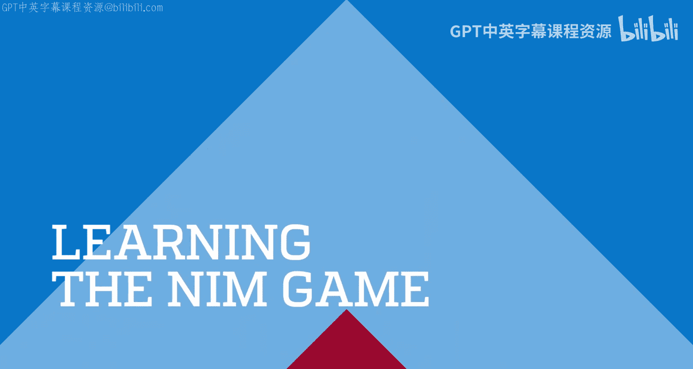
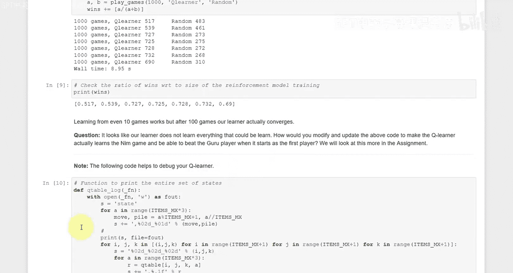

# 应用机器学习：第14章：学习尼姆游戏 🎮

在本节课中，我们将学习如何开发一个强化学习Q学习模型，来玩一个名为“尼姆”的策略游戏。我们将了解游戏规则、构建学习环境、定义关键组件，并最终训练一个智能体来击败随机玩家。

---

## 概述 📋

尼姆游戏是一个策略游戏，通常有三堆物品。玩家轮流从任意一堆中取走任意数量的物品（至少一个）。被迫取走最后一个物品的玩家输掉游戏。我们将构建一个强化学习环境，其中包含三种玩家：随机玩家、最优（大师）玩家和我们的Q学习智能体。我们的目标是训练Q学习智能体，使其能够学习并最终在游戏中表现出色。

---

## 游戏环境与玩家定义 🎲

首先，我们需要定义一个游戏环境。在这个环境中，我们将有三种类型的玩家：

1.  **随机玩家**：其行动完全随机选择。这个玩家只进行探索，不进行任何学习或利用。
2.  **大师玩家**：其行动基于数学上已证明的尼姆游戏最优解。请注意，这种完美策略在其他游戏或问题中可能无法获得。
3.  **Q学习玩家**：我们的智能体，它将通过Q学习算法来学习如何玩游戏。

Q学习玩家使用以下公式来选择行动（利用）：
`行动 = argmax(Q[状态])`
这个公式会选择在当前状态下，Q值表中预测收益最高的行动。

---

## 游戏运行与评估 ⚙️

为了评估玩家的表现，我们需要一个运行游戏并收集结果的函数。`play_games`函数就是这个引擎，它让不同的玩家相互对战，并记录获胜次数。

以下是`play_games`函数的关键点：
*   它通常安排两个玩家进行多轮对战。
*   它会统计每位玩家的获胜次数，以此作为评估标准。
*   结果显示，在这个版本的尼姆游戏中，**先手玩家具有明显优势**。例如，当两个大师玩家对战时，先手玩家总是获胜。这种先手优势在象棋等游戏中也很常见。

---

## Q学习玩家的实现 🤖

我们的Q学习玩家函数（`nim_q_learner`）是核心。它使用训练好的Q值表来做出行动决策。同样，它利用公式 `行动 = argmax(Q[状态])` 来选择行动。

关于Q值表状态的表示：
*   Q值表有三个维度，分别代表三堆物品的当前数量。这个三维元组 `(pile1, pile2, pile3)` 可以被视为游戏的**单个状态**。
*   如果游戏有更多堆（例如五堆尼姆），那么状态维度也会相应增加。这只是实现细节，并非固定模式。

---

## 训练过程：核心与细节 🧠

训练代码是实现“魔法”的地方，也就是实现Q学习更新公式（公式3）的地方。我们需要关注两个关键部分：**状态表示**和**行动表示**。

**1. 状态表示**
如前所述，状态由三堆物品的数量定义，并作为Q值表的前三个索引维度。

**2. 行动表示**
行动需要被编码，以便在Q值表中索引。我们采用一种简化表示：用一个整数来代表行动。这个整数编码了“从哪一堆取多少物品”的信息。
`行动编码 = 堆的编号 * 最大可取物品数 + 取走的物品数`
这种编码方式不会丧失一般性，并且便于在Q值表中进行索引。在Q值表中，第四个维度就对应这个行动编码。

**Q学习更新**
`Q[状态， 行动] = Q[状态， 行动] + α * (奖励 + γ * max(Q[新状态]) - Q[状态， 行动])`
Q学习玩家通过玩游戏，并使用上述公式将获胜的行动记录（更新）到Q值表中。其中：
*   **α** 是学习率。
*   **γ** 是折扣因子。
*   **奖励** 在游戏结束时给出（例如，赢+1，输-1）。

这些参数需要预先设定，它们可以是静态的，也可以在更复杂的学习方案中动态调整。通常需要通过实验来确定适合当前问题的参数值。

---

## 探索与利用的平衡 ⚖️

在训练初期，Q值表是空的。当Q学习玩家遇到一个未知状态（即Q值表没有对应的行动记录）时，它会**随机选择一个行动**。这被称为**探索**。

随着训练的进行，Q值表积累了知识。当遇到已知状态时，玩家会选择Q值最高的行动。这被称为**利用**。

**ε-贪婪策略**等参数用于控制探索与利用之间的平衡。在下面的结果中可以看到，经过学习，Q学习玩家确实掌握了知识。

---

## 结果分析 📊

从实验结果可以看出：
*   **随机玩家 vs 随机玩家**：胜负各半（约500胜 vs 500负），因为双方都在随机行动。
*   **大师玩家 vs 随机玩家**：大师玩家能轻松击败随机玩家。偶尔随机玩家可能凭运气获胜。
*   **大师玩家 vs 大师玩家**：先手玩家总是获胜，这印证了先手优势。
*   **Q学习玩家 vs 随机玩家**：经过训练后，我们的Q学习玩家能够**稳定地击败随机玩家**。

在课程作业中，你将有机会探索：这个学习方案能否进一步改进？为了调试你的代码，可视化工具会非常有帮助。

---

## 总结 🏁

本节课中，我们一起学习了如何将强化学习中的Q学习算法应用于尼姆游戏。我们定义了游戏环境，实现了随机玩家、最优大师玩家和Q学习玩家。我们详细探讨了Q学习中状态和行动的表示方法，以及核心的Q值更新公式。通过实验，我们观察到Q学习智能体能够通过探索和利用，学习到有效的策略，从而击败随机玩家。这为理解强化学习在游戏和序列决策问题中的应用奠定了实践基础。