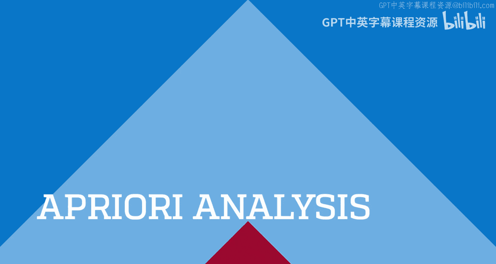
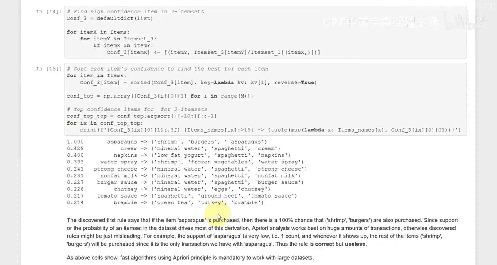

# 约翰霍普金斯大学《应用机器学习｜Applied Machine Learning》中英字幕 p40 16_先验分析.zh_en -BV13xuqzYErx_p40-

Dear students， have you ever heard of market basket analysis。

 which extracts interesting patterns from market data。

 such as items that are frequently purchased together as online retail expanded。

 the necessity to show relevant products to customers became crucial as the window to online shopping is your browser and monitor screen。

 much smaller than the store。 Customs who bought this item also bought this other item you might be interested in is one of the statements you see on online retail stores。

In this module， we will study the probabilistic techniques to extract these subtle。

 but significantly express rules from transactional data sets。

An interesting work example will be taking a list of ingredients and finding out the type of the cuisine。

In this section， we will define study a priori analysis。

 a useful annatic close the machine learning algorithm that finds patterns in the data is the a priori analysis。

In the previous modules， we have seen that data can show patterns that happen frequently。

 It is sufficient to show these patterns occur more than the mean of a probabilityable to dance the function。

 or in other words， these patterns are significantly expressed。

 Imagine an online retailer showing the item purchase information to its customers。

 saying that the customers who purchased this item， also purchased that item。

 they are purchased together， the retailer was able to show this information。

 because of the sheer number of transactions， it conducted till today， and by processing it。

 and it is also assumed that the average customer trend works for most customers。😊。

A priori analysis or association rule discovery is conducted through probability and finding common entities appear together in transactional dataset sets。

Transactal databases such as store purchases are excellent for this purpose。

 as the volume of the database is large。And it is crucial to have large databases to yield reliable probabilities of items purchased together in a transaction。

Here are some definitions。Items are the features of transactions。

Big online retailers has millions of items offered to their customers。

Transactions are entries in the transactional purchase databases where every row or entry is a subset of the item set。

 If three items are purchased together in a transaction。

 then those three items are in the transaction。 If customer tends to buy items separately。

 then back to back transactions could be also joined to represent transactions。

 This can be part of prepros， and there are no hard rules to follow here。

A rule is represented as an item set implies an item set where the intersection of those two item sets is an empty set。

 Each item set can be a single item or a few items together。 The support of an item set。

 simply is the number of transactions， which include all the items in the item set divided by the size of the database。

 It is simply the probability of the item set in the database。Again。

 in order to have this probability reliable， the dataset set must be big enough。

 There are no strong guidelines about the size of the database in the literature， but rather。

 this is left to the analyst。 Confid is the conditional probability that shows given the item set X。

 the likelihood of item set Y to be purchased。 It is the support of the union X。

 Y divided by the support of X。 This is the main metric that reveals rules。

 If a confidence value is one， then it tells us that。This situation。

 X implies Y always happens in this deficit。 It may happen just once， but when it happens， it holdss。

In order to avoid rules that are 100% likely， but happens rarely。

 we can use the minimum support threshold while extracting rules from the data。

Lift is the confidence normalized by the popularity of y。

 It gives an idea about the usefulness of a rule。 X implies y。As we will see in the following cells。

 brute force extracting these rules are time consuming。

 since the possible number of combinations of items that can appear in databases can be very large。

10 million items and 1 billion transactions is not uncommon for big。

 even medium size online retailers every year。 The procedure to extract the rules are simple。

But the good implementation is required to extract rules fast。

 Any important in fact is that as the item sets get larger in cardinality。

 such as more items are added， their support go down。 In other words。

 subset of frequent items are also frequent， if not more frequent than the their supers。

 Most fast association rule algorithms follow this fact。

 Among them are max minor and F P growth algorithms。

 which we will use in the Wia association rule analytic demonstration in the next video。

 This formula shows the antimonotone property of support。

 we can also use a minimum support to filter out rare items。

 which will not contribute to more complex bigger association rules。 Now。

 let's see how to implement a primitive rule extractor up to three items on the module 1 or data set。

The data set has 120 items and 7501 transactions。 We did normalize the data into a matrixof 7501 by 120。

 which would not be practical for two dataset sets， but for our purposes。

 it helps as Vca framework likes its input deormalized。

 We will also need a good representation of the data。

 and we use the dictionary for I D to name and another dictionary for name to Id It are numbered like an index going from 0 to M-1。

 where there are M items or M features in the data。 sanitity check。

And every entry in the data transaction matrix is a transaction which has a set of item Is。Here。😔。

It's a binary representation of the data。 a row represents a transaction which may or may not include one of the item in the available item list。

Support is simply the count of item sets in the data。

Such as one item set for an individual item or two item sets， for two items together and so on。

 we will go up to three item sets because the number of possible combinations go up exponentially。

 since we have not used speeding the thresholds like minimum support threshold or storing the data in a tree to avoid processing all possible combinations generated by the function combination in entire tools。

So， this function。Combination generates all the possible one size combinations from items。

 If I change this to 2 and 3， it would be two items and three items respectively。

 Then the probability is simply dividing the count to the total number of transactions in the database。

 Of course， generating the possible combinations and checking。 if the data has its or not。

Is so inefficient， but simple programming。Association rule extraction requires specific implementations。

A quick improvement could be checking if the support of an item set is 0 and not generating item sets that are supers of those item sets。

These are the results。2 item sets and three item sets。 and their count。 As you see。

 counts always go down。 This is the anti monotone property of the support。

 Rule can be extracted through support。And theyre basically based on the value of the confidence。

 It can be also based on lift and other metrics。 The rule is represented by x implies Y in the transaction。

 X and y appear together。 But how many times they appear together。 That's the count and as a support。

 that gives the confidence value in this example we show that x is a single item。

 implying multiple items in the item set in Y。 generally， this is the reverse situation。

 shrimp asparagus or shrimp implies asparagus。Or in the bigger set。

 shrimp and burgers implies asparagus。 We will demonstrate this in the next Wiid。 As you can see。

 our extracted rule about the asparagus has the confidence of one。

 That means that if asparagus happens， then definitely shrimp and burgers also happen。

What if this rule happens only once in our dataset set。Well， it's rare。It happens so frequent。

 but it's rare in order to filter out such rules， minimum support threshold is added。

 So asperguus has。Law support。The probability of asperus by itself appearing is very low  one out of 7501。

 But when it happens， the transaction contains chimppan burgers，0 per cent confidence。

 I can get rid of this rule by setting a minimum threshold for support。

 as can be from the cells support is diminishing as items are added to the item sets。 They get rarer。

 These bigger item sets where three or more items appear together， They get rarer and rarer。 Now。

 let's see how this whole thing is done in Weca。

