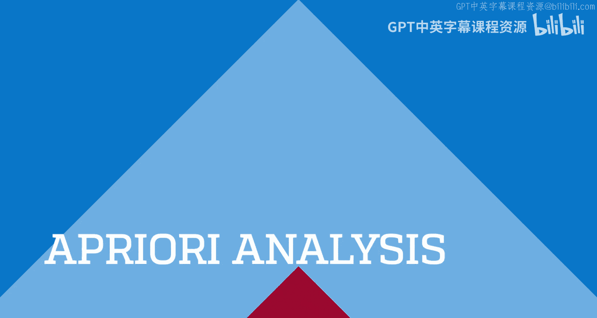
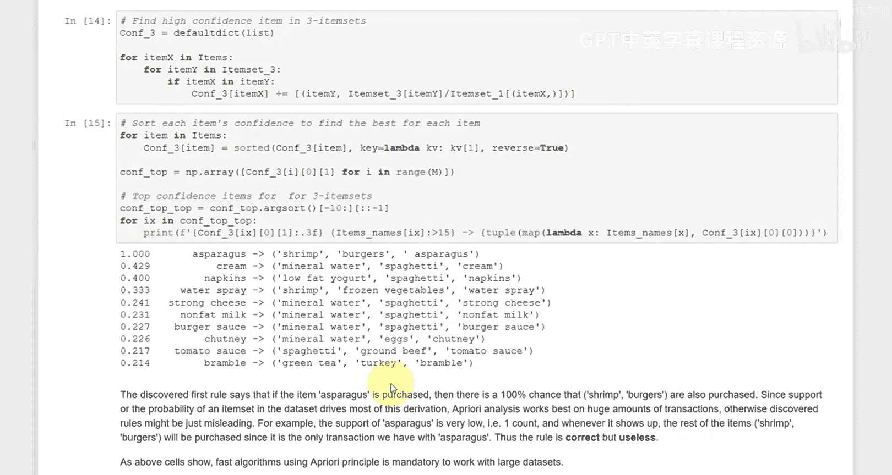

# 应用机器学习：16：先验分析 🛒

在本节课中，我们将学习一种名为“先验分析”的机器学习技术，它用于从交易数据中发现有趣的关联规则，例如“购买了此商品的顾客也购买了彼商品”。我们将了解其核心概念、定义以及一个简单的实现示例。

## 概述

随着在线零售的扩张，向顾客展示相关产品变得至关重要。在线购物的窗口是浏览器和显示器屏幕，比实体店小得多。“购买了此商品的顾客也购买了此商品”是你在在线零售商店中常见的陈述。在本模块中，我们将研究从交易数据集中提取这些微妙但显著表达的规则的概率技术。一个有趣的示例是获取一份配料列表并找出菜系类型。

## 核心概念与定义

上一节我们介绍了关联规则挖掘的背景，本节中我们来看看其核心定义和度量标准。

先验分析是一种有用的机器学习算法，用于发现数据中的模式。在之前的模块中，我们已经看到数据可以显示频繁发生的模式。只要这些模式出现的频率高于某个概率阈值，就足以认为它们是显著表达的。

想象一个在线零售商向顾客展示商品购买信息，说“购买了此商品的顾客也购买了彼商品”。零售商之所以能展示此信息，是因为迄今为止进行了大量交易，并通过处理这些数据，同时假设平均顾客趋势适用于大多数顾客。

先验分析或关联规则发现是通过概率和寻找在交易数据集中共同出现的实体来进行的。商店购买等交易数据库非常适合此目的，因为数据库的体量很大。拥有大型数据库对于得出商品在交易中被一起购买的可靠概率至关重要。

以下是核心定义：

*   **项**：交易的特征。大型在线零售商向顾客提供数百万种商品。
*   **交易**：交易购买数据库中的条目，其中每一行或条目都是项集的子集。如果在一个交易中一起购买了三个商品，那么这三个商品就在该交易中。如果顾客倾向于分开购买商品，那么连续的交易也可以合并来表示交易。这可以是预处理的一部分，此处没有硬性规则。
*   **规则**：表示为 `项集X => 项集Y`，其中这两个项集的交集是空集。每个项集可以是单个项或几个项的组合。
*   **支持度**：一个项集的支持度，简单来说就是包含该项集中所有项的交易数量除以数据库的大小。它简单地是该项集在数据库中的概率。同样，为了使这个概率可靠，数据集必须足够大。文献中没有关于数据库大小的严格指导方针，这通常留给分析师决定。
*   **置信度**：表示给定项集X时，项集Y被购买的可能性的条件概率。它是并集 `X ∪ Y` 的支持度除以X的支持度。这是揭示规则的主要度量标准。如果置信度值为1，则告诉我们：在这种情况下，`X => Y` 在这个数据集中总是发生。它可能只发生一次，但当它发生时，总是成立。
*   **提升度**：置信度通过Y的流行度进行归一化。它给出了规则 `X => Y` 有用性的概念。

## 算法挑战与属性

为了避免那些100%可能但很少发生的规则，我们可以在从数据中提取规则时使用最小支持度阈值。

正如我们将在后续部分看到的，暴力提取这些规则非常耗时，因为数据库中可能出现的商品组合数量可能非常庞大。对于大型甚至中型在线零售商来说，每年1000万种商品和10亿笔交易并不少见。提取规则的过程很简单，但需要良好的实现才能快速提取规则。

一个重要的事实是，随着项集的基数变大（例如添加更多项），它们的支持度会下降。换句话说，频繁项集的子集也是频繁的，即使不比它们的超集更频繁。大多数快速关联规则算法都遵循这一事实。其中包括Max-Miner和FP-Growth算法，我们将在下一个视频的Weka关联规则分析演示中使用它们。

以下公式展示了支持度的**反单调性**：

`support(X) >= support(X ∪ Y)`

我们也可以使用最小支持度来过滤掉稀有项，这些稀有项不会对更复杂、更大的关联规则有贡献。

## 简单实现示例

现在，让我们看看如何在模块1的数据集上实现一个最多包含三个项的简单规则提取器。

该数据集有120个项和7501笔交易。我们将数据归一化为一个7501x120的矩阵，这对于两个数据集来说并不实用，但为了我们的目的，它很有帮助，因为Weka框架喜欢其输入是非规范化的。我们还需要一个良好的数据表示，我们使用一个从ID到名称的字典和另一个从名称到ID的字典。项被编号，像一个从0到M-1的索引，其中数据中有M个项或M个特征。进行完整性检查。

数据交易矩阵中的每个条目都是一笔交易，其中包含一组项ID。这是数据的二进制表示。一行代表一笔交易，其中可能包含也可能不包含可用项列表中的某个项。

支持度简单地是数据中项集的计数，例如单个项的一元项集，两个项一起的二元项集，依此类推。我们将最多处理三元项集，因为可能的组合数量呈指数增长，由于我们没有使用像最小支持度阈值这样的加速阈值，也没有将数据存储在树中以避免处理由itertools中的`combinations`函数生成的所有可能组合。

所以，这个函数 `combinations` 从项中生成所有可能的大小为1的组合。如果我将其改为2和3，则分别是两个项和三个项。然后概率简单地是将计数除以数据库中交易的总数。当然，生成可能的组合并检查数据是否包含它们效率非常低，但编程简单。关联规则提取需要特定的实现。

一个快速的改进可以是检查项集的支持度是否为0，并且不生成那些项集的超集。

以下是结果：二元项集和三元项集及其计数。如你所见，计数总是下降。这就是支持度的反单调性。

## 规则提取与度量

规则可以通过支持度来提取，并且基本上基于置信度的值。它也可以基于提升度和其他度量标准。规则在交易中由 `X => Y` 表示。X和Y一起出现。但它们一起出现了多少次？这就是计数，作为支持度，它给出了置信度值。

在这个例子中，我们展示X是单个项，暗示Y项集中的多个项。通常，这是相反的情况：虾、芦笋或虾暗示芦笋。或者在更大的集合中：虾和汉堡暗示芦笋。我们将在下一个Weka演示中展示这一点。

如你所见，我们提取的关于芦笋的规则置信度为1。这意味着如果芦笋出现，那么虾和汉堡也肯定会出现。如果这个规则在我们的数据集中只出现一次呢？那么它很罕见。它发生得如此频繁，但很罕见。为了过滤掉此类规则，添加了最小支持度阈值。所以芦笋的支持度很低。芦笋本身出现的概率非常低，是7501分之一。但当它出现时，交易包含虾和汉堡，置信度为100%。我可以通过为支持度设置最小阈值来摆脱这条规则。

从单元格中可以看出，随着项被添加到项集中，支持度正在减少。它们变得越来越稀有。这些三个或更多项一起出现的较大项集变得越来越稀有。

现在，让我们看看在Weka中是如何完成这一切的。

## 总结

本节课中，我们一起学习了先验分析的基本概念。我们定义了项、交易、规则、支持度、置信度和提升度等核心术语，并理解了支持度的反单调性这一重要属性。我们还通过一个简单的代码示例，演示了如何计算项集的支持度，并指出了暴力方法的局限性。最后，我们了解到在实际应用中，会使用最小支持度阈值来过滤罕见规则，并采用如FP-Growth等高效算法来处理大规模数据。下一节，我们将在Weka工具中实践关联规则挖掘。