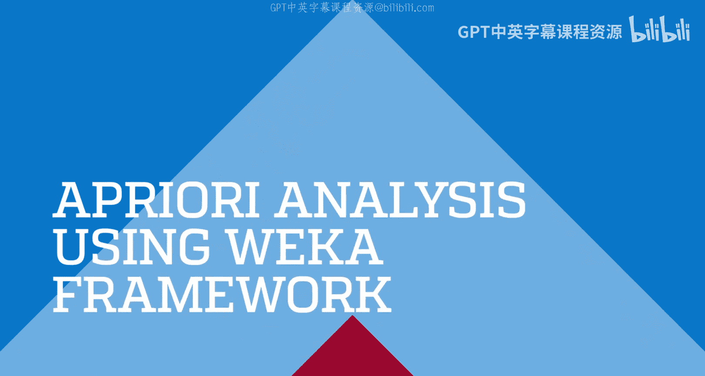
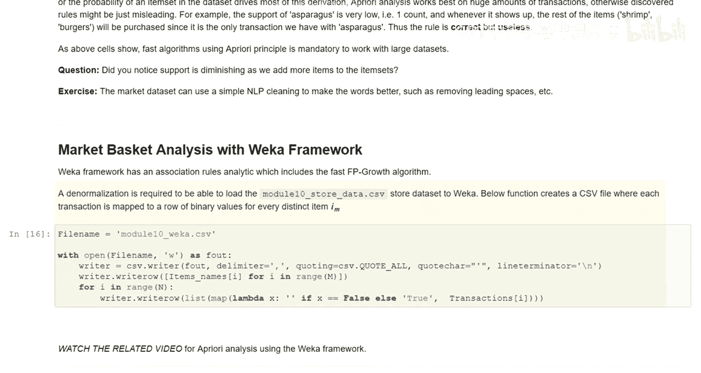
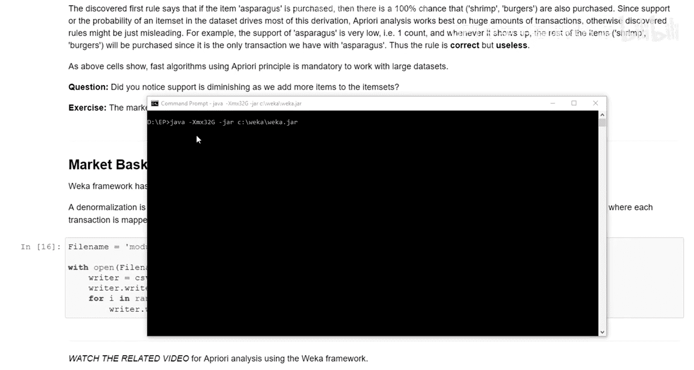
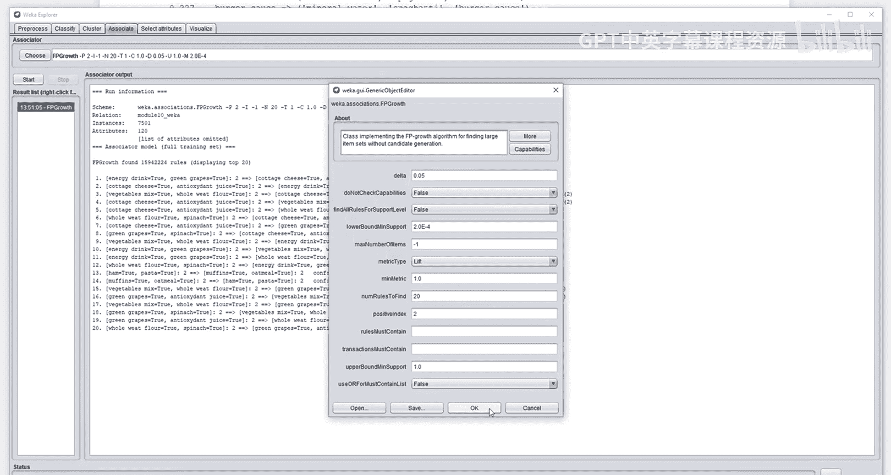

# 约翰霍普金斯大学《应用机器学习｜Applied Machine Learning》中英字幕 p41 17_基于Weka框架的先验分析实践.zh_en -BV13xuqzYErx_p41-

In the previous modules we have utilized the WCA framework。

 let's see the Ai analysis capabilities in the WCA framework and conduct a small analysis with the market dataset set。

Wka is the machine learning framework written in Java。 Certain algorithms are implemented robust。

 but some others can be unreliable as in every open source library。 First。

 we will have a look at the data file that we generated in our notebook in this last cell。

 Wica likes to see the CV file with feature columns where each feature is an item similar to the words in NLP tasks。

 as can be seen in the CV file。

This is the hither with all the items in it。And this is a transaction。 This is a transaction。

 When the item is in the transaction， it's represented with a true。In the second transaction。

 for example， there are three items， and there are no other items。 If I placed false here。

 I would be misleading rule generator in Weca to generate those falses as well。

 which we are not interested。 We start the Wica framework from a command shell using the command line。

 Java。Dash X M X 32 G， dash jar and the Wea jar。 This should be the folder that you store Weca in。

 General， it's a good idea to provide Javava as much memory as possible here。

32 GB of heap is provided。 I have turned 64 on my machine，4，8，16 is also workable。 Defite。 Now。

 let's open the Expr。 Here is how the CSC file to be ingested in the Weca looks like。

 These are the words。

If you realize the data set is unary。If the item exists， it is true and the rest is empty or missing。

That's why， for example， napkins shows up only five times in the transactions。And 7501-5。

 which is 7496。Is missing。 But for our purposes， this is proper because if we kept the falses by changing this empty string to false。

 then Weca Expr would be finding those as rules where napkins is false。

 than cream is also false and that rule has 0 per confidence。 That doesn't help us。

 we want to do where the napkin is true and ignore the rest when it is false。

 After loading the data to Wica， we explore it a bit。 especially histograms would be useful。

 There not a histogram because it's a singular value。

 but normally histograms would be here if this was a different machine learning dataset set。

 Click on associate。Pick the FP growth。There are three rule extractors there in my experience I couldn't find the right way of using the a priorri module。

 but FP growth is more than enough， it's a fast algorithm。

 not that each of these modules are written on the open source platforms by some module owners。

 simply FP growth is more reliable than the other two。Next。

 set the parameters upper bound minimum support， Dlta lower bound minimum support。

 The module uses the support as in the following， the support starts from the upper bound。

 and each iteration lowers it by delta till the lower bound Any support less than this is thrown away。

 Here is the lower bound minimum support。 Here is the upper bound minimum support that's where we start and then reduced by delta after every iteration。

 and here is the rules that is generated by the metric type we use confidence。

 the minimum metric has to be 0。9。 Anything less than 0。9 is not considered as a rule。

 The number of rules only printing on the screen Since all rules passing the criteria set by parameters will be generated。

 set the output item sets to true to see the actual rules in terms of our item names in order to match the output of our notebook in the module。

I'm setting the minimum support to 0。0001。Remember。

 this has to be less than 1 over 7501 since we had a single transaction that asparagus showed up only once in the entire data set。

 And now let's run it。 Now， if you clicked before changing the parameters， maximum number of items。

 This was -1 before。 it will generate all the rules that is possible up to 120 items。

 I change this to 3， I change the lower bound minimum support to 0。

0001 so that it can match the support for asparagus。 number of rules to list 10。

 and the rest is default。And I run it。These rules must match with the rules that be generated in the notebook。

 Not that confidence lift leverage， conviction reported here， confidence， lift， leverage conviction。

 These last two， we did not cover。 Not that all these metrics can be considered subjective。 Now。

 change the parameters back to default and find is interesting rules。

 I'm setting the lower bound minimum support to 0。001。 If this is too high， it won't find any rules。

Changing the confidence to 0。9 maximum number of items，-1。

 Let's see if this algorithm is fast enough。 Wa， it's fast。 It found all these rules。

 It found 11 rules， and all these are confidence more than 90。9。 Here。

 The rules are item sets to 1 item sets。Or item， one item set is an item。

That is why we have more rules than the notebook。 You might think that the more useful information would be item sets to item。

 but both information is the flip side of each other。

 So if we are looking at the case where the given item set is what is the likelihood of that item in the notebook。

 What we have done is given this item， What is the probability of that item set。

And if there are only two items。Meaning one item and one item in the item set。

 then it's typical to what we have done in the notebook。In cell 13。

 the way we reported we are including in the asparagus， the item in the item set。 But， in fact。

 this corresponds to asparagus implies shrimp。 soup implies mineral water。

 It's just to ease up the programming here。 So we are not doing something wrong。

 but it's just for the display。 You have to do more processing to display， display it properly。

 Go back to the vickca。 Now， let's change the lower bound minimum support。错误。

Even lower and then run it。 It will take longer。 It will take。 It will find more rules。

 Setting the minimum support is the real magic here。

 There is no set in stone or a good approach for finding out what that minimum support should be。

 because it really controls the number of rules。 it's just trial and error。

 after prototype experiments。 If you realize we change the support only by a magnitude。

 a single magnitude。 from 10 to the-3 to 10 to the -4。 and see the effect。

 There were only 11 rules before。 Now it's taking a very long time。

 probably it will find hundreds of rules。 If not thousands。

 So the previous values when I use the parameter as 0。0001。 didn't finish。

 actually generated millions and millions and rules。 and I was out of memory。 So I switched to 0。

0002 and then generating all the rules。 If I set my confidence to。Higher value， that would also work。

And here it generated 12 million rules and displaying the top 10。 These are all high confidence。

 of course， Con 1。 And when I buy eggs and hard hand protein bar。

 then there's a good chance of 100 per cent that I would also buy mineral water and so on。 Lastly。

Change the minimum metric to1 and then change the minimum support to 0。0001。

And then generate all the rules， maximum number of items， -1， and see what it will do。

We run FP growth again with these parameters。0。0002。All the number of items using lift metric。

 minimum metric is one number of rules to find 20。We had these results。

Confidence does not control the number of rules generated， but support does。

 And by changing the support from2 to1， we are actually not doubling。 It's an exponential growth。

 We are generating 15 millions。 just in this case， probably when we change from2 to1 the support。

 it will be changing around 150 million or so。 I'm finishing up all my 50 GB of memory on my machine。

 The takeaway is rule generation is straightforward。

 but the sheer number of rules that can be generated when you do not control the support properly can be overwhelming。

 We have to start from a higher bound of minimum support like 0。1 go down。

 If we do not go down enough， we will not be able to find interesting rules that happen， seldom。

 but still with very high confidence or lift like  hundred0%。

 This concludes our Vca framework demonstration。

