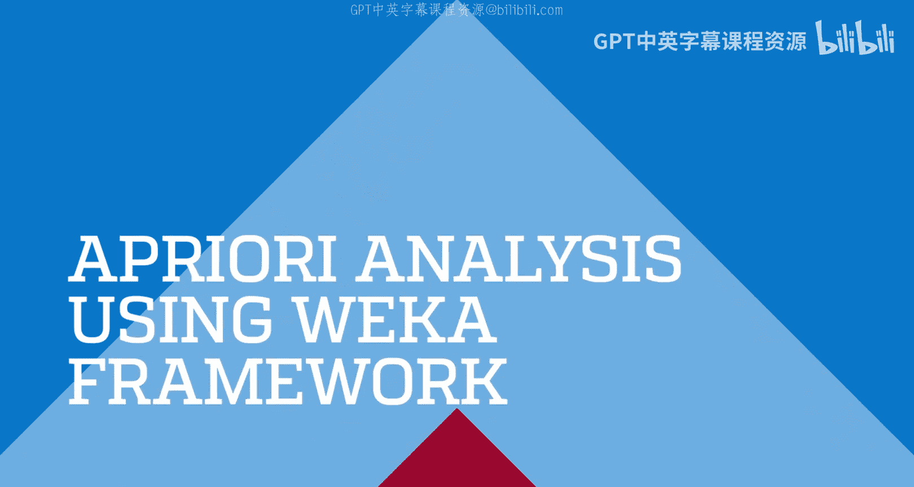
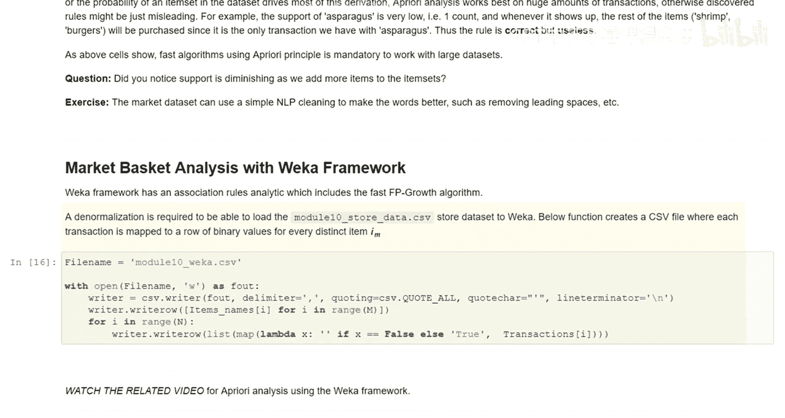
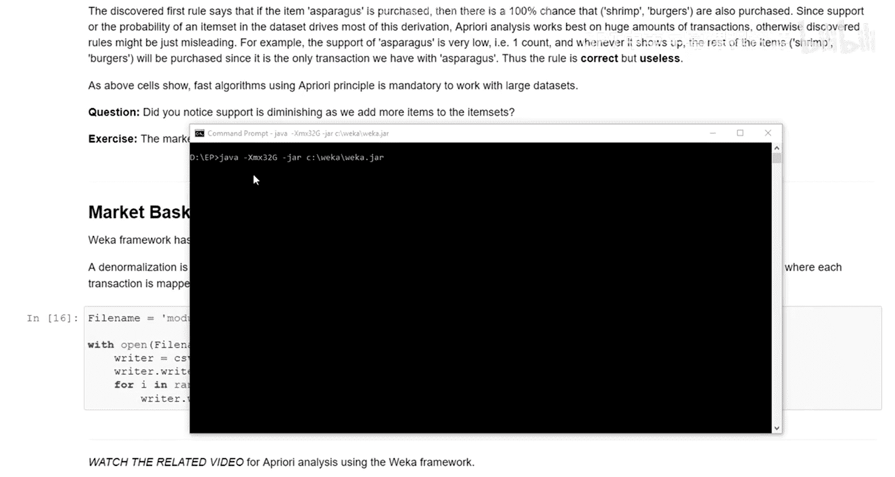
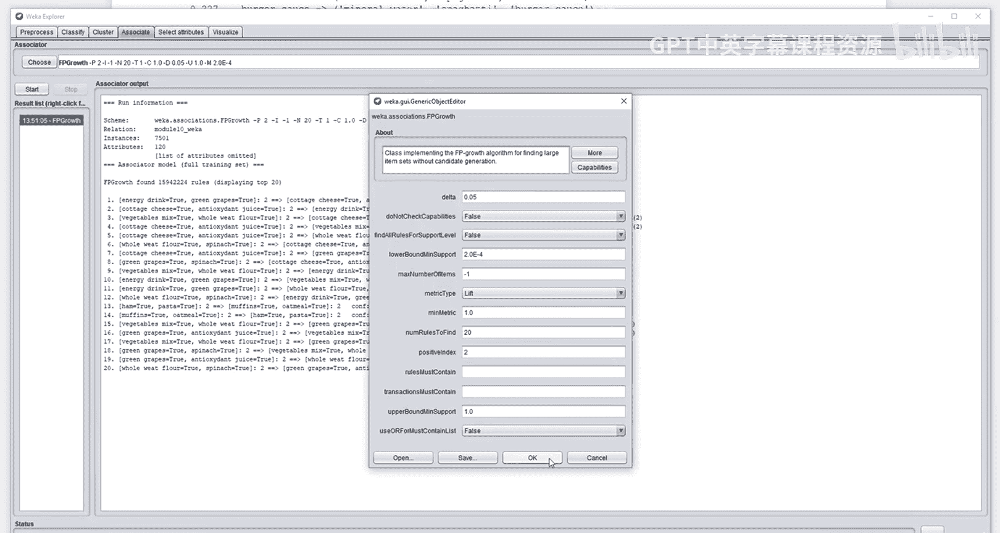

# 应用机器学习：17：基于Weka框架的先验分析实践 🛒




在本节课中，我们将学习如何在Weka框架中进行关联规则分析。我们将使用一个市场数据集，探索Weka的先验分析功能，并理解如何通过调整参数来发现数据中有趣的规则。



## 概述

上一节我们介绍了关联规则的基本概念。本节中，我们将利用Weka框架，对一个真实的市场交易数据集进行先验分析。我们将从加载数据开始，逐步配置算法参数，并解释生成规则的含义。

## 加载数据与数据格式



首先，我们需要了解Weka框架期望的数据格式。Weka要求数据以CSV文件形式提供，其中每一列代表一个特征（或“项”），类似于自然语言处理任务中的词汇。

以下是我们从笔记本中生成的数据文件示例：

```csv
item1, item2, item3, ...
true, , true, ...
, true, true, ...
```

在这个文件中，表头行列出了所有可能的商品项。每一行代表一笔交易。如果某件商品出现在交易中，则对应位置标记为 `true`；如果未出现，则留空或标记为缺失值。例如，在第二笔交易中，只出现了三件商品，其他商品位置为空。**将未出现的商品标记为 `false` 会误导Weka的规则生成器，使其生成关于“商品不存在”的无用规则，这不是我们感兴趣的。**

## 启动Weka并导入数据

我们通过命令行启动Weka框架。建议为Java虚拟机分配尽可能多的内存，以确保处理大型数据集时的性能。

```bash
java -Xmx32G -jar weka.jar
```

启动后，我们导入CSV格式的数据集。数据集是二元的：商品存在则标记为 `true`，否则为空。例如，“餐巾纸”在整个数据集的7501笔交易中只出现了5次，因此在其他7496笔交易中其值为空。**这种格式是合适的，因为如果我们用 `false` 填充空值，Weka将会生成诸如“餐巾纸为假则奶油也为假”的规则，这种规则的置信度为0，对我们没有帮助。我们只关心商品存在（`true`）时的关联规则。**

## 探索数据与配置算法

数据加载后，我们可以先进行初步探索。虽然对于这种二元数据，直方图的作用有限，但对于其他类型的机器学习数据集，直方图会很有用。

接下来，我们进入“关联”功能，并选择 **FP-Growth** 算法。Weka提供了三种规则提取器，根据经验，Apriori模块可能难以正确配置，而FP-Growth算法不仅速度快，而且更为可靠。

以下是配置FP-Growth算法时需要理解的关键参数：
*   **上界最小支持度**：算法开始迭代时的支持度阈值。
*   **下界最小支持度**：算法停止迭代时的支持度阈值。任何支持度低于此值的规则将被丢弃。
*   **Delta**：每次迭代后支持度降低的步长。算法会从上界支持度开始，每次迭代减去Delta，直到达到下界支持度。
*   **度量类型**：我们选择“置信度”。
*   **最小度量值**：设为0.9，意味着只考虑置信度不低于90%的规则。
*   **输出项集**：设置为 `true`，以便以商品名称的形式查看规则，方便与笔记本的输出结果进行比对。

## 运行分析与解读结果

为了匹配我们之前在笔记本中的分析，我们将最小支持度设置为一个非常低的值（例如0.0001）。**这个值必须小于 1/7501，因为我们数据集中有商品（如芦笋）仅出现了一次。**

首次运行时，我们可能将“最大规则长度”设为3，并将“下界最小支持度”设为0.0001。运行后，生成的规则应与笔记本中生成的规则相匹配。

Weka输出的规则度量包括置信度、提升度、杠杆度和确信度。其中杠杆度和确信度我们在之前的课程中未涉及。**需要注意的是，所有这些度量标准的选择都带有一定的主观性。**

## 调整参数与探索更多规则

关联规则挖掘的核心技巧在于参数调整，尤其是支持度的设置。

如果我们提高下界最小支持度（例如设为0.001），并保持高置信度（0.9），算法会运行得很快，但可能只找到少数几条强规则。此时生成的规则可能是“项集 => 单项”的形式，这与笔记本中“单项 => 项集”的形式是同一枚硬币的两面，信息是等价的。

**支持度是控制规则数量的关键参数，而置信度主要控制规则的质量。** 如果我们尝试将支持度进一步降低（例如从0.0002降至0.0001），规则数量可能会呈指数级增长。例如，支持度从0.0002变为0.0001，规则数量可能从1200万条激增至1.5亿条，极易耗尽内存。

因此，最佳实践是：从较高的最小支持度（如0.1）开始尝试，然后逐步降低。如果支持度设置得不够低，我们可能会错过那些虽然出现频率低（支持度低）、但关联性极强（置信度或提升度极高）的有趣规则。这个过程没有固定公式，需要通过多次试验来找到适合当前数据集和业务目标的平衡点。

## 总结




本节课中，我们一起学习了在Weka框架中进行关联规则挖掘的完整流程。我们了解了Weka所需的数据格式，配置并运行了FP-Growth算法，并通过调整支持度和置信度参数来探索数据中隐藏的规律。关键要点是：规则生成本身是直接的，但如果不恰当地控制支持度阈值，可能产生的规则数量将是巨大的。因此，需要通过迭代实验，从较高的支持度开始，逐步向下探索，以发现既有意义又可管理的关联规则。