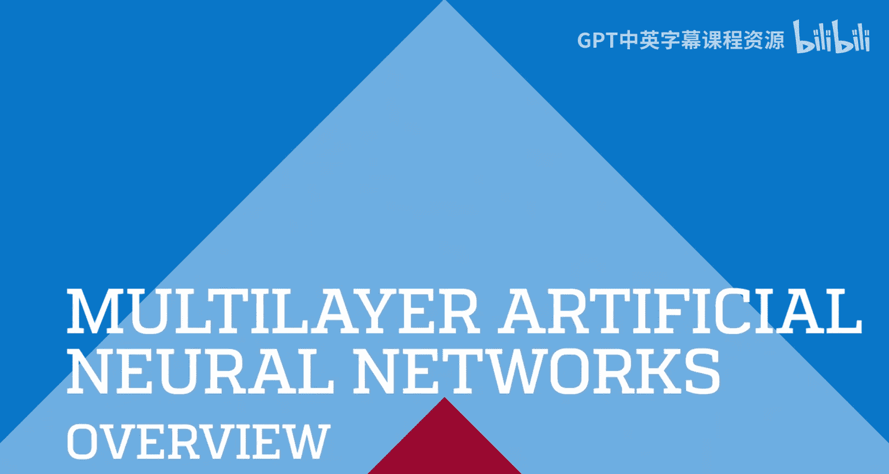

# 约翰霍普金斯大学《应用机器学习｜Applied Machine Learning》中英字幕 p42 0_多层人工神经网络概述.zh_en -BV13xuqzYErx_p42-

。

In previous modules， we studied the linear classfireorcept。

 which is inspired by neurons of the brain。Neural networks are formed when the perceptron is combined in numbers to form a layer of perceptrons。

By utilizing multiple layers in a cascadedd fashion， we build deep neural networks。

 which become very popular by learning Imo and speech recognitionognition better than humans。

🎼From developments in speech cognition， translation， and visual object cognition， to drug discovery。

 genomics and automatic gameplay， these were achieved by deep neural networks and their various networked topologies。

 such as recurrent neural networks or convolutional neural networks。

🎼Neurural networks are universal function appromators。

 which can generate any decision boundary as long as they are fed by large and relevant dataset sets。

🎼Even though neural networks are black box classifiers。

 they are so strong that several studies attempt to explain why they work better than the classical ruleway AI。

🎼Today， universities and industry are in a big effort to utilize the available topic data。

Vas compute through GPGUs and mature open source frameworks such as Tensorflow and Pythtorch。

🎼In this module， first will define the single layer and multiple layer neural networks。

🎼Providing the mathematical definitions of input and output layers， as well as the hidden layers。

🎼Then we will describe the forward propagation algorithm that can optimize a neural network to match it its input with minimized error at the output。

🎼Then we will implement a neural network class far from scratch with all the necessary supporting parameters such as learning rate or batch size Finally。

 we will verify its performance on the digit image data set we have used frequently。

