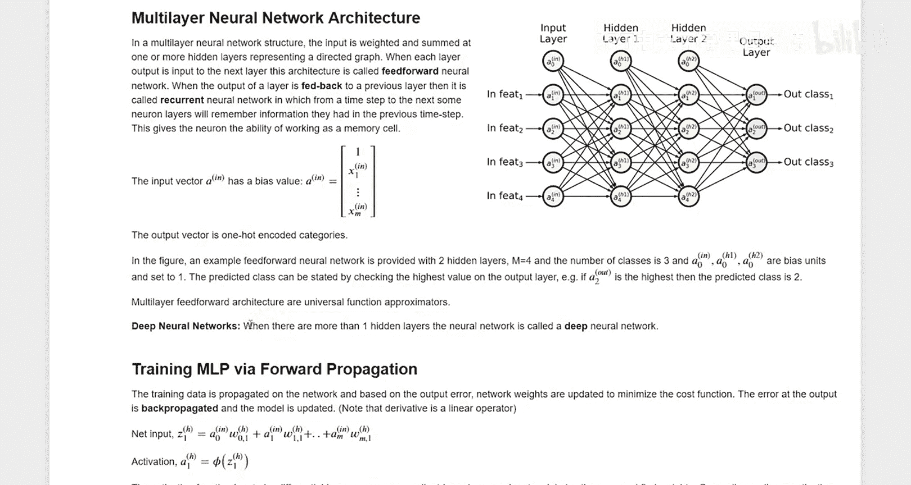

# 约翰霍普金斯大学《应用机器学习｜Applied Machine Learning》中英字幕 p43 1_神经网络基础.zh_en -BV13xuqzYErx_p43-

Dear students， neural networks or using the new terminology。

 deep learning neural networks are very popular lately。How do they work， why are they popular。

 what are their parameters and their network configurations， how do we train a neural network。

 we will address these questions in this module by first defining the neural network model mathematically。

Then we will describe how neural network optimization works。Finally。

 we will demonstrate the designed and implemented neural network classifier。

 which models our mini digit image dataset set。In this section。

 we will study multilayer artificial neural networks， also known as multilayer perceptron。

 neural networks are inspired by the brain。 A brain can be modeled as a graph consists of nodes and edges。

 where each node is a computation node called a neuron。

 Each edge is a link between neurons called a synapse。

 A neuron is typically connected to thousands of other neurons。

 Each neuron operation can be modeled through the perceptron module。

 where we study it in the previous modules。M number of inputs are weighted and summed up。

Then the sum is passed to an activation function。Basically。

 a signal shaper and a threshold which outputs a0 or no signal or one or signal active。

G output is either 0 or 1。The output of a perceptron are the inputs to other perceptrons。

 or used as an output as a predicted class value。So in this case。

 the output of G is the predicted class value。This could also be the input to the other perceptrons。

 Ne output either 0 or  one weights weigh these values。

 and they're added to be used in the input of the next perceptron。

So 0 or1 is coming out from all these cells， and on they weighted， theyre summed up。

 an activation function is applied， a 0 or1 is produced。

 and that is the output of the neuron as predict value y。This equation also summs that。

The figure shows a single neuron， which can be used to build a layer of neurons。 In other terms。

 a perceptron is the building block building cell in a neural network layer。

 cells stack up to build the layer。 Laers are cascaded to build the neural network。

 Training a perceptron was covered in the earlier modules， and in the textbook。

 simply the training of a perceptron yields。 the set of weights。

The W vector and x is the input vector， such as features Y is the label for that training data point Y is provided to us as any other classification problem。

Why is the numerical value 0 or1， If multiple classes are involved， such as 0，1，2，3，4，8。

4 class problem， each one of them can be represented as an output cell， but still。

 their output is a 0 or 1。In this case， one had encoded Only one of the classes should be one。

 The rest of them should be 0， as in one hot encoding scheme。 We will see that in the following cell。

In this case， there are three classes。 All three are one hot encoded。

And their output of a perceptron， which receives the input of the previous layer weighted。

 summed up activation function applied an output as 0 or 1。

 The training algorithm computes the error。 The difference between the labeled Y and the output of the cell A。

Here it's the activation output of the cell， and this information is used as the gradient of the error to update the weights。

 to minimize the total error， which is， again， the difference between y the ground truth。

And the Y chap， the predicted why。Perceptrons cannot solve the ex problem where first classes in quadrant 1 entry3 and the second classes in quadrant 2 and 4。

 The following cell demonstrates the data set for the ex problem， as can be seen from the plot。

 the red and the green hyperplanes， which are two different perceptrons。

 cannot solve the problem by themselves。Red can only discriminate。The purple group here。

But this other purple remained in the second class。And the green can only discriminate。This group。

 but the other group is lost。Even using chad。Perceptrons， unless we use a sigmoid function。

 this is not separable， but even with a sigmoid function， certain ex problems cannot be solved。

 Thus multi layerer neural networks are necessary。 A single perceptron in this fashion。

 when stacked together forms a linear combination。 Each of the combination is factored by the weight vectors summed up。

 and then the cell in total is the linear combination of the previous cells individually represented in each cell。

 Not that a single layer neural network would be a stack of perceptrons in its layer。

 and we can use that single layer to solve the X problem， such as hidden layer one here。

 It will have multiple hyperplanes。 Each one of them generated by a single perceptron in the layer。

So the stack of them can solve the X problem。 however， multi layerer neural networks， as here。

 can do much better by realizing not only a linear decision surface。

 which is still a combination of linear perceptrons。

 but also any curved shape similar to what SVMs could achieve in a multi layerer neural architecture。

 more than one layer is cascaded。 there at least three layers in a neural network， input layer。

 hidden layer， output layer。If there are M features。

 then all these M features must have individual neurons at the input layer。

 such as here In this example， we have four features in the data set。 M is4。

 each data point is fed one by one to the network。 However， in implementation。

 this is achieved by batches。 If we train the neural network one by one and compute the gradient to update all of the weights。

 This is very slow learning。 and the weights fluctuate too much。 If， for example。

 every other data point has a y ground truth 0 and one alternating。

 each one of them causes the weights updated so much fluctuated。 Therefore。

 the data points are batched， say every hundred。 their errors are summed up accumulated and weights are updated at every batch。

 If the batch size is too large。 then again， weights are updated very slowly and convergence will be slow。

 When the output of every layer is fed to the next。LaySuch as in this neural network。

 it is called feed forwardward neural networks。 When there is a feedback。

 a layer fed back to the previous layers， then generally it is called recurrent neural networks。

Similar to a multiple variation， the biasas a0 here for all the layers had a better。

 Not that the input layer is feature size， but the heather layers can be smaller。

 They still receive the weighted values of all the previous layer， but they are slower in number。

 They could be lower。 And finally， the output layer should match the number of prediction classes。

 The binary classification is used than there are two neurons at the output。 In this case。

 there are three neurons because we have three classes。

 The formatting or labeling of the elements in the network shows the subscript as the number of neurons in the layers。

 We have four features。 The subscript is 4。We have four plus the bias layer bias cell。

5 cells in hidden layer， The subscript is 0 to 4， Similarlyly in hidden layer 2。

 and in the final layer， we do not have a bias cell， but three classes， so it's one to3。

 the superscript is the layer number， layer input， layer hidden 1， layer hidden 2， layer output。

Each output of a cell is its activation function output。 selection of an activation function。

 such as step function， sigmoid function or relu function is very important and determines the nature of the network。

 we will see more about this in the following modules。 It's called a deep neural network。

 when there are more than one hidden layer。 In the past， training。

 deep neural networks was very costly。 However， with the emergence of the GPG Pus that's not a problem anymore。

 Next， we will see how the training is achieved through forward provocation algorithm。

