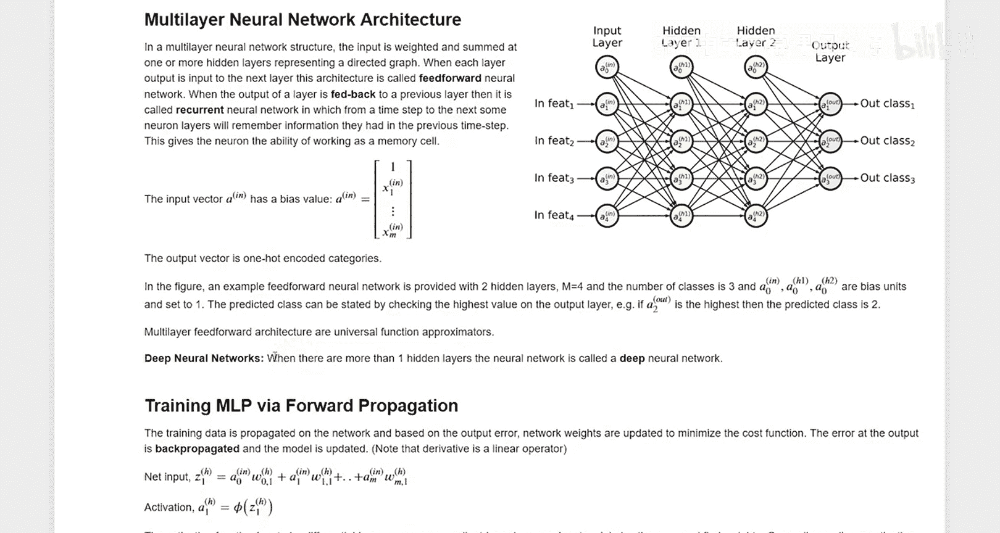

# 应用机器学习：1：神经网络基础 🧠

在本节课中，我们将要学习多层人工神经网络（也称为多层感知机）的基础知识。我们将从数学上定义神经网络模型，描述其优化原理，并演示如何设计和实现一个用于手写数字图像分类的神经网络分类器。

## 神经网络模型

上一节我们介绍了感知机作为基础单元，本节中我们来看看如何由这些单元构建出神经网络。

神经网络的设计灵感来源于大脑。大脑可以被建模为一个由节点和边组成的图。每个节点是一个被称为**神经元**的计算单元，每条边是神经元之间的连接，称为**突触**。一个神经元通常与成千上万的其他神经元相连。

每个神经元的操作可以通过感知机模块来建模。M个输入经过加权求和，然后总和被传递给一个**激活函数**。激活函数就像一个信号整形器和阈值器，输出0（无信号）或1（信号激活）。因此，输出G是0或1。

一个感知机的输出可以作为其他感知机的输入，或者作为预测的类别值。在这个例子中，G的输出就是预测的类别值。它也可以作为下一个感知机的输入。所有神经元输出的0或1值被赋予权重并求和，作为下一个神经元的输入，再经过激活函数处理，产生0或1的输出，这就是神经元最终的预测值y。

**公式**：`y = G(∑(w_i * x_i))`

下图展示了一个单神经元，它可以用来构建一层神经元。换句话说，感知机是神经网络层中的基本构建单元。多个单元堆叠起来构成一层，多层级联起来就构成了神经网络。

感知机的训练在之前的模块和教材中已经介绍过。简单来说，训练感知机就是找到一组权重向量W。其中，x是输入特征向量，y是该训练数据点的标签（0或1）。

如果涉及多个类别（例如0,1,2,3,4），每个类别可以表示为一个输出神经元，但其输出仍然是0或1。在这种情况下，通常使用**独热编码**：只有一个类别的输出为1，其余为0。

以下是独热编码的一个例子：
*   当有三个类别时，所有三个神经元都采用独热编码。
*   一个感知机的输出（接收前一层加权求和并应用激活函数后的0或1结果）被用于计算误差。
*   误差是真实标签y与神经元激活输出a之间的差值。这个误差信息被用作梯度来更新权重，以最小化总误差（即真实值y与预测值ŷ之间的差值）。

## 多层神经网络的必要性

单个感知机无法解决“异或”问题。在异或问题中，第一类数据点位于第1和第3象限，第二类数据点位于第2和第4象限。

如下图所示，红色和绿色的超平面（代表两个不同的感知机）无法单独解决这个问题。红色只能区分一部分紫色组，绿色也只能区分另一部分。即使使用Sigmoid函数，某些异或问题也无法解决。因此，需要**多层神经网络**。

以这种方式堆叠在一起的单个感知机形成线性组合。每个组合由权重向量加权求和，因此整个单元是前一层各个单元的线性组合。

一个单层神经网络就是其层中感知机的堆叠。我们可以用这个单层来解决异或问题，例如这里的隐藏层1。它将有多个超平面，每个超平面由该层中的一个感知机生成，因此它们的堆叠可以解决异或问题。

然而，**多层神经网络**可以做得更好。它不仅能实现线性决策面（这仍然是线性感知机的组合），还能实现任何曲线形状，类似于支持向量机在多维空间中能达到的效果。

## 网络架构与术语

在多层神经网络架构中，至少级联了三个层：**输入层**、**隐藏层**和**输出层**。

*   如果数据有M个特征，那么输入层必须有M个独立的神经元。例如，数据集中有4个特征（M=4），输入层就有4个神经元。
*   每个数据点被逐一输入网络。但在实际实现中，这通常通过**批次**来完成。逐一训练并更新权重会导致学习速度慢且权重波动大。因此，数据点被分批处理（例如每100个一批），累积误差，并在每个批次结束时更新权重。如果批次太大，权重更新会非常缓慢，收敛也会变慢。
*   当每一层的输出都馈送到下一层时，这种网络被称为**前馈神经网络**。当存在反馈（即某一层反馈到前一层）时，通常被称为**循环神经网络**。
*   与多元回归类似，所有层都包含一个偏置项（如图中的a0）会更好。
*   输入层的大小等于特征数量，但隐藏层可以更小。它们仍然接收前一层所有权重值的输入，但神经元数量更少。输出层的大小应与预测类别数匹配。对于二分类，输出层有两个神经元；对于三分类，则有三个神经元。

网络中各元素的格式或标签使用下标表示层中的神经元编号，使用上标表示层号。例如，有4个特征，下标为4；隐藏层1有4个神经元加1个偏置单元，下标为0到4；最终输出层没有偏置单元，但有3个类别，所以下标为1到3；上标表示层号（输入层、隐藏层1、隐藏层2、输出层）。

每个神经元的输出是其激活函数的输出。激活函数的选择（如阶跃函数、Sigmoid函数或ReLU函数）非常重要，它决定了网络的性质。

当存在多于一个隐藏层时，它被称为**深度神经网络**。在过去，训练深度神经网络成本很高。然而，随着GPU的出现，这已不再是问题。

## 总结

本节课中我们一起学习了神经网络的基础。我们了解到神经网络由感知机单元堆叠而成，至少包含输入层、隐藏层和输出层。单个感知机能力有限，无法解决如异或等非线性问题，而多层神经网络通过组合多个线性决策面，能够拟合复杂的非线性边界。我们还介绍了网络的基本架构、前馈与循环网络的区别，以及使用批次训练的重要性。下一节，我们将通过前向传播算法来了解神经网络是如何进行训练的。

