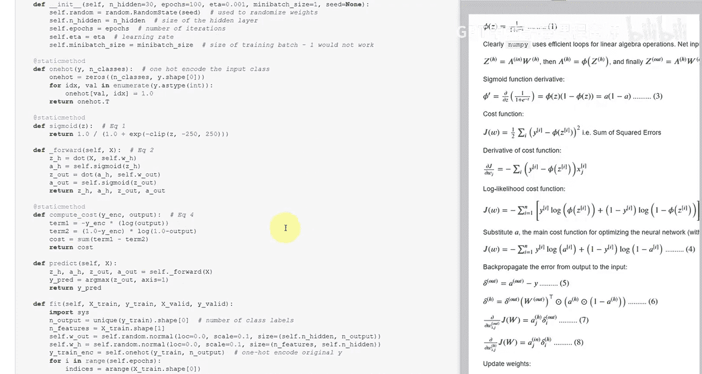

# 约翰霍普金斯大学《应用机器学习｜Applied Machine Learning》中英字幕 p44 2_前向传播算法详解.zh_en -BV13xuqzYErx_p44-

As we have seen in several machine learning algorithms。

 the core of the neural network training is also an optimization engine。

Which minimizes the on the training data set by adjusting weights of the perceptrons。

Let's see how forward error propagation and its optimization scheme works。

Not that the training data points and the output of perceptrons are forward propagated。

And the error is back propagated。 They will use an nonlinearar sigmoid function as in equation 1。

 since it is differentiable， not that a step function or a relu would not be differentiable。

Sigmoid activation function or a step function or a relative function are the popular choices for the activation function。

 among them， only sigmoid is linearly differentiable。And， of course。

 there are other methods for the relu and the step， but that's not in ourosco。

 The net input at the cell is given with Z1， such as the dot product of the previous layer。

 activation output and the weights。 a set of weights are stored every layer。

 which is the size of the layer。 Act a is through the phi function， such as the sigmoid。

 Z pass to phi is the output of the activation function， as in this equation 2。

 Not that all these equations are computed by nu， and its linear algebra operations are very efficient。

 such as the matrix multiplication or transpose and so on。

 The net input for n data points would be the capital A Z at the output as equation2 presents。

 We need derivatives to use in updating the weights， similar to the grading descent。

 Since the phi function is sigmoid。 its derivative。

Is so straightforward as in given an equation 3 It's basically a times1 minus a is in equation 3 then the cost J of w is the sum of squared errors at the output y minus phi output plugging the values and solve 4 W since we are optimizing the weights by minimizing the L2 error and here this is the L2 error。

 we got j of w S3 the j function W passed as argument as in equation4 we use the log of the cost J is in equation the previous equation here because it's much easier to work with the log function since the optimization is based on the cost J or cost lower of j it will yield the same optd weights then the delta error in equation 5 is where we start back proagating the error the delta error of the output which is the activation output of the output layer minus the actual label。

Is back propagated to the input layer E 6。 we apply the delta at the hidden layer H delta times weight times the derivative of phi and then equation 7 using the log cost。

 it will be the activation times delta and then equation8 will be the same thing at the input layer。

 the derivative of the log cost at the hidden layer is activation at input and delta hidden。

 Not of the subscripts and superscripts。 For example。

 this particular gradient is at the output layer and this particular gradient is at the hidden layer。

 and the error is backproagated。 Finally， we update the weights with the learning eta factor。

 and the delta computed to the derivatives。 The backproagated error。

 Not that we are optimizing every weight vector of the layers。In this particular example。

 we have two layers of weights，1 at the hidden layer，1 at the output layer。 Now。

 let's see how the equations line up against the code。

 We have neural net multi layerer perceptron class。

 which encompasses everything necessary for our primitive from scratch coded neural network fit and predict function is the same API using a scale learn classifiers。

We have some static methods。1 at encoding sigmoidite and compute cost underscore before the function name shows that that particular function is private only。

 and they are not supposed to be used outside of the class。

 Equation 1 is the sigmoid function here and here。1 over1 plus exponential Z。

 But we also have a clipping here so that it will be clipped at-250 and 250。

 Forward is one full forward of the network。 It computes the output at the hidden layer and the output at the output layer。

 W H W out are the weight vectors for each of those layers。

 and they are stored in the instance variable。 Eation 2 here。

Is the that product of a and the weights。 Equation 4 is the compute cost function and the logarum of it here。

Term one is the first component， term 2 is the second。Cost is the difference between them。

 If you compare equation 4 to the compute cost function， you will see that it's a1 to one mapping。

 Eation 3 is sigoid derivative for the hidden layer。 Delta out is equation 5。

 Eation 5 is in the fit here。

And this is batched。 We have batch index to pull the training wise。

Which is also encoded and then compute to Delta Eation 6 is Delta out at the hidden layer。

 equation 6 and equation 6。And equation 6 is here is the dot product of delta out and weights out times the sigmaoid derivative at the hidden layer。

 We are back propagating the error at the output to the back layer。

 which is the hidden layer and to the input eventually equation 7 is the gradient at the output layer equal to the dot product of delta out and weight at the output layer transpose the orientations of the matrixrices such as W and delta might be tricky like do you need the transpose or not。

 Do you need a matrix product B or B matrix product A in implementation。

 the best is printing and logging all the matrix sizes in individual operations。And finally。

 equation 8，7 and 8， of course， are the gradients at the hidden layer and that product of the input and the delta from the hidden layer。

 as can be seen the errors and through the gradients， It back proagated。

 Equation 9 is the weight updates for both W hidden and W out。 Both of them are updated here。

 with their respected gradients。 as a note， weights hidden are between input and hidden layer and weights。

 output are at between hidden and the output。 and this particular quote as a single hidden layer。

 Next， we will see how this class is used to classify the images that we have classified in the first module。

