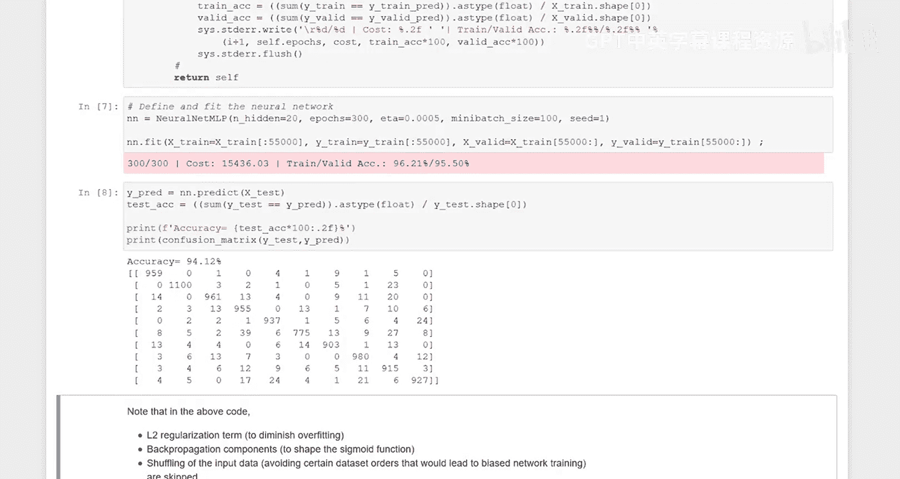

# 约翰霍普金斯大学《应用机器学习｜Applied Machine Learning》中英字幕 p45 3_神经网络设计与实现.zh_en -BV13xuqzYErx_p45-

Now let's see how we assembled the pieces we covered so far to build a neural network classifier from scratch and evaluate its performance on the Min dataset set。

We have looked how the error is back propagated from output to the input and how to update weights for the layers。

 Now， we will see how to work with the neural network in practice and talk about the remaining parameters in the implementation。

Parameterters to the class is the size of the hidden layers。Default is 30。 number of epochs。

 defaultult is 0 to run the optimizational。As neural networks use gradient descent。

 the optimization can go indefinitely until the error is not changed any。

 or the change on the error is less than a particular threshold。

 Another way is using the epochs to specify the number of maximum iterations。

 As can be seen from the implementation In this case。

 The optimization will be continued epoch many times。

 Eta is the learning speed and has to be determined by hyperparameter optimization。 As you know。

 this is the factor of the error that is back propagated to the input。

 Minimat size determines the number of data points to accumulate。 before the weights are updated。

 In this case， it one。 It not usable。 It will cause a lot of fluctuations。 It can be 100。

 It can be determined from the training data set size。

 The error will be accumulated until the mini batch sizes reached。 Finally。

 the seed is same with any other nondeterminististic fire， such。

Random force classifier Setting the C to a particular value will make the training deterministic initiallynitially。

 weights are randomly selected， and this will affect the optimization。 S can be seen here。

 both weight vectors are set randomly between 0 and a scale of 0。1。

 meaning they will be very close to 0， but they will be numbers around-010。1 and plus 0。

1 with a normal distribution。 The implementation misses regularization and shuffling of the input data to reduce overfitting or by us This particular minus data is the full data。

 a much bigger version of the dataset we use in previous modules。

 It has 6k training images and 10k testing images with 784 features basically these are the pixels of the images S can be seen in cell 4 Our model is learning the digits which look like this。

 These are all trees as the ground truth。And we are trying to learn what the tree is。

 Multilayer Perceptron Classifier is used from S key learnn library。

 and it does a good job with these three models，92%，93% and 94%。

 A random classification would be 10% since we have only 10 digit classes。

 The validation portion is using 5 k data points here，5 k。

 the last 5 k data points in order to demonstrate the learning and the measure of overfitting progress。

55 k data points are used to train the model。 Let's run the model。As can be seen。

 the epochs are increasing。 The cost is going down。

The training accuracy is going up and the validation accuracy is going up。

 as we know from previous modules， when the training accuracy。

 meaning reclassification of the training accuracy。

 comes close to the validation accuracy that's a good way to stop the training， the more training。

 the risk of overfitting increases。As our epoch is continuing， our coast is going down。

The training and validation a are changing， but much smaller degree。But still。

 the cost is going down。If if we had set a threshold of something like 10 to the minus- 3。

It won't it wouldn't stop。So the number of epochs will be reached at 300。

 and then the training will stop。Our runtime is finished。

 final course is 15000 final training accuracy， training recclassification accuracy is 96%。

 and the validation is 95。5。 Let's run the testing。 Our test does 94。

 Our implementation performs similarly to the Sk learnn classifiers。

 Ily we need to use the validation to see a measure of overfitting for Sk learn classifiers2。

 so our model is doing good while training quicker， but maybe we have overfitted。

This concludes our module。

