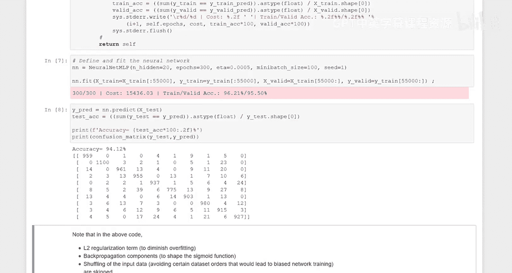

# 应用机器学习：3：神经网络设计与实现 🧠

在本节课中，我们将学习如何将之前介绍过的各个部分组合起来，从头开始构建一个神经网络分类器，并在MNIST数据集上评估其性能。

上一节我们介绍了误差如何从输出反向传播到输入，以及如何更新各层的权重。本节中，我们来看看如何在实践中使用神经网络，并讨论实现中剩余的参数。

以下是神经网络实现中的关键参数：

*   **隐藏层大小**：默认值为30。
*   **训练轮数**：默认值为0，表示运行优化器直到满足停止条件。由于神经网络使用梯度下降，优化过程可以无限进行，直到误差不再变化，或误差变化小于特定阈值。另一种方法是使用`epochs`来指定最大迭代次数。从实现中可以看出，优化过程将持续`epoch`次。
*   **学习率**：由超参数优化确定。这个参数是反向传播到输入的误差因子。
*   **小批量大小**：决定在更新权重之前累积的数据点数量。如果设置为1，会导致训练过程波动很大。它可以设置为100，或根据训练数据集大小来确定。误差会一直累积，直到达到小批量大小。
*   **随机种子**：与任何其他非确定性分类器（如随机森林分类器）相同。将种子设置为特定值会使训练过程具有确定性。初始权重是随机选择的，这会影响优化过程。可以看到，两个权重向量都是在0附近按0.1的尺度随机设置的，这意味着它们非常接近0，但数值会在-0.1到+0.1之间呈正态分布。

该实现缺少正则化和输入数据洗牌，以减少过拟合或偏差。这个特定的MNIST数据是完整数据集，比之前模块中使用的数据集大得多。它包含6000个训练图像和10000个测试图像，每个图像有784个特征，基本上是图像的像素。

可以看到，我们的模型正在学习识别数字，这些数字看起来像这样。这些都是数字“3”作为真实标签，我们正试图学习什么是“3”。

我们使用了Scikit-learn库中的多层感知器分类器，它在这些模型上表现良好，准确率分别为92%、93%和94%。由于我们只有10个数字类别，随机分类的准确率将是10%。验证部分使用了5000个数据点，即最后5000个数据点，以展示学习过程和过拟合进度的度量。55000个数据点用于训练模型。

让我们运行模型。可以看到，训练轮数在增加，损失在下降。训练准确率在上升，验证准确率也在上升。从之前的模块中我们知道，当训练准确率（即对训练数据的重分类准确率）接近验证准确率时，是停止训练的好时机。训练越多，过拟合的风险就越大。随着训练轮数继续，我们的损失在下降。训练和验证准确率在变化，但变化幅度小得多。然而，损失仍在下降。如果我们设置了像10^-3这样的阈值，它不会停止。因此，训练轮数将达到300，然后停止训练。

我们的运行已完成，最终损失为15000，最终训练重分类准确率为96%，验证准确率为95.5%。让我们运行测试。我们的测试准确率为94%。我们的实现与Scikit-learn分类器的性能相似。我们还需要使用验证集来查看Scikit-learn分类器的过拟合度量，所以我们的模型在训练时表现良好，但可能已经过拟合。

本节课中我们一起学习了如何从零开始实现一个神经网络分类器，理解了关键参数的作用，并在MNIST数据集上进行了训练和评估，观察了训练过程中的损失和准确率变化，以及过拟合的潜在风险。