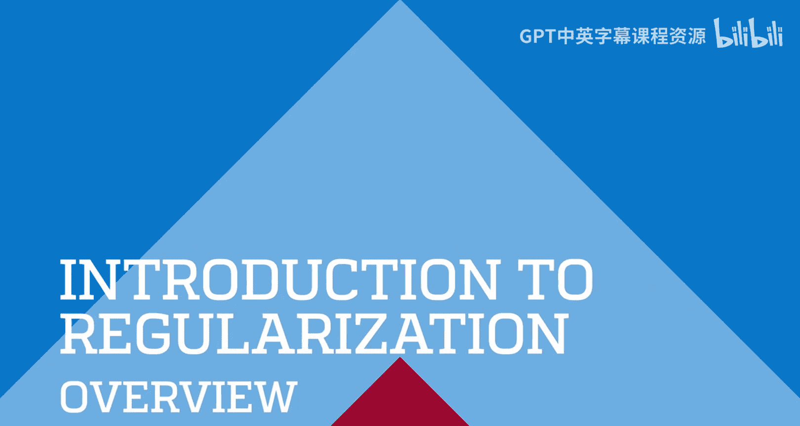

# 约翰霍普金斯大学《应用机器学习｜Applied Machine Learning》中英字幕 p46 4_正则化技术概述.zh_en -BV13xuqzYErx_p46-

。

🎼As mentioned several times in the previous modules。

🎼Model generalization is the most important feature of a good machine learning model。

🎼A good model is robust， minimizes overfitting， and is able to make good predictions when never seen before data points were inferred by the trained model。

Techniques such as ensemble learning， feature reduction。

 and employing strong learning algorithms help maintain high model generalization。

🎼Another major method to achieve robust models is regularization in this module we will first explain the reasoning behind the necessity for regularization。

🎼Then we will present how neural network regularization is achieved in two different methods by controlling weight values in the neural network layers and by controlling network cells through turning them on and off during training phase。

🎼Next， we will present how decision boundaries are affected。

🎼Change by introducing regularization to the model using a handpicked dataset set。🎼And finally。

 we will demonstrate increased robustness when a neural network model is trained with regularization and dropout improvements。

