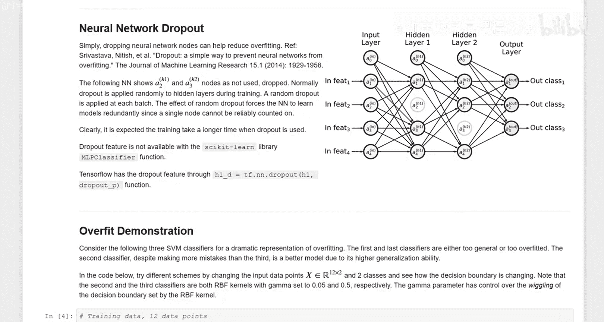

# 约翰霍普金斯大学《应用机器学习｜Applied Machine Learning》中英字幕 p47 5_正则化与神经网络Dropout技术.zh_en -BV13xuqzYErx_p47-

Doear students。As we have reiterated several times in the past modules。

 model generalization is the most important aspect of machine learning。

And it is the model developer's responsibility to make sure this is achieved。

 It is indeed an art in machine learning model development to lower the model variance while keeping the learning bias law。

 it is arguable but relevant that most major classifier such as ensemble。

 SVM and neural networks operate in this manner and their hyperparameter sensitivities are subjectively low。

In this module， we will cover techniques to reduce overfitting and to assure model generalization such as regularization。

 decision tree pruning， and neural network dropout。

We will also present how these techniques affect the decision boundaries of respective classifiers。

First， we will explain the reasons why we need regularization in the first place and similar techniques to minimize the overfitting of a machine learning model。

 Second， we will demonstrate effects of regularization and similar methods on the model complexity。

 machinech learning model has to reflect the nature of the entity that the model is strength to explain in order to build a model。

 we use data which is samples the conduct of the entity。 Most of the state of the art algorithms。

 maxim the model explaining the entity minimizing the bias or variance of the model。

 an abstract model generalizes the entity， but when too much loses the precision or fidelity。

 and when high fidelity is achieved， that the model generalization is lost。

 which does not help as a too complex model is not robust and it is overfitted。

 In addition to the fine algorithms that minimize overfit such。Just support vector machines。

There are other methods that help minimizing overfitting ensemble methods help reduce overfi as abstract numerous classifiers working together is a sound and proven strategy。

 That's why random force is one of the most popular algorithms。

 cleaning and reducing the noise reducing the features by feature ranking and selection process helps reduce overfi。

 The third approach， model regularization is simply as a cost term based on the weights of the features。

 such as in a neural network or in a support vector machine。

 analog logocus to a feature selection method。 For example。

 The regularization cost penalizes the usage of features when the model is dependent to all of them。

 Of course， there must be a good balance point where enough features are used to build the model with a high accuracy。

 Two regularization costs are popular。 L1 and L2 L1 is simply some of absolute values and。

Of coursese here the weights are absolute valued， and L2 is the sum of squares of them。

 L2 is more popular， Eas to add to the neural network， for example， in the cost function。

 such as in gra increase by the sum of weights。 If you remember we were adding the gradient to the error to update the weights so in the same error。

 the L2 regularization constant regularization sum can be added the optimizer will both optimize the weights to be used by looking at the gradient and minimize L2 so that sum of the weights actually are not used a fourth abstract method is by decision trees and reducing the complexity of raised decision tree model。

In this section， decision tree pruning an example is provided using the Iris dataset set。

 consider the irris dataset and build two classifiers one regular and the second a pruned decision tree with alphabetta pruning technique。

 The details can be found in the Wi Weca textbook as can be seen by the complexity of these trees。

 a pruned one is simpler but not necessarily inferior。 In fact。

 more distilled removed not that much helping subrees for example， helps interestingly。

 the prune tree has a better accuracy when using 5050 training and testing split evaluation method the 5050 train test clearly shows that the right one pruned simpler decision tree has a better testing accuracy please change the alpha parameter and evaluation conditions to see the effect of the pruning you can also change 5050 to 9010 and see what kind of effects are realized。

Another innovative approach for neural networks is the application of dropout Not that psyit learnn MP learner does not have this feature。

 but the tensorflow， as we will see soon has this feature。

 The dropout is simply dropping some nodes randomly every batch to optimize the neural network being more robust losing a few features helps the network optimizing a redundant network As a reminder。

 the neural network optimization is all about optimizing the weights at the end of the training。

 the weights are updated。 the dropout feature， the dropout approach simplifies the weights where the network relies on multiple sets of features。

 but not a single set in this example， node 2 on the hidden layer 1 and node3 on the hidden layer 2 are dropped for this particular batch If the batch sizes 1000 All those 1000 data points during training are used but a2 and a3 nodes are not computed they are not fed forward。

The neural network so that they are not used in the training of the neural network。

 Other nodes are used for the training of the neural network。This imposes some redundancy。

 a good value for a dropout feature is 0。3 or 30%。 Clearly。

 the dropout causes the neural network training slowdown。 Next。

 we will see how overfitting looks like in models performance and decision boundaries。

