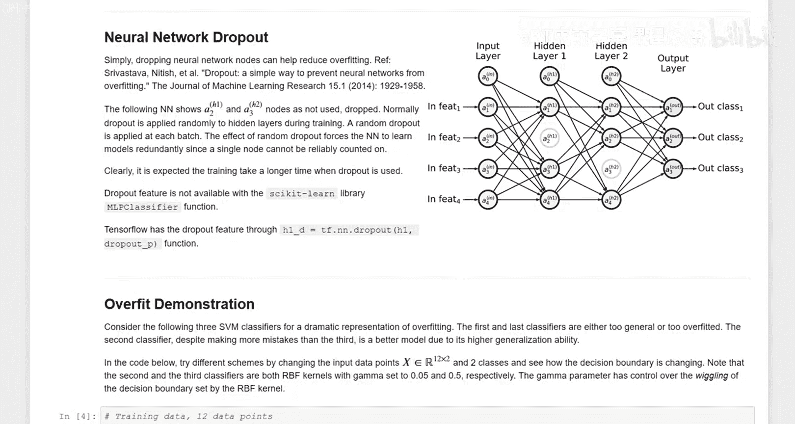

# 应用机器学习：5：正则化与神经网络Dropout技术 🧠

在本节课中，我们将学习如何通过正则化、决策树剪枝和神经网络Dropout等技术来减少模型过拟合，确保模型的泛化能力。这些技术是机器学习模型开发中平衡偏差与方差的关键艺术。

## 概述：为何需要正则化？

正如我们在过去的模块中多次重申的，模型泛化是机器学习最重要的方面。模型开发者有责任确保实现这一点。在保持学习偏差较低的同时降低模型方差，是机器学习模型开发中的一门艺术。可以说，大多数主流分类器，如集成方法、支持向量机和神经网络，都以这种方式运行，并且它们对超参数的敏感性相对较低。

## 模型复杂性与过拟合

机器学习模型必须反映其试图解释的实体的本质。为了构建模型，我们使用代表该实体行为样本的数据。大多数先进算法旨在最大化模型对实体的解释力，同时最小化模型的偏差或方差。

一个抽象的模型能够泛化实体，但如果过于抽象，则会失去精度或保真度。反之，当实现高保真度时，模型的泛化能力又会丧失。过于复杂的模型不稳健，会导致过拟合。

除了像支持向量机这样旨在最小化过拟合的优秀算法外，还有其他方法可以帮助减少过拟合。

## 减少过拟合的方法

以下是几种帮助最小化过拟合的主要方法：

1.  **集成方法**：集成方法通过让众多分类器协同工作来减少过拟合，这是一个可靠且经过验证的策略。这就是随机森林成为最流行算法之一的原因。
2.  **数据清洗与特征选择**：通过清洗和减少噪声，以及通过特征排序和选择过程来减少特征数量，有助于降低过拟合。
3.  **模型正则化**：模型正则化是一种基于特征权重的成本项，例如在神经网络或支持向量机中。它类似于一种特征选择方法。正则化成本会在模型依赖所有特征时，对特征的使用进行惩罚。当然，必须找到一个良好的平衡点，以使用足够的特征来构建高精度模型。

## 正则化成本：L1与L2

两种正则化成本很流行：L1和L2。

*   **L1正则化**：是权重绝对值的和。其公式为：`L1 = λ * Σ|w_i|`，其中 `w_i` 是权重，`λ` 是正则化强度参数。
*   **L2正则化**：是权重平方的和。其公式为：`L2 = λ * Σ(w_i^2)`。

L2正则化更流行，更容易添加到神经网络中。例如，在成本函数中增加权重的平方和。如果你还记得，我们通过将梯度加到误差上来更新权重。在同样的误差计算中，可以加入L2正则化项。优化器将同时观察梯度来优化权重，并最小化L2项，从而使权重的总和实际上不被过度使用。

## 决策树剪枝

第四种抽象方法是通过决策树并降低已构建决策树模型的复杂度。本节将使用鸢尾花数据集展示决策树剪枝的一个例子。

考虑鸢尾花数据集，并构建两个分类器：一个是常规决策树，第二个是使用alpha剪枝技术修剪过的决策树。细节可以在Weka教科书中找到。

正如这些树的复杂度所示，修剪过的树更简单，但不一定更差。事实上，通过剪枝移除那些没有太大帮助的子树，反而可能有益。有趣的是，在使用50/50训练测试分割评估方法时，修剪过的树具有更好的准确率。50/50的训练测试结果清楚地表明，右侧经过修剪的、更简单的决策树具有更好的测试准确率。

你可以更改alpha参数和评估条件，以观察剪枝的效果。也可以将50/50改为90/10，看看会产生什么样的影响。

## 神经网络的创新方法：Dropout

神经网络的另一个创新方法是应用Dropout。请注意，scikit-learn MLP学习器没有此功能，但TensorFlow（我们很快会看到）具备此功能。

Dropout就是简单地在每个批次中随机丢弃一些节点，以优化神经网络，使其更加稳健。丢失一些特征有助于网络优化成一个冗余的网络。提醒一下，神经网络优化最终是关于优化权重的。在训练结束时，权重会被更新。Dropout方法简化了权重，使网络依赖于多组特征，而不是单一的一组。

在这个例子中，对于这个特定的批次，隐藏层1的节点2和隐藏层2的节点3被丢弃。如果批次大小为1000，在训练期间会使用所有1000个数据点，但a2和a3节点不会被计算，也不会被前向传播。因此，它们不参与神经网络的训练。其他节点则用于神经网络的训练。这强制引入了一些冗余。

Dropout特征的一个良好值是0.3或30%。显然，Dropout会导致神经网络训练速度变慢。

## 总结

本节课中，我们一起学习了确保模型泛化能力的关键技术。我们探讨了模型过拟合的原因，并介绍了三种核心方法：**正则化**（特别是L1和L2）、**决策树剪枝**以及神经网络的**Dropout技术**。这些技术通过不同方式控制模型复杂度，惩罚不必要的特征依赖，或引入训练过程中的随机性，从而帮助我们在保持模型偏差较低的同时，有效降低方差，最终构建出更稳健、泛化能力更强的机器学习模型。