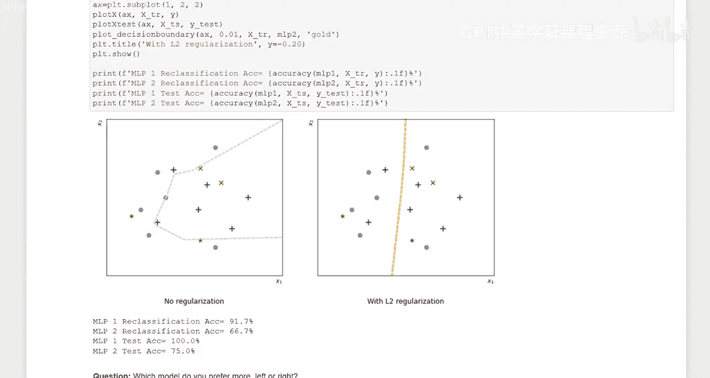

# 约翰霍普金斯大学《应用机器学习｜Applied Machine Learning》中英字幕 p48 6_正则化实践演示.zh_en -BV13xuqzYErx_p48-

Let's see how decision boundaries are affected when regularization is applied and have a look at model bias versus model variance。

We will demonstrate the decision boundaries of three classifier models and the evaluation of overfitting。

Our input dataset set is manually created with two features to ease up the visualization。

The classification problem is binary， and we have equal number of0 and1 categories of the dataset set。

Our first classifier is a linear SVM， and the second one is an RBF kernel SVM with a low value gamma and another RBF SM with high gamma parameter。

 A high gamma value increases the curvature variances while the decision boundary is fitted to the data more visualualization of the linear SVM is done using the dividing hyperplane pulled from the classifier model and coefficients。

As can be seen in SV linear， the coefficients are used。

 This is a hyperplane dividing hyperplane that the SVM uses to divide the binary class problem。

Visualization of the RBF SVM is realized using a mesh grid and contour plots。

Ploot decision boundary function uses the mesh grid to create the data points for both features and then uses the contour。

To draw the decision boundary around those data points using the actual classification predict function。

 these three classifiers will train on the same training dataset set。

 and here are the trained models and their decision boundaries。 Now。

 the ultimate question is that which decision boundary reflects the reality of the data and its behavior mostly。

 Well， albeit'll subjectively， I mark the left plot as biased and the right plot as overfitted。

 and other analyst might pick either one of them for the final model。

 Either on the left one or on the right one。 Thus， it is subjective。

 and it is up to the analyst or the data scientist to pick the right approach。

 If no prior knowledge exists about the data and the environment。

 Then we should pick the middle model， where a good balance between bias and variance is achieved。

 the decision surface is deemed realistic shown here on the training dataset。

Now let's plot the cures again， superimpose and with the testing dataset set。

We can easily see the variations of the model， of those three models。

And the effect of their parameters and the difference between an abstract overfited and a proper model Not that testing dataset set is hand picked。

 but still objectively， as cross marks， which belong to the plus category。

 originally are closer to that class。And the star marks， which originally belong to the circle class。

 make sense。 The lower middle star data point is difficult to classify correctly。This one。But still。

 the middle model， RVF with gamma 0。05， should be the preferred model。SVC主。Now。

 let's see the effect of regularization on a neural network。

 The features are scaled to help diminish their individual effects on the axis and make the model more circlelike or circular likepherical like left model is without regularization。

 and the decision boundary fits to the data。 Perhaps it is not a bad model。

 the model on the right has regularization and it comes up with a plane like a decision boundary。

 we use the exact same training and testing data set as before。

 except for the scaling as you can see a difference between a neural network in the support vector machine。

 neural network finds the boundary very close to the data points， unlike a support vector machine。

 which actually maximizes this margin between the decision boundary and the surrounding data points。

 we was able to see this behavior clearly in this plot。

 but here the decision surface is not sVm like， but it more neural network like any little change in the data points will affect this decision boundary a lot。

But not in support vector machine。 That's why support vector machines are better more generalizable classifiers Without the regularization。

 SVM works fine neural network needs regularization。 Now。

 the million dollar question is that which one to pick this small example perhaps does not show fully。

 but in my opinion， the one on the right has more generalization ability and without in prior knowledge about the environment。

 I would pick the right model， despite it makes more errors on the testing dataset。

That concludes our module。

