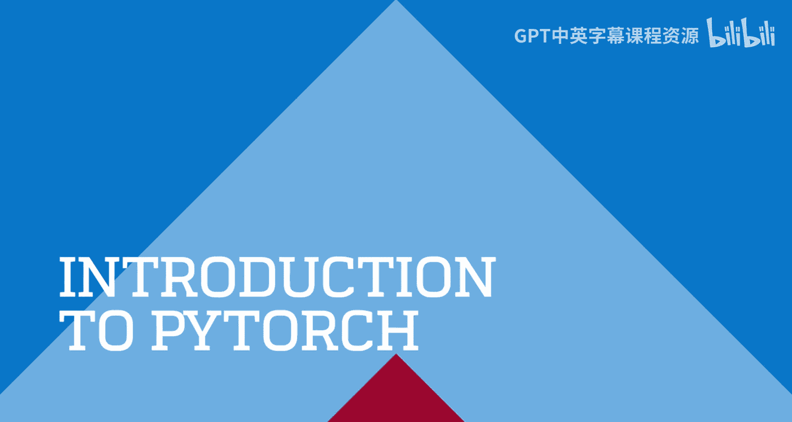
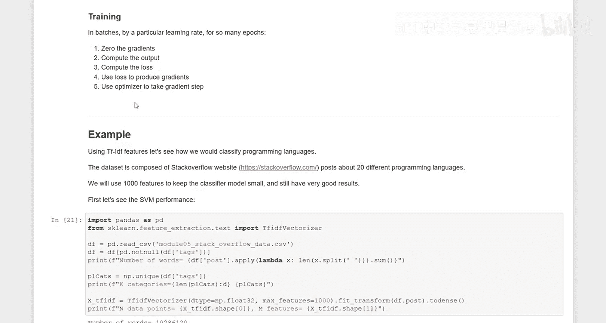

# 约翰霍普金斯大学《应用机器学习｜Applied Machine Learning》中英字幕 p50 8_PyTorch入门导论.zh_en -BV13xuqzYErx_p50-

Dear students， in this module， we will look at the Pythtorch framework。

By briefly investigating its capabilities in terms of variables， data structures， operations。

 functions and neural network models。Pytorch is a capable neural network framework。

 which can realize a vast variety of network architectures， especially recurrent neural networks。

 as Pytorch introduced dynamic computational graphs and a very simple interface with many details hidden from the programmer。

 It became a popular and capable library。 In fact， Tensorflow follow the suite of computational graphs in tensorflow 2。

0， came up with similar methods。 The main idea of these neural network frameworks is that we can build the computationals as a directed oally graphs or DG as can be seen on the figure。

 our basic supervised learning model can be represented as a DAG Dg。 For example。

 let's take perceptron， the building block of a neural network。

 The expression of a perceptron is y equals weights W times by input X added a bias。Also。

 we do this for every data point in the X matrix and compute through some optimization。

 the best set of weights to minimize the predicted y and the given y Xr observations Y are targets。

 the model is W times x plus B parameters are any parameter that the network has such as Eta learning rate or epoch number of operations number of iterations。

 and alpha for regularization and so on， loss function can be the minimum squared error MSE。

 Thus our supervis learning for a perceptron is indeed this graph representation。And perceptron here。

 as we zoom in， the computation W times x plus B can be realized as in this graph， not that。

The single computation is used as many as the number of data points we have。 However。

 the graph is same。 The operation is same。The item data structure。

 container that care the data is called the tensor。 Tsor is a mathematical object。

 holding multidimensional data。Our good old capital X matrix would be a two dimensional tensor。

Before we jump into the actual code， we must create a virtual environment。

 as we will use several frameworks such as Pytorch， Pytorch on GPU。

 Tensorflow and Tensorflow on GPU and any other library such as NLCK Jansem。

We must have an aconual environment so that these frameworks would not interfere with each other。

 nor that each environment or related folders will be several gigabytes in size。

 createate the environment， activate it and run this notebook on it。With these commands。

As you see when we install the library， and acon environment automatically will download or use a library from the baseline called Torch bytorrch。

 Jupiter， Mattpllib， pandas and Sitlen and any other library that has dependency on I name the virtual environment as torch。

 First， we check the version。 as these libraries are very popular， they are updated frequently。

 Exp that there will be API changes。 Quda is the coding framework for GP GPPU developed by Nvidia for their graphical processor video cards。

 These are fast and parallel processors that can do very fastly neural algebrage。

 such as matrix multiplication。 Thus， they are faster than CPUus。

Or they are expected to be faster than CPU implementations。 Second， we have a describe function。

 Let's check our first building block of a tensor。 It will list the details of this tensor。 Clearly。

 tensor is a data structure for both Pythtor and tensor floor。

The two major neural network development platforms。A tensor 2 by 3， similar to2 by3 matrix。

 Most functions are similar to numy versions as well。 We can initialize a tensor with a nunier array。

 Con the shapes sum of the columns， for example， axis 0 of a nuumpier array or dimension 0 of a tensor。

Now， the benefit of a computation graph is that we can specify how the nodes are used and what they need。

 The parameter requires grad Boolean flag can be set on a tensor so that the necessary information is passed to it behind the scenes so that we can actually have the grad gradient to update the tensor and then minimize the error。

 And， of course， this gradient is computed by the predicted output and the actual output Y。

 naturally， the gradient is the difference between the current value and the previous So running the cells multiple times will change it。

 as we run the following cells， the gradient will change。

 recall that we are passing the data from the input to the neural network output。

 which is speed forwarding and then computing the error at the output and back propagating this error to the nodes so that they can be used for gradients。

The requires gra equals to true is exactly for this purpose Behi the scenes by the use of tensors through the computation graph。

 Pytorch handles these details。 So we don't have to call it a complicated code。

 like we did in the neural network module。 Now， the second piece we need is the actual loss function to compute the error。

 We will see this in a moment。 recall the perceptron and let's design a computational graph on it。

 Get the torch n n module， neural network library。 Inherit the class n n module called it perceptron。

 The call to the superconstructor and create a single forward cell F C1 with the input dimension M。

 It's the number of features。 The output will be a single value as the perceptron generates。

 This was the binary value 0 or one after the activation function。

 N and linear is the function where we multiply the weights with the input X。

 We do not have to write the operation。 because n and linear is in fact， that。

Operation the weights are hidden here。 input is x and an output is self F1。 The forward function。

 which is the overriding function in the Nn module。 This is the actual neural network cell。 Actually。

 in fact， this is a layer。 The output of the forward is truly activation function sigmoid it。

 It's so simple。Now we will see three activation functions， sigmoid， hyperbolic tangent and relu。

 each of these are good for certain applications， and it is up to the designer to research and use the correct one or the suitable one。

 For example， relu helps fight diminishing gradients。 as if it happens， the convergence will stop。

 perhaps prematurely， it is a popular activation function for image classification。

 a fourth activation function named soft Mac is popular at the output of the neuralodle network。

 which can map the output to the number of classes and compute respected probabilities。

 If there are cha classes， their total probability should sum up to one。As you see。

 this must be equal to1。 between can have a variety of those functions， such as the MSC。

 which is also L2。Categoorical cross entropy loss and binary cross entropy laws。

 depending on the actual application， each have their pluses and minuses。 for example。

 for one hot vector output。Such as image classification。

 where the outputlet can only belong to one class。Categgoical cross entropy loss function is popular。

 Finally， we need an optr。 And again， Pythtorch has many to choose from。

 The optimization will optimize the weights on each of that an nonlinear function。 Remember。

 we didn't create the status structure。 The status structure is internal to the anan nonlinear。

 Many details are hidden， because they are always needed and used typically in a neural network。

 such as the gradients and the weights。For a trainer， common steps are 1，0 the gradients。

 not that the gradients are the derivatives so that they will jump around as they flow through a network。

Compute the output for each layer， this is feed forwarding the neural network。

 it's the actual output of the neural network for those particular data points。

Computute the error by the loss function， use the loss and compute the gradients。

Exece the optimizer step and update the weights。 Several details will be again hidden from the programmer。

 but internally， all these steps will be done， like in the neural network function that we implemented。

 Next， we will see how we will realize a neural network module using Pytorrch building blocks。😊。

