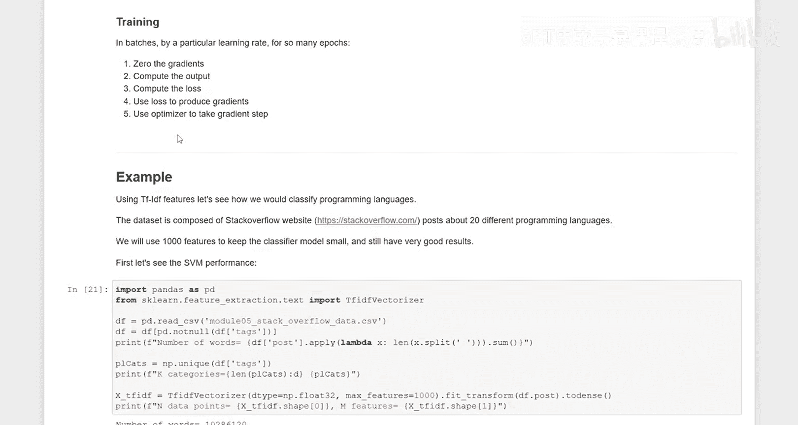

# 应用机器学习：8：PyTorch入门导论


在本节课中，我们将学习PyTorch框架。我们将简要探讨其在变量、数据结构、操作、函数和神经网络模型方面的能力。

PyTorch是一个功能强大的神经网络框架，可以实现多种网络架构，特别是循环神经网络。PyTorch引入了动态计算图和一个非常简单的接口，隐藏了许多编程细节，使其成为一个流行且强大的库。事实上，TensorFlow 2.0也采用了类似的计算图方法。

这些神经网络框架的主要思想是，我们可以将计算构建为一个有向无环图（DAG）。例如，我们的基本监督学习模型就可以表示为一个DAG。

## 计算图与感知机

上一节我们介绍了计算图的概念，本节中我们来看看一个具体的例子：感知机。

感知机是神经网络的基本构建块。其表达式为：
**y = W * X + b**
其中，W是权重，X是输入，b是偏置。

我们对X矩阵中的每个数据点执行此操作，并通过某种优化算法计算最佳权重集，以最小化预测值y与给定目标值Y之间的误差。模型参数包括网络拥有的任何参数，例如学习率η、迭代次数epoch、正则化系数α等。损失函数可以是均方误差（MSE）。

因此，感知机的监督学习确实可以用这个图表示。当我们放大感知机时，计算W*x + b可以表示为图中的节点。请注意，这个单一计算会根据我们拥有的数据点数量重复多次，但图的结构和操作是相同的。

## 张量：核心数据结构

在深入实际代码之前，我们需要了解承载数据的基本容器：张量。

张量是一个数学对象，用于保存多维数据。我们熟悉的矩阵X就是一个二维张量。

## 准备开发环境

在开始编写代码之前，我们必须创建一个虚拟环境。我们将使用多个框架，如PyTorch、GPU版PyTorch、TensorFlow等。拥有一个独立的环境可以防止这些框架相互干扰，并且每个环境相关的文件夹大小可能达到数GB。

以下是创建和激活环境的命令：
```bash
conda create -n torch python=3.9
conda activate torch
pip install torch torchvision jupyter matplotlib pandas scikit-learn
```
如你所见，安装库时，虚拟环境会自动下载或使用名为`torch`的基础库。我将虚拟环境命名为`torch`。

首先，我们检查版本。由于这些库非常流行，更新频繁，请注意可能会有API变更。CUDA是NVIDIA为其图形处理器（GPU）开发的并行计算框架。GPU是快速且并行的处理器，可以非常快速地执行神经代数运算（如矩阵乘法），因此通常比CPU实现更快。

## 初识张量

接下来，我们看看张量这个基本构建块。

`describe`函数将列出此张量的详细信息。显然，张量是PyTorch和TensorFlow这两个主要神经网络开发平台共有的数据结构。

一个2x3的张量，类似于2x3矩阵。大多数函数也与NumPy版本相似。我们可以用数值数组初始化张量。例如，可以沿轴0（NumPy数组的轴0或张量的维度0）对列求和。

现在，计算图的好处在于我们可以指定节点的使用方式和需求。可以在张量上设置`requires_grad`布尔标志，以便在幕后将必要的信息传递给它，这样我们就可以实际获得梯度来更新张量并最小化误差。当然，这个梯度是根据预测输出和实际输出Y计算的。自然地，梯度是当前值与先前值之间的差异。因此，多次运行单元格会改变它。当我们运行以下单元格时，梯度会发生变化。

回想一下，我们将数据从输入传递到神经网络输出（即前向传播），然后在输出端计算误差，并将此误差反向传播到节点，以便它们可以用于梯度计算。`requires_grad=True`正是用于此目的。PyTorch通过计算图中的张量使用，在幕后处理这些细节。因此，我们不必像在神经网络模块中那样调用复杂的代码。

## 损失函数与优化器

现在，我们需要的第二个部分是计算误差的实际损失函数。我们稍后会看到这一点。

回想一下感知机，让我们在其上设计一个计算图。

获取`torch.nn`模块（神经网络库）。继承名为`nn.Module`的类，将其称为`Perceptron`。调用超类构造函数，并创建一个具有输入维度M（特征数量）的单个前向单元`fc1`。输出将是一个单一值，因为感知机生成的是经过激活函数后的二进制值0或1。

`nn.Linear`是我们将权重与输入X相乘的函数。我们不必编写该操作，因为`nn.Linear`实际上就是那个操作。权重隐藏在这里。输入是x，输出是`self.fc1`。

`forward`函数是`nn.Module`中被重写的函数。这是实际的神经网络单元（事实上，这是一层）。`forward`的输出是激活函数`sigmoid`。就这么简单。

现在我们将看到三种激活函数：sigmoid、双曲正切（tanh）和ReLU。每种都适用于某些特定应用，由设计者研究并使用正确或合适的一种。例如，ReLU有助于对抗梯度消失问题。如果发生梯度消失，收敛可能会过早停止。ReLU是图像分类中流行的激活函数。

第四种名为Softmax的激活函数在神经网络的输出层很流行，它可以将输出映射到类别数量并计算相应的概率。如果有C个类别，它们的总概率应求和为1。如你所见，这必须等于1。

损失函数可以有多种，例如MSE（也是L2损失）、分类交叉熵损失和二元交叉熵损失。根据实际应用，每种都有其优缺点。例如，对于独热向量输出（如图像分类，其中输出只能属于一个类别），分类交叉熵损失函数很流行。

最后，我们需要一个优化器。同样，PyTorch提供了许多选择。优化器将在每个非线性函数上优化权重。请记住，我们没有创建状态结构。状态结构是`nn.Linear`内部的。许多细节被隐藏了，因为它们通常在神经网络中总是需要和使用的，例如梯度和权重。

## 训练步骤

对于训练器，常见的步骤是：
1.  将梯度归零。请注意，梯度是导数，因此它们在网络中流动时会不断变化。
2.  计算每一层的输出。这是神经网络的前向传播，是神经网络针对那些特定数据点的实际输出。
3.  通过损失函数计算误差。
4.  使用损失计算梯度。
5.  执行优化器步骤并更新权重。

同样，许多细节将对程序员隐藏，但在内部，所有这些步骤都将完成，就像在我们实现的神经网络函数中一样。

## 总结




本节课中，我们一起学习了PyTorch框架的基础知识。我们了解了计算图如何表示神经网络模型，认识了核心数据结构张量，并学习了如何设置开发环境。我们还探讨了构建神经网络的基本组件：模型定义（如感知机）、激活函数、损失函数和优化器。最后，我们概述了使用PyTorch构建块训练神经网络模块的标准步骤。接下来，我们将看到如何使用PyTorch构建块来实现一个神经网络模块。