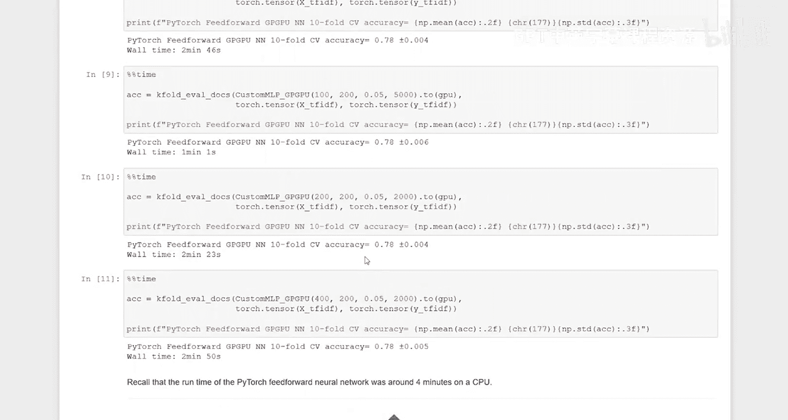

# 约翰霍普金斯大学《应用机器学习｜Applied Machine Learning》中英字幕 p51 9_PyTorch应用演示.zh_en -BV13xuqzYErx_p51-

Let's build the machine learning model using Pyths frameworkra and compare it to a regular neuralod network classifier from SscaleLL。

We continue our Pyth framework and write a neural network to classify 20 programming languages in stack orflow data set。

 we have done this before。 sanity check and see we have TF IDF features。20 classes。

40000 data points to keep it simple， we'll use the first 1000 features。

 which are the terms of the TF IF。And we can set it here。 We have our main evaluation function。

 cross validator here。It's stratified。 It didn't have to be because this data set is balanced。 First。

 let's see a baseline with a linear eV。Which is known to work excellent for this kind of problem。

 Not bad。 We have 79% accuracy， and it takes around 30 seconds。It is hard to be disclassifier。

 but we want to do a neural network。 Let's see what we can In our neural network。

 The input size is 1000。 That's the number of features。 Cha M， our hidden layer size is 100。

 There's only one hidden layer。As you can see。You can add a second hidden layer here exactly here and then update the function here by passing the second layer to the third layer and so on。

 It's so simple two more lines。 Then the output layer has 20 you're right。

 it's the number of classes。 the output uses softmax。 It's only used at this output softmax。

 the activation function in that the activation function in the inside layers are value Use an optimizer Finally。

 use a categorical cross and below loss function as set here。

 Use an optimizer which is subjective selection If one works use it important point the target output y has to be integer 64 not integer 32 convert all the data to tensors。

 as here we have to take the Tfidfx generate train test and validation and convert to tensor data structure the prediction function would be the forward of the input to the output。

And applied softm at the output。 Each internal layer will use Relu。

 the main learning loop batched similar to the previous neural network code we have developed。0 thes。

Forward all the network layers， compute the loss， back propagate the loss。 It is amazing。

 A single function doing all kinds of back propagation of the error。 If 10 layers exist。😊。

All of them will be handled。 Call the optimizers。 All the data Opr needs are there in the internal data structures such as weights and the error。

And these are stored in the Nn module class。Check the test accuracy。And it is similar to the SVM。

 I think neural network works。Now， the entire class as custom MLP in it is the data structure initialization forward is the actual neural network with radio activations and soft marks at the output reset is to reset the network for new training。

 such as zeroing the weights， In fact， having some small values randomly on weights。

Predict is the running of the network with the test input。And now fit is the training module。 again。

 setting up the optimizer loss function running the batchged epoch。On a CPU。

 it takes four minutes to run our neural network。 The code is much simpler than the previous neural network code we had。

Now， let's see how the neural network will work on a GPU。 Let's switch to the Torch GPU notebook。

Use the virtual environment where we install the libraries related to the GPU。

And this is installed here by torch Torch vision to the toolkit。And爽。

These might change over the years or even months。 Also。

 we need to have the full Quda SDK and Quda Qdan installed on our computer along with the Quda 10。

1 capable GP。 I'm running this on my notebook computer with a P 3200 GP。 It's around 5 teroffls。

 The biggest difference between the CPU and GP version of the neural network class is moving the data and computation to the GP from the CPU to the GP to compute from GP to CPU to return the results。

We set the GPU device to device 0 if you have5 GPUs on your machine。These numbers will change。

 we move the data to GPU here and un clear the data to GPU here。

 all these will be handled on the GPU。 My layers are on GPU and then finally my results are moved back to CPU and then we run it。

 It is two times faster than the CPU version。As can be seen here。Here， here， here。

Notice that when we increase the batch size， the performance gets bigger。

 That is why running big networks and non stop is much faster than the CPU。

 because we have fixed overhead when a GP P is initiated for a particular task。

 This concludes our Pythtorch investigation。😊。

