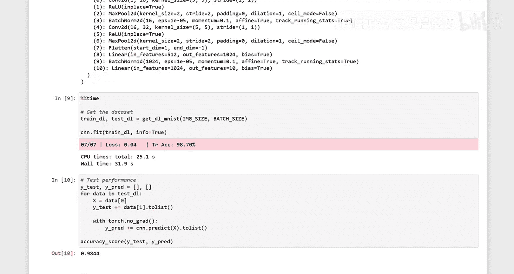
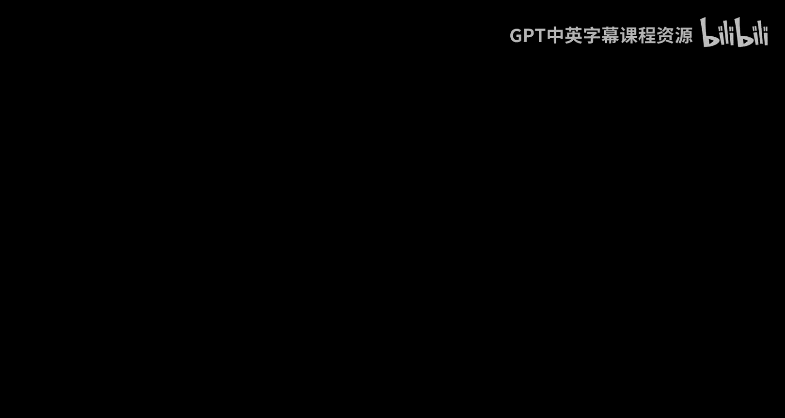

# 约翰霍普金斯大学《应用机器学习｜Applied Machine Learning》中英字幕 p52 10_卷积神经网络原理.zh_en -BV13xuqzYErx_p52-

Introduction to combod neural networks。Dear students， in this module。

 we will study convolutional neural networks with Pytorch。

CNNs are also known as shift Ivariient or space Iient artificial neural networks based on the shared weight architecture of the convolution filters that slide along input features and provide translation equivalentant responses known as future maps。

Most commvolution neural networks。Are not invariant to translation though due to downsling operation。

 They apply to the input， as we will see。CNNs are regularized versions of multilayer perceptrons。

Multillayer perceptrons are usually fully connected networks。

 that is each neuron is one layer and connected to all neuro neurons in the next layer。

The full connectivity of these networks make them prone to overfitting data or becoming too specific。

The typical ways of regularization include penalizing network parameters。During training。

Or trimming connectivity as in skip connections and dropout。

Developing robust dataset sets also increases the probability that CNNNs will learn the generalralized principles that characterize a given dataset set rather than the biases of a poorly populated set。

Which we studied as feature processing。CNNs take a different approach towards regularization。

 They take advantage of the hierarchical pattern in data and assemble patterns of increasing complexity using smaller and simpler patterns embosed in their filters。

I call these Lego pieces。Meaning， CNNNs utilize the hiarchical structure of the data they are processing。

Instead of trying to process the entire image or input at once。CNN break it down into smaller。

 simple features， which are represented by filters。

These filters are applied to different regions of the input to extract the relevant information。

As the network processes。And progresses through the layers。

 these features are combined and assembled into more complex patterns。

Allowing the network to learn increasingly abstract representations of the input。

The hierarchical approach also allows CNNan。To efficiently learn complex patterns in data while minimizing the risk of overfitting。

As usual， we must create a virtual environment to isolate our working environment from other Pytorch libraries and Python libraries。

This is common， an important practice。Activate the environment。

 Torch GPU with torch audio and Torch vision libraries。We will use convolutional neural networks。

 which are invented some years ago in order to improve neural network performance on image dataset sets。

Clearly， images have pieces in them， which have relations to one another。

 such as an arm of a person or eyebrows next。2 eyes on her face。

When images are segmented and filtered clockwise in two dimensions。

The resulting information features can be used as in the following stages。 Furthermore。

 by the use of localized spatial features， some kind of regularization is also achieved。

 like I mentioned。These extracted features can be then past into regular perceptron layers and neural network。

 for example， fully coordinate layers。We call these perceptron layers as dance layers。 In fact。

 this overall operation is very similar to our mammal vision system， as in our brains as comparison。

Recurrent neural networks or RNAans use the temporal information in their feedback neural networks and commoloal neural networks。

CNNs use the spatial information in in their filtered layer neural networks。Now， let's see， first。

How the convolution operation works。Apply a filter of3 by3。Size initial lies in this manner。

To the provider image。As can be seen from the filter， the second matrix。

It is kind of horizontal edges on top and bottom。The convolution operation weighs these edges on the kernel that。

It will scan the entire image。The kernel commod behaves like local and spatial correlation operator。

Its element wise multiplication and adding。The second example has left and right vertical ages。

And behaves。Extracting horizontal images or edges correlated to this shape。

Let's see if our computation is correct by using the torch convolgen operator。

We will have the environments。Two days available。In my environment。

S can be seen from the output here。And here in cell 4。

These are equivalent to the computations we made manually。

A conal neural network uses a 2D filter as its main filter。The API has input and output sizes。

Then the filter kernel size， strip and padding。Clonnal size is the filter dimensions in two dimensions。

A tu of 5 by5 uses a filter of5 pixel by5 pixel in x and y dimensions of the image。

The filter length is the convolution length， generally in powers of two。

Striide is the filter window being moved to X or Y in so many pixels。 General it is one by one。

Shifting。A pixel shifts one。In either dimensions。Depending on the image size。

 it is straightforward to compute the size of the outputs。

Pytororch requires filter sizes be computed unlike Tensorflow cares。Later in the notebook。

 emitted is provider to compute the filter or layer sizes。

The API helps understanding how to set the shapes of the tensors for the filters。

Let's focus on half tensors's shape as they go through。

The input is three channels by 32 and by 32 images。The question mark is the batch size。

10 filters are applied with Str of 2。The padding is handled to fill up or fill up the left hand。

Right size of the kernel sizes。Since stride is2， the output images are 16 by 16。

And since there are 10 filters。There are 16 by 16 by 10 of them。

Next is 20 filters with size 3 by 3 by 10。Note that here the filters 10 and 20 are arbitrary。

 I decided it。It makes the output8 by 8 by 20。Next。

 the layer flattens the entire tensor into batch size by 1280。Which is exactly8 times 8 times 20。

Next， this fully connected layer maps the 10 classes which our MIS dataset has。

Another concept in neural networks is batch normalization。

 where the layer learns parameters of mean and standard deviation to normalize the output。

Typically in neural network greedy optimization， the stability of the gradient descent is difficult to achieve。

Either the gradients may vanish or gradients may become larger and larger。

The batch normalization layer helps the training go much more smoother。Avoiding exploding gradients。

 which will drive the outputs to very large numbers。Now。

 let's have a look at how we design a CNNN for Amnes data set。In this case， the kronos size is5。

A padding of two is necessary on left， right， top and bottom。Subampling or pooling layer。

We combine the outputlets of the filters， thus reducing the size of the data。

But not losing the information。Max pool。Max maximum pooling layer or average pooling layer are the two major ways of doing it。

 which are already called down sampling of the output。Down sample link。

Is kind of compression or reducing the output？Next。

 we will see how we realize the full convolutional neural network module using Pytorrch building blocks。

Our image sizes are 28 by 28， which have digits in them。We will use two covollusionutional layers。

16 and 32 in length。Which correspond to the number of filters。

Deciding on these filters and their sizes are of course magic。

 it is based on the complexity of the data。And there are many research papers about them。Next。

 we will use。Relu。Activation function in order to avoid vanishing gradients。

 this is also very typical， and then we will use pooling in between them。

Between the convollusionutional layers。Next， we will pass this through a dense layer。

 which is a perceptron， a fully connected layer， and then an output dance layer to classify into 10 categories with softmax activation。

These are。1 hot encoded categories， are images 28 by 28 by one channel of 3D matrices plus batch。

Makes it a tensor of order 4。As can be seen in the Pytorch CNN。Here。And the Pytharch CNN summary。

The neural network has 10 stages。As shown here。Populate two layers， size 1632， and then pool link。

The overall dataset set will reduce to one quarter， because we are reducing its。

Half on each dimension， the 4 by4 size at the fully connected layer。Here， the 4 by 4。

Is connected layer computed by the method。And pass to the last layer， which makes the input size 5。

12。It can be computed manually， or it can be computed by this。As you see。It starts with 28，28，16。

And then 12 is generated。Insert 12，12 in the second one。And then this will output as 4 by4。

That's the size of the tensor。The output of this layer is 124 and again。

 selected kind of arbitrarily。Then the last fully connected layer with output of 10 completes the neural network。

512 enters from convolutional sections。I decided 124。1024。And output 1024 to 10 features。

 which are brought by my dataset set。As you can see， the performance is almost perfect。99 here。

99 in test， which is a regular convolutional neural network architecture。

We didn't make the effort to improve this even further。Internally。

Valuable derived features are generated in the convolutional layers。 That's why。

It worked so perfectly。This concludes our convolutional neural networks lecture for images。

嗯。

