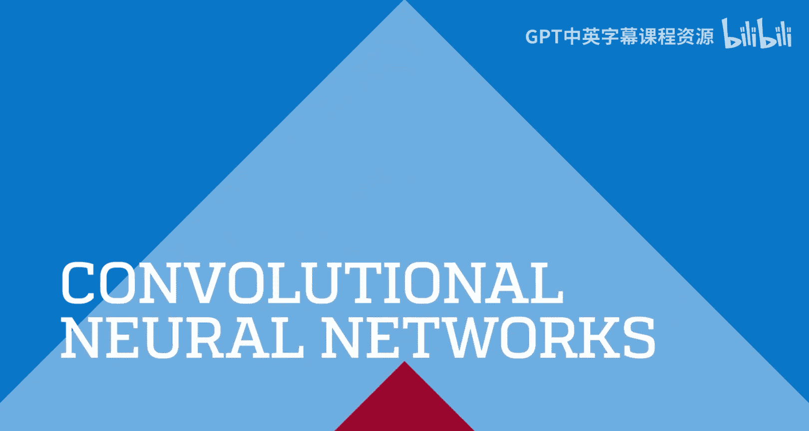
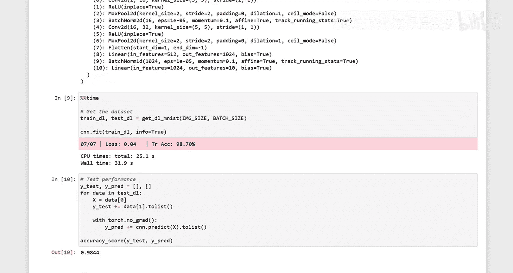

# 应用机器学习：10：卷积神经网络原理 🧠




在本节课中，我们将学习卷积神经网络的基本原理，并使用PyTorch框架进行实践。卷积神经网络是处理图像等具有空间结构数据的强大工具。

## 概述

卷积神经网络是一种基于共享权重卷积滤波器架构的人工神经网络。这些滤波器在输入特征上滑动，生成被称为特征图的平移等效响应。CNN通过利用数据中的层次化模式，使用嵌入在滤波器中的更小、更简单的模式来组装出更复杂的模式，从而实现对数据的有效学习和正则化。

## 卷积操作原理

上一节我们介绍了CNN的基本概念，本节中我们来看看卷积操作是如何工作的。

卷积操作的核心是应用一个滤波器（或称为核）到输入图像上。该操作通过元素级乘法和加法，计算滤波器与输入图像局部区域的相关性，从而提取特定特征（如边缘）。

例如，一个3x3的滤波器可以用于检测水平或垂直边缘。滤波器滑过图像的每个区域，计算点积并生成输出特征图。

我们可以使用PyTorch的卷积运算符来验证手动计算的结果。在代码环境中，`torch.nn.Conv2d` 是实现该操作的主要模块。

```python
import torch
import torch.nn as nn

# 定义一个简单的卷积层
conv_layer = nn.Conv2d(in_channels=1, out_channels=1, kernel_size=3, stride=1, padding=1)
```

## CNN的关键组件与参数

理解了基础操作后，我们需要了解构建CNN层时涉及的关键参数。

以下是定义卷积层时需要设置的主要参数：
*   **输入/输出通道**：`in_channels` 和 `out_channels` 决定了输入数据的深度（如RGB图像为3）和本层要生成的特征图数量。
*   **卷积核大小**：`kernel_size` 定义了滤波器在空间维度（高度和宽度）上的尺寸，例如 `(5, 5)`。
*   **步幅**：`stride` 决定了滤波器每次移动的像素数。步幅为 `(2, 2)` 会使输出特征图的尺寸减半。
*   **填充**：`padding` 在输入图像的边缘添加像素（通常为0），以控制输出特征图的空间尺寸。

计算输出尺寸的公式为：
`输出尺寸 = floor((输入尺寸 + 2 * 填充 - 卷积核尺寸) / 步幅) + 1`

## 构建CNN网络架构

现在，让我们看看如何将这些组件组合起来，为一个具体的数据集（如MNIST手写数字数据集）设计一个完整的CNN。

我们将使用PyTorch的构建模块来实现网络。典型的架构包括卷积层、激活函数、池化层和全连接层。

以下是构建一个简单CNN的步骤：
1.  **输入层**：接收图像数据，例如尺寸为 `[batch_size, 1, 28, 28]` 的张量。
2.  **卷积层1**：应用多个滤波器（如16个）提取初级特征，后接ReLU激活函数引入非线性。
3.  **池化层1**：进行下采样（如最大池化），减少数据空间尺寸并保留主要特征。
4.  **卷积层2**：应用更多滤波器（如32个）提取更高级的特征，后接ReLU。
5.  **池化层2**：进一步下采样。
6.  **展平层**：将多维特征图转换为一维向量，以输入全连接层。
7.  **全连接层**：进行最终分类，输出层使用Softmax激活函数得到10个类别的概率分布。

```python
class SimpleCNN(nn.Module):
    def __init__(self):
        super(SimpleCNN, self).__init__()
        self.conv1 = nn.Conv2d(1, 16, kernel_size=3, stride=1, padding=1)
        self.pool = nn.MaxPool2d(kernel_size=2, stride=2)
        self.conv2 = nn.Conv2d(16, 32, kernel_size=3, stride=1, padding=1)
        self.fc1 = nn.Linear(32 * 7 * 7, 128) # 展平后的尺寸需要计算
        self.fc2 = nn.Linear(128, 10)

    def forward(self, x):
        x = self.pool(torch.relu(self.conv1(x)))
        x = self.pool(torch.relu(self.conv2(x)))
        x = x.view(-1, 32 * 7 * 7) # 展平操作
        x = torch.relu(self.fc1(x))
        x = self.fc2(x)
        return x
```

## 批归一化与性能

为了提高训练的稳定性和速度，现代CNN中常引入批归一化层。

批归一化层对每一批数据的输出进行归一化处理，学习缩放和偏移参数。这有助于缓解训练过程中的梯度消失或梯度爆炸问题，使优化过程更平滑、更快速。通常将其插入到卷积层和激活函数之间。

## 总结




本节课中我们一起学习了卷积神经网络的核心原理。我们了解了卷积操作如何利用空间局部性提取特征，认识了构成CNN网络的关键层（卷积层、池化层、全连接层）及其参数。我们还通过PyTorch代码示例，实践了为MNIST数据集构建一个简单CNN的过程，并了解了批归一化对训练过程的改善作用。CNN通过其层次化的结构，能够从数据中自动学习到从简单到复杂的特征表示，这是其在图像识别等领域取得成功的重要原因。