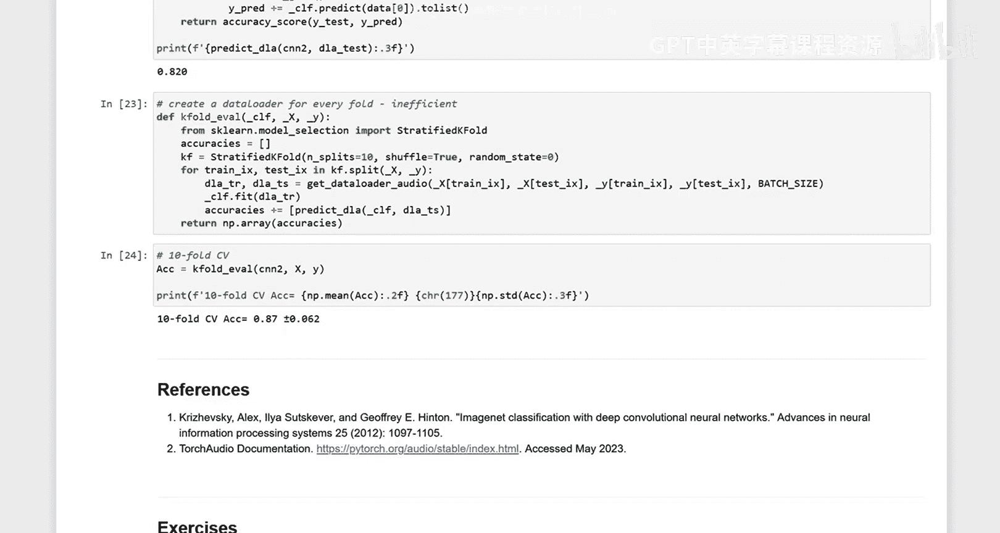

# 约翰霍普金斯大学《应用机器学习｜Applied Machine Learning》中英字幕 p53 11_音频信号分类技术.zh_en -BV13xuqzYErx_p53-

Audio signal classification。As we have seen， convolutional neural networks are very successful modeling architectures。

 How do we use them on audio where the data is one dimensional on the time axis。Normally。

 recurrent neural networks would be used to classify audio or sequential data， however。

 we have another method based on the frequency domain analysis techniques。

 the data set here has cats and dog sounds in natural environments。

 not studio recorded one approaches slicing each data into one second durations and running a spectrum for example。

 and capturing the image of that spectrum of the sound for that one second duration。

This duration could be from 200 milliseconds to anything longer。 Now。

 if we approach this problem in this way， it would be unrealistically easier。

 rather if we generate the spectraltrogram on the signal。

 the full signal and then classify the entire spectrogram with multiple spectrums。

Then this model will be much more robust than realistic。Torch audioud library。

Can extract spectrograms using the sound file library backend。Here。

The left plot is the time series audio signal， and the right one is the spectrogram。

 We can classify these images， which are the representation representations of time series signals in frequency domain。

 There are multiple slots here based on the parameters I provided。Clearly。

 the duration of the signals will cause a problem to solve。

This particular example is around9 seconds， it could be 2， it could be 20。

How to normalize length So a single image with fixed length。Is generated。

Is what we're going to solve。This is also a typical problem in sequence classification。

We either append with values or cut if the duration is longer than a threshold。

This histogram of durations will help us decide which duration we will use。A 10 seconds。

Of fixed duration seems reasonable。The histogram of the durations。Helped us decide on 10 seconds。

 We will lose some of the data with blue ones a little bit。

And we will append or fill up for the other ones。We either cut or we either we or we a。

Set the data load。That we are going to use in our pipeline。Not that this extraction is based on。

Mel frequency cap from。To help the audio signal represented better in the frequency domain。

Torch audio library。Deals with this future extraction。Each signal is processed in the cell。

And also captured by category。The processing of the MLMFCC is handled here。

It's a simple transformation。The heavy lifting is done by the torch audio。

And then the audio length is normalized， either appended by top up。

Basically repeat repetition of the data。Ans。By cutting at 10 seconds。

 since we use a sampling frequency properly and a 50 hob size， every strip。Is 100 milliseconds。

 thus 10 second makes 100 length of horizontal axis scale。And the number of MFCCC bins is 20。

This is typical I set it myself， you can change it to 10， you can change it to 30。

 so each data point of cats and dogs audio will become a 20 by 100 image。

Which is the spectrogram of that audio signal。The neural network。

 architecture or CNNN specifically set for these spectrograms is provided here。

It can be small because our data is small and we don't expect such complexity。

 most of the future extraction is already done。By the MFCC layer。Two layers， size 8 and 16。MlP8。

And then2 times MLP。At 1 sixteen。The kernel size is 5。

Most of this is typical and similar to the previous architecture。One can change these parameters。

 look for better representations。The fully connected layer is 32 again arbitrarily。

Number of classes is2 provided by the dataset。Ans。848222 by default comb 2D parameters such as padding。

Or strides。Tells me the final size is 2 by 22， which is used here。

So that I can set my final size correctly。And then the last layer is all these last linear size。

Which is set as32。And the conversion is done in this layer， from so many cells。2，32。And finally。

 the output is tangents， hyperbolic tangents。Which works with audio signals。

 You can change this to any other activation function， and it will work closely。

Summary of the neural network is here。A 5050 train test， as you know， this is prototype testing。

You should not run everything fully once the neural network is designed。

You should prototype test with quick iterations。5050 train，82%。 It's not bad。

And when I do a full tenfold cross validation， it's 87， which is pretty good。

 It can be definitely improved so much。This concludes our combodological neural networks lecture for audio。

