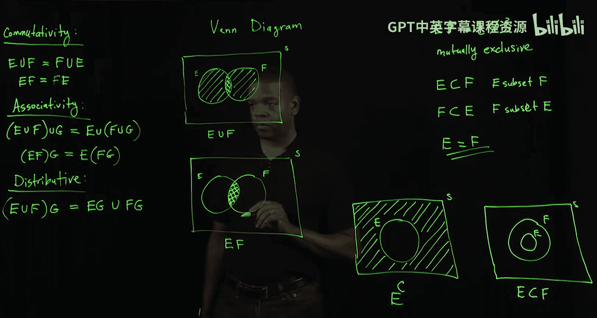

#  012：事件关系与维恩图

在本节课中，我们将学习事件之间的一些重要关系，包括互斥、子集和相等。我们还将通过维恩图来直观地理解这些关系，并介绍集合运算的三个基本代数性质：交换律、结合律和分配律。

## 事件间的重要关系

除了并集和交集，事件之间还存在其他几种重要关系。

首先，如果事件 **E** 和事件 **F** 的交集是空集，我们称这两个事件是**互斥**的。这意味着没有哪个结果能同时属于 **E** 和 **F**。互斥事件也意味着它们是相互独立的。

在讨论子集时，我们使用特定的符号。如果 **E** 是 **F** 的子集，我们写作 **E ⊆ F**。反之，如果 **F** 是 **E** 的子集，则写作 **F ⊆ E**。如果 **E** 是 **F** 的子集，同时 **F** 也是 **E** 的子集，那么我们就说 **E** 等于 **F**，记作 **E = F**。

## 直观理解：维恩图

为了更直观地理解这些关系，我们引入一种强大的图形化工具——维恩图。

首先，我们画一个方框，它代表样本空间 **S**，即一个实验或观察中所有可能结果的集合。

在这个方框内，我们可以画出事件 **E** 和事件 **F**，它们都是 **S** 的子集。

### 并集的图形表示

如果我们想表示 **E** 和 **F** 的并集 **E ∪ F**，在维恩图中，它就是被 **E** 和 **F** 覆盖的所有区域的总和，包括它们重叠的部分。

### 交集的图形表示

要表示 **E** 和 **F** 的交集 **E ∩ F**，在维恩图中，它就是 **E** 和 **F** 两个圆圈重叠的部分。这个区域代表同时满足 **E** 和 **F** 的结果。

### 补集的图形表示

事件 **E** 的补集 **Eᶜ**，在维恩图中表示样本空间 **S** 内所有不在 **E** 中的区域。

### 子集的图形表示

如果 **E** 是 **F** 的子集（**E ⊆ F**），那么在维恩图中，代表 **E** 的圆圈会完全包含在代表 **F** 的圆圈内部。

## 集合运算的代数性质

理解了图形表示后，我们来看看处理集合（事件）时需要遵循的几个基本代数规则。这些规则能帮助我们简化复杂的集合表达式。

以下是三个核心性质：

1.  **交换律**
    交换律允许我们改变运算中事件的顺序。对于并集和交集都成立。
    *   **并集交换律**： **E ∪ F = F ∪ E**
    *   **交集交换律**： **E ∩ F = F ∩ E**

2.  **结合律**
    结合律允许我们改变运算的分组方式，而不改变结果。
    *   **并集结合律**： **(E ∪ F) ∪ G = E ∪ (F ∪ G)**
    *   **交集结合律**： **(E ∩ F) ∩ G = E ∩ (F ∩ G)**

3.  **分配律**
    分配律描述了并集和交集运算之间的相互作用。
    *   **交集对并集的分配律**： **(E ∪ F) ∩ G = (E ∩ G) ∪ (F ∩ G)**
    *   **并集对交集的分配律**： **(E ∩ F) ∪ G = (E ∪ G) ∩ (F ∪ G)**

## 总结

本节课中，我们一起学习了事件之间的关键关系：互斥、子集和相等。我们通过维恩图直观地展示了这些关系以及并集、交集和补集的含义。最后，我们介绍了集合运算的三个基本代数性质——交换律、结合律和分配律，这些性质为我们提供了分析和简化复杂事件表达式的有力工具。掌握这些概念是理解后续概率论知识的重要基础。