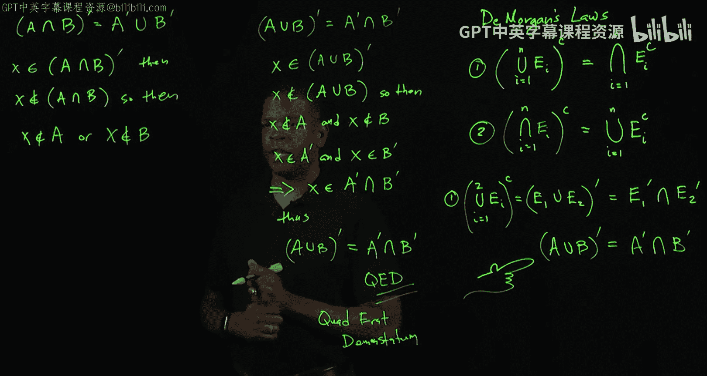

#  013：德摩根定律 📚

在本节课中，我们将学习集合论中一个非常重要的工具——德摩根定律。该定律揭示了集合的并集、交集与补集运算之间的深刻关系，是后续概率论和逻辑推理的基础。

## 概述

德摩根定律包含两条规则，它们描述了如何将并集的补集转换为补集的交集，以及如何将交集的补集转换为补集的并集。理解这两条定律，能帮助我们更灵活地处理复杂的集合运算问题。

## 定律内容

以下是德摩根定律的两条核心规则。

### 定律一：并集补集的转换

第一条定律指出，**有限个事件并集的补集，等于这些事件各自补集的交集**。

用公式表示如下：

\[
\left( \bigcup_{i=1}^{n} E_i \right)^c = \bigcap_{i=1}^{n} E_i^c
\]

为了更直观地理解，我们可以考虑最简单的情况，即两个事件 `A` 和 `B`。此时定律简化为：

\[
(A \cup B)^c = A^c \cap B^c
\]

### 定律二：交集补集的转换

第二条定律指出，**有限个事件交集的补集，等于这些事件各自补集的并集**。

用公式表示如下：

\[
\left( \bigcap_{i=1}^{n} E_i \right)^c = \bigcup_{i=1}^{n} E_i^c
\]

同样地，对于两个事件 `A` 和 `B`，定律简化为：

\[
(A \cap B)^c = A^c \cup B^c
\]

## 定律证明

上一节我们介绍了德摩根定律的内容，本节中我们来看看如何证明它。我们将以两个事件的简化形式为例进行证明。

### 证明定律一：`(A ∪ B)^c = A^c ∩ B^c`

我们采用元素法进行证明，即证明等式两边的集合包含完全相同的元素。

1.  **第一步：假设一个元素属于左边集合**
    假设存在一个结果 `x`，它属于集合 `(A ∪ B)^c`。用符号表示为：
    \[
    x \in (A \cup B)^c
    \]

2.  **第二步：推导元素的性质**
    根据补集的定义，如果 `x` 属于 `(A ∪ B)` 的补集，那么 `x` 就一定**不属于** `A` 和 `B` 的并集 `(A ∪ B)`。
    这意味着 `x` 既不在集合 `A` 中，也不在集合 `B` 中。即：
    \[
    x \notin A \quad \text{且} \quad x \notin B
    \]

3.  **第三步：转换到补集**
    如果 `x` 不在 `A` 中，那么根据定义，`x` 就在 `A` 的补集 `A^c` 中。同理，`x` 也在 `B` 的补集 `B^c` 中。
    因此，`x` 同时属于 `A^c` 和 `B^c`。

4.  **第四步：得出元素属于右边集合**
    一个元素同时属于两个集合，就意味着它属于这两个集合的交集。所以：
    \[
    x \in A^c \cap B^c
    \]

5.  **完成证明**
    我们证明了：如果 `x ∈ (A ∪ B)^c`，那么必然有 `x ∈ A^c ∩ B^c`。反之，该推理过程也可逆推，证明如果 `x ∈ A^c ∩ B^c`，则 `x ∈ (A ∪ B)^c`。
    因此，两个集合相等。证明完毕（Q.E.D.）。

### 证明定律二：`(A ∩ B)^c = A^c ∪ B^c`

我们使用类似的逻辑来证明第二条定律。

1.  **第一步：假设一个元素属于左边集合**
    假设存在一个结果 `x`，它属于集合 `(A ∩ B)^c`。即：
    \[
    x \in (A \cap B)^c
    \]

2.  **第二步：推导元素的性质**
    根据补集的定义，如果 `x` 属于 `(A ∩ B)` 的补集，那么 `x` 就一定**不属于** `A` 和 `B` 的交集 `(A ∩ B)`。
    这意味着 `x` 至少不在 `A` 和 `B` 中的一个集合里。即：
    \[
    x \notin A \quad \text{或} \quad x \notin B
    \]
    （注意：这里是“或”的关系，与定律一证明中的“且”不同。）

3.  **第三步：转换到补集**
    如果 `x` 不在 `A` 中，那么 `x` 就在 `A^c` 中。或者，如果 `x` 不在 `B` 中，那么 `x` 就在 `B^c` 中。
    因此，`x` 至少属于 `A^c` 和 `B^c` 中的一个。

4.  **第四步：得出元素属于右边集合**
    一个元素至少属于两个集合中的一个，就意味着它属于这两个集合的并集。所以：
    \[
    x \in A^c \cup B^c
    \]

5.  **完成证明**
    同理，我们证明了 `(A ∩ B)^c` 和 `A^c ∪ B^c` 包含相同的元素，因此两个集合相等。证明完毕（Q.E.D.）。

## 总结

本节课中我们一起学习了德摩根定律。我们首先概述了该定律在集合运算中的核心地位，然后明确给出了它的两条规则：
1.  并集的补集等于各自补集的交集：`(A ∪ B)^c = A^c ∩ B^c`
2.  交集的补集等于各自补集的并集：`(A ∩ B)^c = A^c ∪ B^c`

接着，我们通过严谨的元素法，一步步证明了这两条定律在简化情况（两个事件）下的正确性。理解并掌握德摩根定律，将为后续学习概率论中的事件关系、布尔代数以及逻辑推理打下坚实的基础。