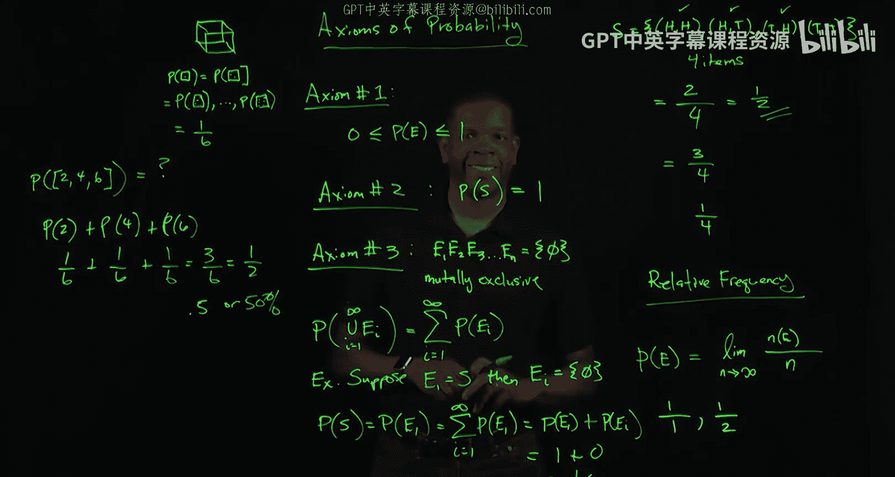

#  014：概率公理体系 🎲


在本节课中，我们将学习概率论的基础——概率公理体系。我们将了解如何从样本空间出发，通过一系列基本规则（公理）来定义和计算事件的概率。这些公理是概率论所有后续发展的基石。

## 样本空间回顾

上一节我们介绍了样本空间的概念。样本空间是某个实验所有可能结果的集合。例如，抛一枚硬币两次，其样本空间 S 可以表示为：
```
S = { (正面, 正面), (正面, 反面), (反面, 正面), (反面, 反面) }
```
这个样本空间包含四个等可能的基本结果。

基于样本空间，我们可以计算事件的概率。例如，事件“第一次抛掷得到正面”包含两个结果：`(正面, 正面)` 和 `(正面, 反面)`。因此，其概率为：
```
P(第一次正面) = 有利结果数 / 总结果数 = 2 / 4 = 1/2
```
事件“至少出现一次正面”包含三个结果，其概率为 `3/4`。事件“两次都是正面”的概率为 `1/4`，而事件“没有正面”的概率为 `0`。

## 相对频率法

另一种定义概率的方法是使用相对频率。其核心思想是，当实验重复次数趋于无穷时，事件发生的频率会收敛于其概率。

**公式**：
```
P(E) = lim (n→∞) [ (事件E发生的次数) / (总实验次数 n) ]
```
例如，抛硬币时，随着抛掷次数 `n` 的增加，出现正面的比例会越来越接近 `0.5`。

然而，并非所有情况都能方便地进行大量重复实验。当我们可以明确列出样本空间时，概率公理体系为我们提供了计算概率的理论框架。

## 概率公理

概率公理是三条关于概率函数 `P` 必须满足的基本规则。它们直观且构成了概率论的基础。

以下是三条核心公理：

**公理一**：任何事件 `E` 的概率都是一个介于 0 和 1 之间的数。
```
0 ≤ P(E) ≤ 1
```
其中，`P(E) = 0` 表示事件不可能发生，`P(E) = 1` 表示事件必然发生。

**公理二**：整个样本空间 `S`（即必然事件）的概率为 1。
```
P(S) = 1
```

**公理三**：对于任意一系列**互斥**事件（即它们不可能同时发生），这些事件之并的概率等于它们各自概率之和。
设 `E1, E2, E3, ...` 是一系列互斥事件，则：
```
P(E1 ∪ E2 ∪ E3 ∪ ...) = P(E1) + P(E2) + P(E3) + ...
```
这个性质称为**可加性**。

## 公理应用示例

为了理解公理三，让我们看一个具体的例子。

假设我们掷一个均匀的六面骰子。每个面朝上的可能性相同，因此：
```
P(掷出1) = P(掷出2) = P(掷出3) = P(掷出4) = P(掷出5) = P(掷出6) = 1/6
```

现在，考虑事件“掷出一个偶数点”，即掷出 2、4 或 6。这些事件是互斥的（一次掷骰只能出现一个结果）。根据公理三，我们可以将它们的概率相加：
```
P(偶数点) = P(掷出2) + P(掷出4) + P(掷出6)
          = 1/6 + 1/6 + 1/6
          = 3/6 = 1/2
```
因此，掷出偶数点的概率是 50%。

另一个例子能帮助我们理解公理的完备性。假设事件 `E1` 就是整个样本空间 `S`（即 `P(E1) = 1`），而其他所有事件 `E2, E3, ...` 都与 `E1` 互斥（即它们的交集为空集）。根据互斥性，这些其他事件的概率必须为 0。那么，根据公理三：
```
P(S) = P(E1 ∪ E2 ∪ E3 ∪ ...) = P(E1) + P(E2) + P(E3) + ... = 1 + 0 + 0 + ... = 1
```
这与公理二完全一致，展示了公理体系的自洽性。

## 总结

本节课中，我们一起学习了概率论的核心基础——概率公理体系。我们首先回顾了通过枚举样本空间来计算概率的方法，然后介绍了通过相对频率定义概率的思想。最后，我们详细阐述并应用了三条概率公理：
1.  概率值介于 0 与 1 之间。
2.  必然事件的概率为 1。
3.  互斥事件之并的概率等于各事件概率之和（可加性）。



这些公理虽然简单，却是构建整个概率论大厦的基石，确保了概率计算的一致性和逻辑性。在后续课程中，我们将基于这些公理推导出更多有用的概率性质和公式。